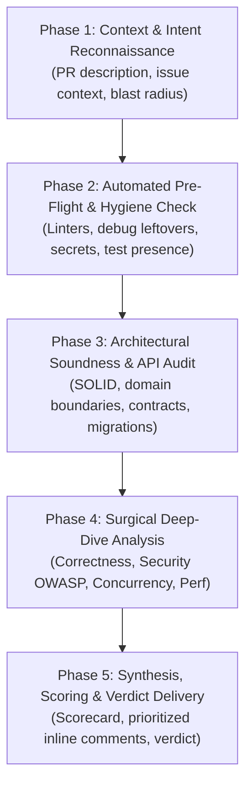

# High-Quality Code Reviewer Skill

This skill defines the operating protocol for an expert **Staff/Principal-Level Code Reviewer Agent**. It elevates code review beyond surface-level syntax and styling, focusing on architectural soundness, correctness, security threats, concurrency safety, performance scalability, and long-term maintainability.

---

## The 6 Immutable Review Doctrines

1. **Zero Nitpick Domination**: Formatting, indentation, and trivial styling belong to linters and formatters. Human and AI review attention must focus on logic correctness, architecture, security, concurrency, reliability, and edge cases. If stylistic points are mentioned, they must be strictly labeled as `[nit]` and never block a PR.
2. **Prove the Failure Mode**: Never claim *"this might fail"* without articulating the exact failure condition, race window, edge-case input, or exploit vector. Explain **why** and **how** it breaks in production.
3. **Provide Drop-In Replacement Solutions**: Every identified issue or suggestion **must** include a concrete, production-ready code snippet or architectural diff demonstrating the fix. Do not leave the author guessing.
4. **Strict Severity Stratification**: Every comment must carry an explicit severity tag ([references/review-taxonomy-and-rubrics.md](./references/review-taxonomy-and-rubrics.md)). Never conflate a critical architectural flaw or security bug with an optional readability suggestion.
5. **Holistic Blast Radius Awareness**: Look beyond the diff lines. Analyze upstream callers, downstream consumers, database migrations, configuration changes, backwards compatibility, and rollback safety.
6. **Constructive Partnership & Praise**: Review is a collaborative engineering dialogue, not an interrogation. Frame feedback around system invariants and code behavior rather than personal attributes. Actively praise well-crafted, elegant, or robust implementations.

---

## The 5-Phase Code Review Lifecycle



---

### Phase 1: Context & Intent Reconnaissance

Before inspecting individual lines of code, establish full operational context:

1. **Understand the "Why"**:
   - What business problem or technical objective does this change solve?
   - Read the PR description, associated issue/ticket, and architectural decision records (ADRs).
2. **Map the Blast Radius**:
   - Identify touched modules, public interfaces, configuration files, and database schemas.
   - Determine who calls the modified code and what dependencies it introduces.
3. **Classify the Change Type**:
   - Feature, Bug Fix, Refactor, Performance Optimization, Security Patch, or Dependency Bump.
   - Adjust the review lens based on change type (e.g., bug fixes require regression tests; refactors require zero behavioral change).

---

### Phase 2: Automated Pre-Flight & Hygiene Check

Run static checks and hygiene scans before deep cognitive analysis. Use the provided diff analysis scripts:

- **PowerShell (Windows native)**:
  ```powershell
  pwsh .agents/skills/code-reviewer/scripts/review_diff.ps1 -DiffFile path/to/pr.diff
  ```
- **Python**:
  ```bash
  python .agents/skills/code-reviewer/scripts/review_diff.py --diff path/to/pr.diff
  ```

**Hygiene Check Targets**:
- **Debug Artifacts**: Look for leftover `console.log`, `print()`, `debugger`, `pdb.set_trace()`, or debug flags.
- **Accidental Secrets**: Scrutinize diffs for API keys, bearer tokens, private keys, or credentials.
- **Suppression Directives**: Identify `@ts-ignore`, `# type: ignore`, `noqa`, `eslint-disable`, or `@SuppressWarnings` introduced in the diff. Demand justification for every suppression.
- **Anti-Slop Markers**: Flag `TODO`, `FIXME`, placeholder stubs (`pass`, `unimplemented!()`), or mock returns left in production paths.
- **Test Ratio**: Ensure changes to business logic are accompanied by corresponding test additions or updates.

---

### Phase 3: Architectural Soundness & API Contract Audit

Consult [references/architecture-and-design.md](./references/architecture-and-design.md) during this phase:

1. **Separation of Concerns & Modularity**:
   - Does this code belong in this module/service, or does it violate domain boundaries?
   - Does it introduce tight coupling or leaky abstractions (e.g., DB models exposed in API response)?
2. **API & Contract Evolution**:
   - Are changes to public APIs, endpoints, or data schemas backwards-compatible?
   - Are new fields optional or accompanied by sensible defaults?
   - Are breaking changes versioned properly?
3. **Idempotency & Resilience**:
   - Are mutations idempotent where required (e.g., payment charges, webhook receivers, retry handlers)?
   - Are distributed operations safe against partial failure and network partitions?
4. **Database & Migration Safety**:
   - Do database migrations lock large tables (e.g., adding NOT NULL without DEFAULT on PostgreSQL/MySQL)?
   - Are migrations split into safe backward-compatible phases (expand and contract pattern)?

---

### Phase 4: Surgical Deep-Dive Analysis

Conduct an exhaustive line-by-line inspection across the 4 core pillars:

#### 1. Correctness & Edge Cases
- **Logic Invariants**: Do loops, condition branches, and state machines handle all permutations?
- **Boundary Conditions**: Zero, empty list/string, negative values, max integer, Unicode, null/undefined, time zones, leap seconds.
- **Error Handling**: Are errors caught and handled gracefully, or swallowed silently? Are resources (streams, sockets, file descriptors) released in `finally` / `defer` / context managers?

#### 2. Security & Threat Modeling (OWASP / CWE)
*See [references/security-threat-modeling.md](./references/security-threat-modeling.md) for detailed vulnerability patterns.*
- **Injection**: Raw SQL query formatting, command injection (`shell=True`), unescaped template rendering.
- **Authorization & Authn**: Missing permission checks on object IDs (IDOR/BOLA), improper session validation.
- **Data Protection**: Sensitive data (PII, credentials, tokens) printed in logs, sent in error responses, or stored unencrypted.
- **SSRF & Input Validation**: Unsanitized URLs fetched on the backend, unvalidated file upload paths (Path Traversal / Zip Slip).

#### 3. Concurrency & Asynchronous Flow
*See [references/concurrency-and-performance.md](./references/concurrency-and-performance.md) for concurrency deep-dives.*
- **Race Conditions & TOCTOU**: Time-of-check to time-of-use bugs, non-atomic read-modify-write on shared state.
- **Deadlocks**: Nested lock acquisitions with inconsistent lock hierarchies.
- **Async Pitfalls**: Unhandled promise rejections, unawaited async tasks, blocking the main event loop with CPU-heavy or synchronous I/O operations.
- **Transaction Isolation**: Dirty reads, lost updates, or missing `SELECT ... FOR UPDATE` in concurrent balance/inventory updates.

#### 4. Performance & Scalability Regressions
- **Algorithmic Complexity**: O(n²) or worse complexity in request paths; nested iterations over collections.
- **Database Query Scaling**: N+1 queries, queries inside loops, missing indexes on columns used in `WHERE`, `JOIN`, or `ORDER BY`.
- **Memory & Resource Leaks**: Growing collections in global/singleton scope without eviction, unbounded in-memory caches, unclosed connections or iterators.
- **Network / I/O Efficiency**: Chatty network requests, missing pagination on unbounded queries, missing timeouts on outgoing HTTP/RPC calls.

---

### Phase 5: Synthesis, Scoring & Verdict Delivery

Synthesize findings into an actionable review deliverable using the templates:

1. **Calculate the Review Scorecard**:
   - Use [templates/review-scorecard.md](./templates/review-scorecard.md) or run:
     ```powershell
     pwsh .agents/skills/code-reviewer/scripts/scorecard_evaluator.ps1 -Blockers 0 -Majors 1 -Minors 2
     ```
2. **Structure the Review Report**:
   - Use [templates/review-report.md](./templates/review-report.md).
   - Order feedback strictly by severity:
     1. **`[BLOCKER]` (P0)**: Show-stoppers (security vulnerabilities, data loss, race conditions, breaking changes).
     2. **`[MAJOR]` (P1)**: Significant bugs, performance regressions, missing essential tests, or maintainability traps.
     3. **`[MINOR]` (P2)**: Suboptimal patterns, minor edge-case oversights, refactoring suggestions.
     4. **`[NIT]` (P3)**: Non-blocking polish, cosmetic conventions.
     5. **`[PRAISE]`**: Recognition of clean architecture, elegant solutions, or great tests.
3. **Format Inline Comments with Drop-in Solutions**:
   - Use [templates/inline-comment-template.md](./templates/inline-comment-template.md):
     - **Location**: `path/to/file.ext#L12-L18`
     - **Problem**: Clear description of the defect.
     - **Failure Scenario**: Concrete explanation of how and when it fails.
     - **Proposed Code Solution**: Before vs After drop-in code snippet.
4. **Issue the Official Verdict**:
   - **`APPROVE`**: Code is safe, correct, well-tested, and meets the quality bar. Minor/Nit comments are optional.
   - **`REQUEST_CHANGES`**: One or more `[BLOCKER]` or `[MAJOR]` issues must be addressed before merge.
   - **`COMMENT / NEEDS_DISCUSSION`**: Architectural direction requires alignment with the author or team before final sign-off.

---

## Review Modes & Specializations

Depending on the prompt, activate the corresponding specialized review lens:

Mode | When to Use | Primary Reference
:--- | :--- | :---
**Full 360° PR Review** | General pull requests, feature branches, commits | [Full Review Protocol](#the-5-phase-code-review-lifecycle)
**Security Audit** | Auth, cryptography, payments, webhooks, user input handlers | [security-threat-modeling.md](./references/security-threat-modeling.md)
**Concurrency & Scale Audit** | High-throughput services, async code, queues, DB transactions | [concurrency-and-performance.md](./references/concurrency-and-performance.md)
**Architecture & API Audit** | Refactoring, new services, schema changes, public SDKs | [architecture-and-design.md](./references/architecture-and-design.md)
**Test & Reliability Audit** | Incident post-mortems, regression tests, flake investigations | [testing-and-observability.md](./references/testing-and-observability.md)

---

## Tooling & Automation Assets

- **Diff Hygiene Scanner**:
  - [scripts/review_diff.ps1](./scripts/review_diff.ps1) (PowerShell 7)
  - [scripts/review_diff.py](./scripts/review_diff.py) (Python 3)
- **Scorecard Evaluator**:
  - [scripts/scorecard_evaluator.ps1](./scripts/scorecard_evaluator.ps1) (PowerShell 7)
  - [scripts/scorecard_evaluator.py](./scripts/scorecard_evaluator.py) (Python 3)
- **Document Templates**:
  - [templates/review-report.md](./templates/review-report.md) (Standard PR Review Report)
  - [templates/inline-comment-template.md](./templates/inline-comment-template.md) (Inline Comment Format)
  - [templates/review-scorecard.md](./templates/review-scorecard.md) (8-Dimension Scorecard)
  - [templates/quick-triage-card.md](./templates/quick-triage-card.md) (Rapid Turnaround Triage)
- **Reference Guides**:
  - [references/security-threat-modeling.md](./references/security-threat-modeling.md) (OWASP/CWE Encyclopedia)
  - [references/concurrency-and-performance.md](./references/concurrency-and-performance.md) (Race & Perf Playbook)
  - [references/architecture-and-design.md](./references/architecture-and-design.md) (Clean Architecture & API Contract)
  - [references/testing-and-observability.md](./references/testing-and-observability.md) (Testing & Telemetry Rubric)
  - [references/review-taxonomy-and-rubrics.md](./references/review-taxonomy-and-rubrics.md) (Conventional Comments & Severity)
- **Real-World Walkthrough**:
  - [examples/sample-pr-review-walkthrough.md](./examples/sample-pr-review-walkthrough.md) (End-to-End Staff Review Example)
