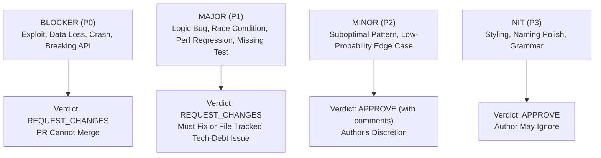

# Review Taxonomy, Conventional Comments & Severity Rubrics

This reference defines the taxonomy, severity rubrics, and communication guidelines for delivering high-impact, staff-engineer-level code reviews.

---

## 1. Conventional Comments Specification

To eliminate ambiguity between must-fix bugs and optional opinions, all review comments must follow the **Conventional Comments** standard:

$$\textbf{**<label> [<decorations>]:** <subject>}$$

### 1.1 Canonical Labels

Label | Meaning | Blocking by Default?
:--- | :--- | :---
`issue` | Highlights a defect, bug, security flaw, race condition, or specification violation. | **YES** (`[blocking]`)
`suggestion` | Proposes an alternative implementation, refactoring, or improvement. | **Configurable** (`[blocking]` or `[non-blocking]`)
`question` | Requests clarification or context to properly assess correctness. | **Configurable** (typically blocks approval until answered)
`thought` | Shares an idea or architectural consideration for future iterations. | **NO** (`[non-blocking]`)
`nit` | Points out minor stylistic preferences or trivia. Never blocks a PR. | **NO** (`[non-blocking]`)
`praise` | Commends exceptionally clean design, clever algorithms, or thorough testing. | **NO** (Positive reinforcement)
`chore` | Simple mechanical task (e.g., updating docs, bumping dependency lockfile). | **Configurable**

### 1.2 Canonical Decorations

Decoration | Meaning
:--- | :---
`[blocking]` | Mandatory change; prevents PR approval until resolved or mitigated.
`[non-blocking]` | Optional improvement; author may address now, file a follow-up ticket, or decline.
`[security]` | Pertains to an OWASP vulnerability, auth bypass, data leak, or threat vector.
`[perf]` | Pertains to algorithmic complexity, N+1 query, memory leak, or latency regression.
`[arch]` | Pertains to domain boundaries, coupling, SOLID violations, or API contract.
`[test]` | Pertains to missing regression tests, flaky assertions, or test coverage gaps.

---

## 2. Severity Hierarchy & Action Rules



### 2.1 Blocker (P0) — Immediate Show-Stopper
- **Definition**: Active security vulnerabilities, data corruption risks, concurrency deadlocks, high-probability crash bugs, unmitigated breaking schema/API changes.
- **Rule**: Halts merge immediately. Official PR verdict **must** be `REQUEST_CHANGES`.

### 2.2 Major (P1) — High Priority Defect
- **Definition**: Incorrect business logic under known conditions, N+1 queries on hot paths, resource leaks, missing regression tests for bug fixes, brittle error swallowing.
- **Rule**: Must be resolved before merging into production, unless explicit technical debt exception is approved with an issue link.

### 2.3 Minor (P2) — Quality & Maintainability Polish
- **Definition**: Suboptimal design pattern, missed code reuse opportunity, edge-case vulnerability with negligible probability, minor documentation gap.
- **Rule**: Does not block PR approval. Can be addressed in-flight or deferred.

### 2.4 Nit (P3) — Non-Blocking Polish
- **Definition**: Variable naming preference, comment phrasing, minor test refactoring.
- **Rule**: Reviewer should state "Feel free to adopt or disregard." Never block PR.

### 2.5 Praise — Constructive Recognition
- **Definition**: Highlighting clean modular abstractions, thorough edge-case tests, or elegant algorithmic solutions.
- **Rule**: High-quality reviews should include at least one praise comment whenever good craftsmanship is present.

---

## 3. Communication Tone & Review Etiquette

### Principle 1: Frame Around Code & Invariants, Not Persons
- ❌ **Accusatory**: *"You forgot to check if the user is authenticated here."*
- ✅ **Objective**: *"This endpoint does not currently verify whether the requesting session is authenticated, allowing unauthenticated callers to access user data."*

### Principle 2: Explain the "Why" and Provide the Failure Scenario
- ❌ **Cryptic**: *"Don't use `SELECT *`."*
- ✅ **Constructive**: *"Using `SELECT *` fetches the `encrypted_payload` and `internal_metadata` columns (often >1MB each) for every row, which will degrade query latency on the dashboard. Specifying only `SELECT id, name, status` will reduce payload size by ~90%."*

### Principle 3: Always Include Drop-In Code Solutions
Every issue or suggestion should include a concrete diff block:
````markdown
```suggestion
- const user = await db.getUser(id);
+ const user = await db.getUser(id, { transaction: tx });
```
````

### Principle 4: Distinguish Facts from Opinions
- State known bugs as factual risks.
- State personal stylistic preferences as opinions prefixed with `thought [non-blocking]:` or `nit [non-blocking]:`.
