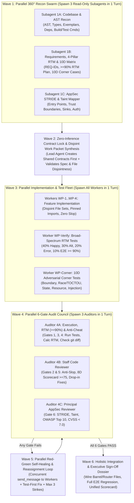

# Jetski Orchestrator: Unified 5-in-1 Multi-Agent Engineering System for `jetski-cli`

This skill unifies **five specialized software engineering disciplines**—**Research Planner**, **Verify Tester**, **Corner-Case Tester**, **Staff Code Reviewer**, and **Principal Security Reviewer**—into a single, high-velocity **Parallel Subagent Orchestration System** purpose-built for **Jetski CLI (`jetski-cli`)**.

Instead of executing research, planning, coding, functional testing, edge-case testing, code review, and security auditing sequentially in a single bottlenecked conversation, the **Lead Orchestrator Agent** decomposes every phase into **parallel subagent waves** using Jetski CLI's native multi-agent tools (`define_subagent`, `invoke_subagent`, `send_message`, `manage_subagents`, and `run_workflow`).

---

## 1. How the 5 Skills Fuse into One `jetski-cli` Super-Skill

| Source Skill | Core Doctrines & Capabilities Preserved | Parallel Subagent Wave in `jetski-cli` |
| :--- | :--- | :--- |
| **`research-planner`** | • **Zero-Inference Mandate**: Front-load 100% of design decisions; never ask workers to "figure out" or "handle appropriately".<br>• **360° Requirements & AST Recon**: Functional/negative requirements, codebase conventions, pinned dependency versions, exact test/lint commands.<br>• **Spoon-Fed Atomic Work Packets**: Max 1–2 files, max 100–150 LOC, 100% disjoint file write sets ($\text{Files}(WP_i) \cap \text{Files}(WP_j) = \emptyset$). | **Wave 1** (Parallel Recon Swarm) & **Wave 2** (Contract Lock & Packet Synthesis) |
| **`verify-tester`** | • **$\ge 90\%$ Scenario Coverage Mandate**: Bidirectional Requirements Traceability Matrix (RTM) mapping every `REQ-ID` $\leftrightarrow$ `AC-ID` $\leftrightarrow$ `TC-ID`.<br>• **Four Functional Pillars**: **40% Golden Happy Paths**, **30% Alternate Valid Branches**, **20% Standard Error Flows**, **10% End-to-End Workflow Integrations**.<br>• **Deterministic Contract Verification**: Strict schema, status code, and payload conformance. | **Wave 1B** (RTM Architecture), **Wave 3** (`WP-Verify` Test Synthesis), **Wave 4A** (Coverage Audit Gate 3) |
| **`corner-case-tester`** | • **10 Corner-Case Dimensions**: Numeric Boundaries, Floating-Point Precision, Strings/Unicode/Encodings, Collections/Structures, Nullability/Types, Concurrency/TOCTOU, State Machine Inversions, Resource Exhaustion, Distributed/Network Skew, Security Injections.<br>• **Test-First Imperative (Red $\rightarrow$ Green)**: Never fix a bug without first writing a deterministic failing test.<br>• **Anti-Cheat & Mutation Integrity**: Zero test tampering (`git diff` audit on `tests/`), zero weakened assertions, zero hardcoded test bypasses, plus mutation sanity check. | **Wave 1B** (10D Matrix), **Wave 3** (`WP-Corner` Test Synthesis), **Wave 4A** & **Wave 5** (Red-Green Self-Healing Gate 4) |
| **`code-reviewer`** | • **6 Immutable Review Doctrines**: Zero Nitpick Domination (`[nit]` never blocks), Prove the Failure Mode, Provide Drop-In Replacement Solutions, Strict Severity Stratification (`[BLOCKER]`, `[MAJOR]`, `[MINOR]`, `[NIT]`, `[PRAISE]`), Holistic Blast Radius Awareness, Constructive Partnership.<br>• **8-Dimension Weighted Scorecard**: Architecture (15%), Correctness (20%), Security (20%), Concurrency (15%), Performance (10%), Reliability (10%), Testing (5%), Maintainability (5%) — minimum **75/100** with **0 Blockers / 0 Majors**. | **Wave 4B** (Parallel Staff Code Review Gate 5) & **Wave 5** (Drop-In Remediation) |
| **`security-reviewer`** | • **6 Immutable AppSec Doctrines**: Adversarial Proof of Concept (PoC), Objective CVSS v3.1/v4.0 Scoring, Source-to-Sink Taint Tracking, Cryptographic & Timing Correctness, Multi-Tenant Blast Radius (BOLA/IDOR), Drop-In Hardened Remediation + Regression Test.<br>• **Full Domain Audit**: STRIDE Threat Modeling, OWASP Web/API Top 10, OWASP LLM/AI Top 10, Cloud/IaC Security, Supply Chain & Secret Scanning — **0 Critical/High ($\text{CVSS} \ge 7.0$)**. | **Wave 1C** (STRIDE Threat Model), **Wave 4C** (Parallel AppSec Audit Gate 6) & **Wave 5** (Hardened Remediation) |

---

## 2. The 6 Core Operating Doctrines of `jetski-orchestrator`

1. **Maximize Parallel Subagent Velocity (Never Run Serially What Can Run in Parallel)**:
   Whenever 2 or more tasks (reconnaissance angles, independent feature modules, verification test suites, corner-case test suites, or review audits) have no data dependency on each other, spawn them **simultaneously in the same turn** via multiple `invoke_subagent` calls or a `run_workflow` `parallel(...)` block.
2. **Smart Model Tiering & Workspace Isolation**:
   - **Model Selection**: Use `Model: "flash"` or `"flash_lite"` for fast read-only reconnaissance, boilerplate/DTO modules, and straightforward unit test generation; use `Model: "inherit"` or `"pro"` for complex core algorithms, concurrency/cryptography modules, Staff Code Review, and Principal AppSec Review.
   - **Workspace Isolation**: Use `Workspace: "inherit"` when parallel subagents write to **100% disjoint file sets** (fastest, zero merge overhead); use `Workspace: "share"` when parallel subagents run conflicting build/test caches; use `Workspace: "branch"` when running competitive implementations (`race` / `best_of`) or touching overlapping files.
3. **Front-Loaded Zero-Inference Specifications & Pre-Locked Contracts**:
   Subagents start with a blank conversation context. The Lead Orchestrator **must** create shared interfaces/types/schemas first and provide each subagent with a **Zero-Inference Work Packet** containing exact file whitelists, pinned imports, exact signatures, step-by-step procedural logic, an exhaustive edge-case matrix, anti-slop bans, and an exact verification command.
4. **Trust Nothing, Verify Everything via the Parallel 6-Gate Audit Council**:
   A subagent claiming *"Task complete, all tests pass"* is an untrusted claim. Every deliverable is audited by parallel verification and review subagents across all **6 Mandatory Gates** before acceptance.
5. **Contextual Reassignment via `send_message` & Autonomous Red-Green Self-Healing**:
   When any gate fails, **do not discard the worker's context**. Send a surgical Correction Directive to the existing subagent via `send_message(Recipient=<conversationId>, Message=...)` (or call the persistent multi-turn `worker(...)` in `run_workflow`) with exact `file:line` anchors, failing test output, and drop-in replacement code. Enforce a **3-Strike Circuit Breaker**: if a subagent fails 3 consecutive correction rounds, terminate it (`manage_subagents(Action="kill")`) and escalate to a `"pro"` subagent or direct Lead Architect fix.
6. **Anti-Cheat & Zero-Regression Integrity**:
   No defect fix or corner-case remediation is accepted unless a deterministic failing test is written first (`RED` $\rightarrow$ `GREEN`), `git diff` confirms **zero test tampering** (no deleted/weakened assertions or mocked internal sinks), and 100% of the baseline regression suite passes.

---

## 3. The 6-Wave Parallel Subagent Orchestration Lifecycle



---

### Wave 1: Parallel 360° Reconnaissance Swarm (3 Concurrent Subagents)

For any non-trivial task, do **not** read dozens of files sequentially in the main agent. Immediately spawn **3 read-only reconnaissance subagents in the same turn** using `invoke_subagent` (`TypeName="research"`, `Model="flash"` or `"inherit"`):

1. **Subagent 1A — `Recon-Codebase-AST` (`research-planner` Phase 2)**:
   - Maps directory structure, existing interfaces, abstract classes, and domain models.
   - Extracts 2–3 canonical code exemplars (showing project style, naming, error handling, logging, and imports).
   - Reads package manifests (`package.json`, `pyproject.toml`, `go.mod`, `Cargo.toml`) to pin exact library versions.
   - Discovers exact working commands for linting, typechecking, and targeted unit test execution.
2. **Subagent 1B — `Recon-RTM-And-Corner-Cases` (`research-planner` Phase 1 + `verify-tester` Phase 1–2 + `corner-case-tester` Phase 1)**:
   - Deconstructs the user request into atomic Functional Requirements (`REQ-001..N`), Negative Requirements, and `Given-When-Then` Acceptance Criteria (`AC-001..M`).
   - Drafts the **Bidirectional Requirements Traceability Matrix (RTM)** covering $\ge 90\%$ of scenarios across the **Four Functional Pillars** (`40% Happy`, `30% Alternate`, `20% Standard Error`, `10% E2E`).
   - Interrogates all inputs, states, and dependencies across the **10 Corner-Case Dimensions** to produce the prioritized **Corner-Case Discovery Matrix (`CC-001..K`)**.
3. **Subagent 1C — `Recon-AppSec-STRIDE` (`security-reviewer` Phase 1)**:
   - Identifies all attack surfaces, entry points, and trust boundaries.
   - Performs **STRIDE Threat Modeling** (**S**poofing, **T**ampering, **R**epudiation, **I**nformation Disclosure, **D**enial of Service, **E**levation of Privilege).
   - Maps untrusted input **Sources**, required **Sanitizers/Validators**, and dangerous execution **Sinks** (SQL/NoSQL, shell, filesystem, SSRF, deserialization, LLM prompts/outputs), plus multi-tenant BOLA/IDOR boundaries.

> **Reactive Wait**: Stop calling tools after emitting the 3 `invoke_subagent` calls. Jetski CLI automatically wakes you when all 3 recon reports arrive.

---

### Wave 2: Zero-Inference Contract Lock & Disjoint Work Packet Synthesis (Lead Orchestrator)

Once Wave 1 completes, the Lead Orchestrator synthesizes the **Master Orchestration Dossier** ([templates/master-orchestration-dossier.md](./templates/master-orchestration-dossier.md)):

1. **Freeze Shared Contracts & Pre-Scaffold Skeletons First (`research-planner` Phase 3)**:
   - Write out 100% of shared data types, interfaces, DTOs, schemas, function prototypes, and the **Error Taxonomy** (exact error classes, codes, messages, and HTTP status codes).
   - **Pre-Create Shared Files & Target Skeletons**: Create shared type/interface files directly in the workspace *before* spawning Wave 3 workers. When subagents may be routed to weaker/lower-tier models (`flash_lite`, `flash`, or literal workers), **pre-scaffold target implementation files** with `jetski_orchestrator.py generate-skeleton` containing `# === [ANCHOR: IMPLEMENT <fn> START/END] ===` blocks so the subagent only has to fill in $\le 50\text{–}80$ lines inside the anchor via `edit_file`.
2. **Partition into Disjoint, Sandwich-Framed Atomic Work Packets (`research-planner` Phase 4)**:
   - Decompose implementation and test creation into **Zero-Inference Work Packets** ([templates/zero-inference-work-packet.md](./templates/zero-inference-work-packet.md)):
     - **Micro-Sizing for Weak Models**: Max **1–2 files** (1 file preferred for `flash`/`flash_lite`) and **60–120 lines of code** per packet.
     - **Zero-Navigation Inlined Context**: Inline exact copy-pasteable imports, referenced types, and a 15–30 line code exemplar directly in the packet so the subagent never has to search the repo.
     - **Concrete Input $\rightarrow$ Output Truth Table**: Provide literal few-shot Input $\rightarrow$ Expected Return/Exception rows instead of abstract prose.
     - **Sandwich Prompt Framing**: Place Mission + File Whitelist in the first 15 lines (Top Bun) and repeat the **5 Non-Negotiable Hard Rules** in the last 15 lines (Bottom Bun) to prevent "Lost in the Middle" instruction drop-off.
     - **Disjoint Write Rule**: No two concurrent packets in an `"inherit"` workspace may write to the same file:
       $$\text{Files}(WP_i) \cap \text{Files}(WP_j) = \emptyset \quad \forall i \ne j$$
     - **Barrel/Router Pattern**: Parallel workers create their isolated module files; the Lead Orchestrator wires shared `index.ts` / `router.ts` / `package.json` files in Wave 6.
3. **Run Deterministic Pre-Dispatch Validation & Cryptographic Test Locking**:
   Validate spec completeness, strict literal readiness (`--strict-literal`), disjoint file sets, and lock existing/acceptance test checksums (`lock-tests`) so weak workers cannot tamper with tests:
   ```bash
   python .agents/skills/jetski-orchestrator/scripts/jetski_orchestrator.py validate-spec --file ./docs/packets/WP-1.md --strict-literal
   python .agents/skills/jetski-orchestrator/scripts/jetski_orchestrator.py validate-packets --packet-dir ./docs/packets
   python .agents/skills/jetski-orchestrator/scripts/jetski_orchestrator.py lock-tests --test-dir ./tests --manifest ./.test-lock.json
   ```

---

### Wave 3: Parallel Implementation & Test Synthesis Fleet (`invoke_subagent` or `run_workflow`)

Optionally register specialized subagent types via `define_subagent` (see [templates/subagent-personas-catalog.md](./templates/subagent-personas-catalog.md)), then spawn **all independent Work Packets concurrently in a single turn**:

- **Feature Implementation Subagents (`WP-1..WP-K`)**:
  - Execute their assigned Zero-Inference Work Packet + unit tests within their strict file whitelist.
- **Broad-Spectrum Verification Test Subagent (`WP-Verify`)**:
  - Authors the comprehensive acceptance/functional test suite mapped to `REQ-ID`s across the **4 Pillars** (**40% Golden Happy Paths**, **30% Alternate Valid Branches**, **20% Standard Error Flows**, **10% E2E Workflow Integrations**) to guarantee $\ge 90\%$ RTM scenario coverage.
- **Adversarial Corner-Case Test Subagent (`WP-Corner`)**:
  - Authors the dedicated adversarial test suite (`tests/corner_cases/` or `tests/adversarial/`) targeting all **10 Corner-Case Dimensions** (Numeric `0/-1/MaxInt`, Float `0.1+0.2/NaN`, Strings `""/Emoji/NullByte/10MB`, Collections `[]/Duplicates/DeepNesting`, Null/Type Coercion, Concurrency/TOCTOU races, State Machine Inversions, Resource Leaks, Network Timeouts/Idempotency Replay, and Path/SQL/XSS/Prototype Injections).

#### Execution Pattern A: Direct Parallel `invoke_subagent` Calls (Best for 2–8 Work Packets)
Emit all `invoke_subagent` tool calls in the **same turn**:
```json
[
  {
    "tool": "invoke_subagent",
    "args": {
      "TypeName": "self",
      "Role": "WP-1: Core Auth Service",
      "Workspace": "inherit",
      "Model": "inherit",
      "Prompt": "<Full Zero-Inference Work Packet WP-1>"
    }
  },
  {
    "tool": "invoke_subagent",
    "args": {
      "TypeName": "self",
      "Role": "WP-Verify: 4-Pillar RTM Test Suite",
      "Workspace": "inherit",
      "Model": "flash",
      "Prompt": "<Full Zero-Inference Work Packet WP-Verify>"
    }
  },
  {
    "tool": "invoke_subagent",
    "args": {
      "TypeName": "self",
      "Role": "WP-Corner: 10D Adversarial Test Suite",
      "Workspace": "inherit",
      "Model": "inherit",
      "Prompt": "<Full Zero-Inference Work Packet WP-Corner>"
    }
  }
]
```

#### Execution Pattern B: Programmable `run_workflow` Pipeline (Best for Large Fan-Out or Automated Audit Loops)
Run the built-in swarm workflow script ([scripts/jetski_swarm_workflow.py](./scripts/jetski_swarm_workflow.py)):
```json
{
  "tool": "run_workflow",
  "args": {
    "ScriptPath": "C:/Users/pricewu/Documents/SideProject/magic_skills/.agents/skills/jetski-orchestrator/scripts/jetski_swarm_workflow.py",
    "Description": "Execute parallel work packets with 6-Gate Council Audit and self-healing loop",
    "Args": {
      "max_retries": 3,
      "workspace": "inherit",
      "work_packets": [
        {
          "id": "WP-1",
          "role": "WP-1: Core Service",
          "model": "inherit",
          "allowed_files": ["src/service.ts", "tests/unit/service.test.ts"],
          "spec": "<Full Zero-Inference Spec>",
          "verification_command": "npm test -- tests/unit/service.test.ts"
        }
      ]
    }
  }
}
```

---

### Wave 4: Parallel 6-Gate Audit Council (3 Concurrent Audit Subagents)

When Wave 3 workers finish, **never trust their self-reports**. Spawn **3 parallel Audit Subagents in the same turn** to evaluate all **6 Mandatory Gates** concurrently:

#### Auditor 4A: Deterministic Verification, RTM ($\ge 90\%$) & Anti-Cheat Auditor (Gates 1, 3 & 4)
1. **Gate 1 (Scope & Boundary Isolation)**:
   - Checks `git status --porcelain` and `validate-spec --mode audit` to confirm zero files outside the allowed whitelist were touched.
2. **Gate 3 (Broad-Spectrum RTM Coverage $\ge 90\%$)**:
   - Runs `jetski_orchestrator.py calc-coverage --rtm-file ./docs/master-dossier.md --threshold 90.0` to verify $\ge 90.0\%$ scenario coverage across all 4 Pillars.
3. **Gate 4 (10D Corner-Case Execution & Anti-Cheat Integrity)**:
   - Runs `jetski_orchestrator.py run-remediation --test-command "<corner_test_cmd>" --baseline-command "<full_test_cmd>"` to verify 100% test pass rate and zero unauthorized test modifications.

#### Auditor 4B: Staff Code Reviewer (Gates 2 & 5 — `code-reviewer`)
Consults [references/staff-code-review-playbook.md](./references/staff-code-review-playbook.md):
1. **Gate 2 (Spec Compliance & Anti-Slop)**:
   - Runs `jetski_orchestrator.py audit-diff` to verify zero `TODO`, `FIXME`, `HACK`, `pass`, `unimplemented!()`, empty `catch {}`, `as any`, `@ts-ignore`, `# type: ignore`, or `# noqa`.
   - Reads every created/modified file to verify 100% contract fidelity.
2. **Gate 5 (Staff Code Quality & 8-Dimension Scorecard)**:
   - Audits Architecture/SOLID, Logic Invariants, Concurrency/TOCTOU/Deadlocks, Performance ($O(N^2)$, N+1 queries), Memory/Resource Cleanup (`finally`/`defer`/`with`), and Error Handling.
   - Runs `jetski_orchestrator.py eval-review-scorecard` — requires **Overall Score $\ge 75.0 / 100$**, **0 `[BLOCKER]`**, and **0 `[MAJOR]`** issues.
   - Every finding must include an exact failure trace and a **verified drop-in replacement code snippet**.

#### Auditor 4C: Principal Offensive AppSec Reviewer (Gate 6 — `security-reviewer`)
Consults [references/offensive-appsec-and-cvss-playbook.md](./references/offensive-appsec-and-cvss-playbook.md):
1. **Automated Security & Secret Scan**:
   - Runs `jetski_orchestrator.py audit-security --path ./src` to detect hardcoded credentials, high-entropy secrets, dangerous execution sinks, weak ciphers, and IaC misconfigurations.
2. **Source-to-Sink Taint & Domain Deep-Dive**:
   - Audits **OWASP Web/API Top 10** (BOLA/IDOR tenant isolation, Mass Assignment, SSRF RFC 1918/metadata blocking, SQL/NoSQL/Command injection, CORS/CSRF).
   - Audits **OWASP LLM/AI Top 10** (Direct/Indirect Prompt Injection, Unsafe Output Handling, Excessive Agency).
   - Audits **Cryptography & Auth** (CSPRNGs, AES-GCM/ChaCha20-Poly1305, Argon2id/bcrypt, constant-time `timingSafeEqual` / `compare_digest`, JWT `alg` pinning).
3. **Objective CVSS v3.1 Scoring & Hardened Remediation**:
   - Computes exact CVSS scores via `jetski_orchestrator.py calc-cvss --vector "..."`.
   - Requires **0 Critical/High ($\text{CVSS} \ge 7.0$)** and **0 unmitigated Medium** vulnerabilities. Every finding includes an **Adversarial PoC**, **drop-in hardened code**, and a **regression test**.

---

### Wave 5: Parallel Autonomous Red-Green-Refactor Self-Healing & Reassignment Loop

If **any** of Gates 1–6 fail during Wave 4:

1. **Group Defects & Provide Literal `Target`/`Replacement` Patch Blocks**:
   - Consolidate all test failures, uncovered RTM scenarios, Staff Code Review `[BLOCKER]`/`[MAJOR]` items, and AppSec vulnerabilities per worker subagent using [templates/surgical-correction-directive.md](./templates/surgical-correction-directive.md).
   - **Zero-Reasoning Mechanical Remediation**: Never ask a weak/lower-tier subagent to "figure out" a complex race condition or security bug. Auditors (`inherit`/`pro`) provide the **exact `edit_file` `Target` and `Replacement` code blocks** inside the Correction Directive so the worker only has to apply the drop-in patch and re-run verification.
2. **Concurrent Contextual Reassignment via `send_message`**:
   - Call `send_message(Recipient=<worker_conversationId>, Message=<directive>)` for all failing workers **in the same turn** so they fix their defects in parallel while retaining their full conversation memory.
3. **Enforce the Red-Green-Refactor Self-Healing Loop & Cryptographic Test Lock (`corner-case-tester`)**:
   - **Step 1 (RED)**: Ensure a deterministic failing test reproduces the bug or exploit payload first.
   - **Step 2 (GREEN)**: Apply the minimal surgical fix in **production source code only**.
   - **Step 3 (ANTI-CHEAT & TEST LOCK AUDIT)**: Run `jetski_orchestrator.py lock-tests --verify` and `run-remediation --enforce-anti-cheat` plus `audit-diff` to verify zero test files were tampered with, zero assertions were weakened (`assert True`), and zero test literals were hardcoded (`if input == "test_..."`).
   - **Step 4 (MUTATION SANITY CHECK)**: Verify that inverting the boundary check or guard causes the new test to fail.
   - **Step 5 (ZERO REGRESSION)**: Confirm 100% of baseline and new tests pass.
4. **Adaptive Fast Model Promotion & 3-Strike Circuit Breaker**:
   - **2-Strike Fast Escalation for Weak Models**: If a lower-tier subagent (`flash_lite`, `flash`, or a struggling worker) fails on **Attempt 2** even after receiving a literal `Target`/`Replacement` block, **do not waste Attempt 3 on the same weak subagent**. Immediately call `manage_subagents(Action="kill", ConversationIds=[<id>])` and either **Bisect the Packet** into two `<50 LOC` micro-packets or **Respawn on `Model: "inherit"` / `"pro"`**.
   - **3-Strike Hard Cap**: Maximum **3** total attempts per work packet before the Lead Orchestrator takes over directly.

---

## 3B. Immunizing Against "Stupider" / Lower-Tier Subagents (The 7 Structural Defenses)

When subagents are routed to smaller, faster, or less capable models, they exhibit predictable failure symptoms. `jetski-orchestrator` neutralizes every symptom structurally:

| Symptom of a "Stupider" Subagent | Structural Cure in `jetski-orchestrator` | Enforcement Mechanism |
| :--- | :--- | :--- |
| **1. Cognitive Overload on Full Files** (truncates code with `// ... rest of file` or forgets exports) | **Skeleton-First "Fill-in-the-Blank" Pre-Scaffolding**: Lead Agent pre-creates the target file with imports, signatures, and `# === [ANCHOR: IMPLEMENT <fn> START/END] ===` markers. Worker only edits $\le 50\text{–}80$ LOC inside the anchor. | `generate-skeleton` & `audit-diff` (blocks `// ... rest of`) |
| **2. API & Import Hallucination** (invents non-existent helper methods or wrong import paths) | **Zero-Navigation Context Inlining**: Work Packet inlines exact copy-pasteable import lines, referenced type definitions, and a 15–30 line code exemplar so the worker never has to search or guess. | `validate-spec --strict-literal` |
| **3. Misinterpreting Abstract Prose** (implements wrong edge-case math or wrong error types) | **Concrete Input $\rightarrow$ Output Truth Table**: Every Work Packet includes a literal few-shot I/O table (`Input Literal` $\rightarrow$ `Expected Return / Exception + Message`). | `validate-spec --strict-literal` |
| **4. "Lost in the Middle" Attention Decay** (ignores constraints buried in the middle of long prompts) | **Sandwich Prompt Architecture**: Places Mission + File Whitelist in the first 15 lines (**Top Bun**) and repeats the **5 Non-Negotiable Hard Rules + Verification Command** in the last 15 lines (**Bottom Bun**). | [zero-inference-work-packet.md](./templates/zero-inference-work-packet.md) |
| **5. Lazy Test Tampering & Hardcoding** (deletes failing tests, writes `assert True`, or codes `if x == "test_1": return y`) | **Cryptographic Test Lock (`lock-tests`) & Anti-Hardcoding Scan**: SHA-256 hashes and assertion counts of test files are locked prior to worker execution; production diffs are scanned for hardcoded test literals. | `lock-tests --verify` & `audit-diff` |
| **6. Remediation Thrashing** (breaks code worse when told *"fix the race condition"*) | **Literal `Target`/`Replacement` Patching**: Strong auditors (`inherit`/`pro`) author exact drop-in `Target`/`Replacement` blocks; the Correction Directive instructs the worker to apply them mechanically via `edit_file`. | [surgical-correction-directive.md](./templates/surgical-correction-directive.md) |
| **7. Looping on Unsolvable Tasks** (burns 3 retries repeating the same syntax/logic error) | **2-Strike Fast Model Promotion & `fallback` / `best_of` Workflows**: Automatically promotes `flash`/`flash_lite` workers to `inherit`/`pro` after 2 failures, or uses `fallback(weak, strong)` / `best_of(n=3)` in `run_workflow`. | [jetski_swarm_workflow.py](./scripts/jetski_swarm_workflow.py) |

---

### Wave 6: Holistic Integration, 6-Gate Sign-Off Dossier & Clean Baseline

Once all parallel work packets earn `APPROVED` status across all 6 Gates:

1. **Cross-Boundary Wiring**:
   - Wire shared exports, barrel files (`index.ts`/`__init__.py`), routers, dependency injection, and configs.
2. **Full End-to-End Verification & Unified Scorecard**:
   - Run the complete project build, linter, typechecker, and test suite (functional + 10D corner-case + security regression tests).
   - Generate the final **Unified 6-Gate Council Scorecard** ([templates/unified-6gate-scorecard.md](./templates/unified-6gate-scorecard.md)):
     ```bash
     python .agents/skills/jetski-orchestrator/scripts/jetski_orchestrator.py generate-council-scorecard --out ./docs/council-scorecard.md
     ```
3. **Executive Sign-Off Report**:
   - Deliver the final report using [templates/executive-signoff-report.md](./templates/executive-signoff-report.md).

---

## 4. The Unified 6-Gate Quality & Security Rubric

| Gate | Discipline | Mandatory Passing Criterion | Verification CLI Subcommand |
| :---: | :--- | :--- | :--- |
| **Gate 1** | **Scope & Boundary Isolation** | 100% disjoint write sets; zero unauthorized file edits | `validate-packets` & `validate-spec --mode audit` |
| **Gate 2** | **Zero-Inference Spec & Anti-Slop** | 100% contract match; zero `TODO`, `FIXME`, stubs, `any`, `@ts-ignore`, empty `catch` | `validate-spec` & `audit-diff` |
| **Gate 3** | **Broad-Spectrum Functional RTM** | $\ge 90.0\%$ scenario coverage across 4 Pillars (40% Happy, 30% Alt, 20% Error, 10% E2E) | `calc-coverage --threshold 90.0` |
| **Gate 4** | **10D Corner Cases & Anti-Cheat** | 100% pass across all 10 boundary dimensions; zero test tampering; zero regressions | `generate-corner-cases` & `run-remediation --enforce-anti-cheat` |
| **Gate 5** | **Staff Code Review** | 8-Dimension Scorecard $\ge 75.0/100$; `0 Blockers`, `0 Majors`; concurrency & perf safe | `audit-diff` & `eval-review-scorecard` |
| **Gate 6** | **Principal AppSec & CVSS** | `0 Critical/High` ($\text{CVSS} < 7.0$); STRIDE, Taint Sinks, OWASP Web/API/LLM clean | `audit-security` & `calc-cvss` |

---

## 5. Unified CLI Tooling (`scripts/jetski_orchestrator.py` & `.ps1`)

All automation tools from the 5 constituent skills are unified into a single CLI in `scripts/`:

```bash
# 1. Validate a Master Spec or Work Packet for Zero-Inference & Dumb-Model Literal Readiness (--strict-literal)
python .agents/skills/jetski-orchestrator/scripts/jetski_orchestrator.py validate-spec --mode spec --file ./docs/packets/WP-1.md --strict-literal

# 2. Verify 100% disjoint file write sets across all Work Packets
python .agents/skills/jetski-orchestrator/scripts/jetski_orchestrator.py validate-packets --packet-dir ./docs/packets

# 3. Pre-scaffold "Fill-in-the-Blank" skeleton files with implementation anchors for lower-tier subagents
python .agents/skills/jetski-orchestrator/scripts/jetski_orchestrator.py generate-skeleton --target-file ./src/service.py --functions verify_signature acquire_lock

# 4. Cryptographically lock test files (SHA-256 + assertion count) before running weak workers, then verify afterward
python .agents/skills/jetski-orchestrator/scripts/jetski_orchestrator.py lock-tests --test-dir ./tests --manifest ./.test-lock.json
python .agents/skills/jetski-orchestrator/scripts/jetski_orchestrator.py lock-tests --test-dir ./tests --manifest ./.test-lock.json --verify

# 5. Calculate Bidirectional RTM Scenario Coverage against the >=90% 4-Pillar Gate
python .agents/skills/jetski-orchestrator/scripts/jetski_orchestrator.py calc-coverage --rtm-file ./docs/master-dossier.md --threshold 90.0

# 6. Generate 10-Dimension Adversarial Corner-Case Matrix from spec or source code
python .agents/skills/jetski-orchestrator/scripts/jetski_orchestrator.py generate-corner-cases --spec-file ./docs/master-dossier.md --component AuthService --markdown-out ./docs/corner-cases.md

# 7. Run Red-Green Remediation Controller with Git Anti-Cheat & Baseline Regression Check
python .agents/skills/jetski-orchestrator/scripts/jetski_orchestrator.py run-remediation --test-command "pytest tests/corner_cases" --baseline-command "pytest tests/unit" --enforce-anti-cheat

# 8. Audit Git Diff or Target Files for Hygiene, Anti-Slop, Tautological Assertions & Test-Literal Hardcoding
python .agents/skills/jetski-orchestrator/scripts/jetski_orchestrator.py audit-diff --diff ./pr.diff

# 9. Evaluate 8-Dimension Weighted Staff Code Review Scorecard
python .agents/skills/jetski-orchestrator/scripts/jetski_orchestrator.py eval-review-scorecard --blockers 0 --majors 0 --minors 1

# 10. Run Multi-Language Offensive AppSec & Secret Scanner (OWASP / CWE / IaC)
python .agents/skills/jetski-orchestrator/scripts/jetski_orchestrator.py audit-security --path ./src

# 11. Calculate Official CVSS v3.1 Base, Impact & Exploitability Scores
python .agents/skills/jetski-orchestrator/scripts/jetski_orchestrator.py calc-cvss --vector "CVSS:3.1/AV:N/AC:L/PR:N/UI:N/S:U/C:H/I:H/A:H"

# 12. Generate the Unified 6-Gate Council Audit Scorecard
python .agents/skills/jetski-orchestrator/scripts/jetski_orchestrator.py generate-council-scorecard --out ./docs/council-scorecard.md
```

PowerShell 7 native wrapper (`scripts/jetski_orchestrator.ps1`) supports the exact same subcommands on Windows:
```powershell
pwsh .agents/skills/jetski-orchestrator/scripts/jetski_orchestrator.ps1 validate-packets --packet-dir ./docs/packets
```

---

## 6. Reference Manuals, Templates & Examples

Load these modular references on-demand for deep domain rules:

- **Reference Manuals (`references/`)**:
  - [subagent-swarm-and-workflow-patterns.md](./references/subagent-swarm-and-workflow-patterns.md): Advanced `jetski-cli` patterns for `define_subagent`, parallel `invoke_subagent`, `send_message`, `manage_subagents`, `run_workflow`, and the `advanced` workflow library (`parallel`, `race`, `retry`, `best_of`, `verify`, `with_timeout`).
  - [zero-inference-planning-and-recon.md](./references/zero-inference-planning-and-recon.md): Complete `research-planner` playbook for 360° requirements deconstruction, AST recon, contract freezing, task decomposition heuristics, and low-tier model hazard immunization.
  - [verification-and-corner-case-playbooks.md](./references/verification-and-corner-case-playbooks.md): Complete `verify-tester` ($\ge 90\%$ 4-Pillar RTM, contract testing) and `corner-case-tester` (10 Dimensions, Red-Green-Refactor self-healing, Anti-Cheat & Mutation rules) playbooks.
  - [staff-code-review-playbook.md](./references/staff-code-review-playbook.md): Complete `code-reviewer` playbook covering Architecture/SOLID, Concurrency/TOCTOU, Performance/Scalability, Testing/Observability, Conventional Comments, and the 8-Dimension Weighted Rubric.
  - [offensive-appsec-and-cvss-playbook.md](./references/offensive-appsec-and-cvss-playbook.md): Complete `security-reviewer` playbook covering STRIDE, Source-to-Sink Taint Analysis, OWASP Web/API Top 10, OWASP LLM/AI Top 10, Cryptographic Anti-Patterns, Cloud/IaC, Supply Chain, and CVSS v3.1/v4.0 scoring.
- **Templates (`templates/`)**:
  - [master-orchestration-dossier.md](./templates/master-orchestration-dossier.md): Unified Master Plan combining Requirements, Frozen Contracts, 4-Pillar RTM, 10D Corner-Case Matrix, STRIDE Threat Model, and File Ownership Matrix.
  - [zero-inference-work-packet.md](./templates/zero-inference-work-packet.md): 8-Section Spoon-Fed Subagent Work Packet template.
  - [subagent-personas-catalog.md](./templates/subagent-personas-catalog.md): Ready-to-use `define_subagent` definitions and system prompts for all 6 specialized subagents.
  - [unified-6gate-scorecard.md](./templates/unified-6gate-scorecard.md): Unified 6-Gate Council Audit Scorecard template.
  - [surgical-correction-directive.md](./templates/surgical-correction-directive.md): Structured `send_message` reassignment directive template.
  - [executive-signoff-report.md](./templates/executive-signoff-report.md): Final Executive Triage & Verification Sign-Off Dossier template.
- **Scripts & Walkthroughs**:
  - [jetski_orchestrator.py](./scripts/jetski_orchestrator.py) & [jetski_orchestrator.ps1](./scripts/jetski_orchestrator.ps1): Unified 10-command CLI engine.
  - [jetski_swarm_workflow.py](./scripts/jetski_swarm_workflow.py): Programmable `run_workflow` script for multi-wave parallel execution and 6-Gate self-healing.
  - [full-jetski-orchestration-walkthrough.md](./examples/full-jetski-orchestration-walkthrough.md): End-to-end real-world example of 6-Wave parallel subagent orchestration in `jetski-cli`.
