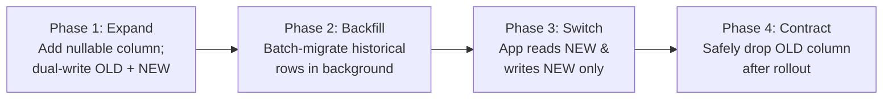

# Staff/Principal Code Review Playbook (Wave 5 — Gate 5)

This reference defines the operating doctrine, severity taxonomy, deep-dive audit pillars, and weighted scorecard rubric for **Wave 5: Staff Code Review** inside `jetski-orchestrator`. It fuses architectural soundness, concurrency safety, algorithmic scalability, observability, and constructive engineering mentorship into a single deterministic gate.

---

## 1. The 6 Immutable Review Doctrines

1. **Zero Nitpick Domination**:
   Formatting, indentation, import sorting, and trivial styling belong to automated linters and formatters. Review bandwidth must focus exclusively on logic correctness, architecture, security, concurrency, reliability, and boundary conditions. If stylistic points are noted, they must be labeled strictly as `[NIT]` (`nit [non-blocking]:`) and **never** block approval.
2. **Prove the Failure Mode**:
   Never assert *"this might fail"* or *"consider changing this"* without articulating the exact failure condition, race window, edge-case input, or production blast radius. Explain **why** and **how** the defect manifests under real traffic.
3. **Provide Drop-In Replacement Solutions**:
   Every identified defect (`[BLOCKER]`, `[MAJOR]`, `[MINOR]`) must include a concrete, production-ready "Before vs. After" code snippet or architectural diff demonstrating the fix. Never leave the author guessing how to satisfy the review.
4. **Strict Severity Stratification**:
   Every inline comment must carry an explicit severity tag and Conventional Comments label. Never conflate a critical data-loss bug or race condition with an optional readability refactoring.
5. **Holistic Blast Radius Awareness**:
   Inspect beyond the diff lines. Trace upstream callers, downstream consumers, database schema migrations, configuration defaults, backwards compatibility across rolling deployments, and rollback safety.
6. **Constructive Partnership & Praise**:
   Frame feedback objectively around system invariants and runtime behavior rather than personal attributes (*"This query lacks a tenant filter"* instead of *"You forgot to filter"*). Actively recognize clean abstractions, thorough edge-case tests, and elegant implementations using `[PRAISE]`.

---

## 2. Severity Stratification & Conventional Comments Taxonomy

All review findings must adhere to the **Conventional Comments** standard combined with strict severity tiers:

$$\textbf{**[\text{SEVERITY}] <label> [<decorations>]:** <subject>}$$

### 2.1 Severity Tiers & Scorecard Penalty Weights

| Severity Tag | Priority | Scorecard Penalty | Definition & Merge Impact |
| :--- | :---: | :---: | :--- |
| **`[BLOCKER]`** | **P0** | **`-40 pts`** | Active security vulnerability, data corruption/loss risk, concurrency deadlock, high-probability crash, or unversioned breaking API/schema change. **Halts merge immediately (`REQUEST_CHANGES`).** |
| **`[MAJOR]`** | **P1** | **`-15 pts`** | Incorrect business logic under valid conditions, TOCTOU race condition, N+1 query on hot path, resource/memory leak, silent error swallowing, or missing regression test. **Blocks merge (`REQUEST_CHANGES`).** |
| **`[MINOR]`** | **P2** | **`-2 pts`** | Suboptimal design pattern, missed code reuse, low-probability edge case, or minor observability gap. Non-blocking unless $>5$ accumulate (`COMMENT / NEEDS_DISCUSSION`). |
| **`[NIT]`** | **P3** | **`0 pts`** | Naming polish, comment phrasing, or minor stylistic preference. **Strictly non-blocking (`APPROVE`).** |
| **`[PRAISE]`** | **—** | **`0 pts`** | Positive reinforcement commending clean modularity, defensive coding, or high-signal test suites. |

### 2.2 Canonical Labels & Decorations

- **Labels**: `issue` (defect/violation, blocking by default), `suggestion` (refactoring/improvement), `question` (clarification needed), `thought` (non-blocking architectural idea), `nit` (non-blocking polish), `praise` (recognition), `chore` (mechanical doc/lockfile task).
- **Decorations**: `[blocking]`, `[non-blocking]`, `[security]`, `[perf]`, `[arch]`, `[test]`, `[concurrency]`.

### 2.3 Required Inline Comment Structure

Every actionable finding (`[BLOCKER]`, `[MAJOR]`, `[MINOR]`) must be formatted using this 4-part structure:

````markdown
### `[MAJOR]` issue [concurrency, blocking]: Non-atomic balance deduction enables double-spend
- **Location**: [`src/services/wallet.py#L42-L51`](file:///abs/path/src/services/wallet.py#L42-L51)
- **Problem**: `withdraw()` reads `wallet.balance` in a standard `SELECT` and deducts the amount in a subsequent Python assignment before committing.
- **Concrete Failure Scenario**: Two concurrent `POST /withdraw` requests for $100 against a $100 balance both read `balance = 100` before either commits, resulting in two successful payouts and a final balance of $0 instead of -$100 (or rejection).
- **Drop-In Code Solution**:
  ```python
  # BEFORE (Vulnerable to TOCTOU Race Condition)
  wallet = session.query(Wallet).filter_by(id=wallet_id).first()
  if wallet.balance < amount:
      raise InsufficientFundsError()
  wallet.balance -= amount
  session.commit()

  # AFTER (Hardened with Row-Level Locking & Atomic Guard)
  wallet = (
      session.query(Wallet)
      .filter_by(id=wallet_id, tenant_id=tenant_id)
      .with_for_update()
      .one()
  )
  if wallet.balance < amount:
      raise InsufficientFundsError()
  wallet.balance -= amount
  session.commit()
  ```
````

---

## 3. Deep-Dive Audit Pillar 1: Architectural Soundness & API Contract Evolution

### 3.1 SOLID Principles & Domain Boundary Separation
- **Single Responsibility (SRP) & Layering**: Controllers/handlers parse requests and return responses; domain services execute pure business rules; repositories encapsulate persistence. Flag handlers that mix HTTP parsing, raw SQL generation, and third-party SMTP/webhook dispatch.
- **No Leaky Abstractions**: Never return raw database ORM entities directly in public API responses (exposes internal schema fields and causes lazy-loading serialization crashes). Require explicit Data Transfer Objects (DTOs) / response schemas.
- **Dependency Inversion (DIP)**: High-level domain modules must depend on interfaces/protocols rather than instantiating concrete external SDKs (`StripeClient()`, ` boto3.client()`) inline, enabling deterministic unit testing.
- **Pragmatic DRY**: Reject premature "do-it-all" boolean-flag utility functions that couple unrelated domain workflows. Duplication is preferable to the wrong cross-domain abstraction.

### 3.2 Backwards-Compatible API Evolution & Error Contracts
- **Compatibility Rules**:
  - *Safe (Additive)*: Adding optional request fields with sensible defaults, or adding new response fields.
  - *Breaking (Subtractive/Mutating)*: Removing or renaming fields, changing field types (e.g., `string` $\rightarrow$ `array`), or making optional parameters required. Breaking changes require an explicit API version bump (`/v1/` $\rightarrow$ `/v2/`) and deprecation telemetry.
- **Uniform Error Envelopes (RFC 7807)**: APIs must return structured error payloads (`type`, `title`, `status`, `detail`, `instance`, `code`) and never leak raw SQL errors, stack traces, or internal hostnames:
  ```json
  {
    "type": "https://api.example.com/errors/insufficient-funds",
    "title": "Insufficient Account Balance",
    "status": 422,
    "detail": "Account balance ($25.00) cannot cover requested transfer ($100.00).",
    "instance": "/v1/transfers/txn_918231",
    "code": "INSUFFICIENT_FUNDS"
  }
  ```

### 3.3 Idempotency & The Transactional Outbox Pattern
- **Mutation Idempotency**: Endpoints that create side effects (payments, orders, webhook consumers, retry handlers) must enforce an `Idempotency-Key` checked atomically before execution, returning `409 Conflict` if in-flight or replaying the cached response if already completed.
- **Eliminating Dual-Writes**: Never update a database record and immediately publish to an external broker (Kafka/SNS/RabbitMQ) outside a transaction:
  ```python
  # BAD: If broker publish fails or process crashes, DB is updated but event is lost!
  db.orders.insert(order)
  message_bus.publish("order.created", order)

  # GOOD: Transactional Outbox Pattern — write both in a single atomic DB transaction
  with db.transaction() as tx:
      tx.orders.insert(order)
      tx.outbox_events.insert(OutboxEvent(topic="order.created", payload=order.to_dict()))
  ```

### 3.4 Zero-Downtime Database Migration Safety (Expand-and-Contract)
Live schema alterations must never lock high-traffic tables or break running application instances during rolling deploys:

- **Lock Prevention Rules**: Require `CREATE INDEX CONCURRENTLY` (PostgreSQL) or `ALGORITHM=INPLACE, LOCK=NONE` (MySQL) on existing tables, accompanied by explicit `lock_timeout` and `statement_timeout` guards.

---

## 4. Deep-Dive Audit Pillar 2: Correctness, Concurrency & Asynchronous Safety

### 4.1 Logic Invariants, Boundaries & Deterministic Resource Cleanup
- **Boundary Permutations**: Verify behavior on `0`, `-1`, empty collections `[]`/`{}`, `None`/`null`/`undefined`, `MAX_SAFE_INTEGER`, NaN/Infinity, multi-byte Unicode/grapheme clusters, and DST/UTC timezone transitions.
- **Scoped Resource Cleanup**: File descriptors, network sockets, DB sessions, and locks must be released deterministically across all exception paths using language-native constructs:
  - Python: `with open(...) as f:` / `contextlib.closing`
  - Go: `defer resp.Body.Close()`
  - TypeScript/JS: `try { ... } finally { await handle.close(); }` or `using`
  - Java / C#: `try-with-resources` / `using var`

### 4.2 Concurrency Hazards, TOCTOU & Atomic Mutations
- **TOCTOU Elimination**: Never separate state verification from state mutation across concurrent requests. Enforce **Pessimistic Locking** (`SELECT ... FOR UPDATE`), **Optimistic Concurrency Control** (`UPDATE ... SET version = version + 1 WHERE id = :id AND version = :expected_version`), or single-statement **Atomic Conditional Updates** (`UPDATE inventory SET stock = stock - :qty WHERE item_id = :id AND stock >= :qty`).
- **Shared Memory Synchronization**: Flag concurrent reads/writes to in-memory maps, slices, or singleton caches across threads/goroutines without `sync.RWMutex`, `threading.Lock`, or atomic primitives:
  ```go
  // BAD: Unsynchronized concurrent map write triggers fatal runtime panic in Go
  var routes = make(map[string]string)
  func Register(k, v string) { routes[k] = v }

  // GOOD: Guarded by sync.RWMutex for safe concurrent access
  var (
      mu     sync.RWMutex
      routes = make(map[string]string)
  )
  func Register(k, v string) {
      mu.Lock()
      defer mu.Unlock()
      routes[k] = v
  }
  ```
- **Deadlock Prevention**: When acquiring multiple locks, enforce a globally deterministic lock acquisition order (e.g., sort entity IDs ascending before locking `lock(min(idA, idB))` then `lock(max(idA, idB))`) and bound acquisition waits with timeouts.

### 4.3 Asynchronous & Event-Loop Safety
- **No Unhandled Rejections / Fire-and-Forget Orphans**: Every spawned promise, `asyncio.create_task`, or goroutine must be explicitly awaited or attached to an error-logging boundary and structured cancellation scope (`AbortController`, `context.Context`, `asyncio.TaskGroup`):
  ```typescript
  // BAD: Fire-and-forget promise crashes process on UnhandledPromiseRejection
  export async function onOrderPaid(order: Order) {
    dispatchWebhook(order);
    return { ok: true };
  }

  // GOOD: Bounded timeout + explicit error boundary for background side effects
  export async function onOrderPaid(order: Order) {
    void dispatchWebhook(order, { signal: AbortSignal.timeout(5000) }).catch((err) => {
      logger.error("Webhook dispatch failed", { orderId: order.id, traceId: order.traceId, err });
    });
    return { ok: true };
  }
  ```
- **Never Block the Event Loop**: Flag synchronous I/O (`fs.readFileSync`, `requests.get` inside `async def`) or CPU-bound work (bcrypt hashing, large JSON/XML parsing, catastrophic regex) on the main event loop. Offload to worker pools (`asyncio.to_thread`, `worker_threads`).

---

## 5. Deep-Dive Audit Pillar 3: Performance, Scalability & Observability

### 5.1 Algorithmic Complexity & Database Query Scaling
- **Eliminate Hot-Path $O(N^2)$**: Flag nested `.find()`, `.includes()`, or list comprehensions inside loops. Pre-index lookup targets into a `Set` or `Map`/`dict` for $O(1)$ resolution ($O(N)$ total).
- **N+1 Query Elimination**: Flag database queries or RPC calls executed inside loops. Enforce batch fetching (`WHERE id IN (...)`) or ORM eager loading (`selectinload`/`joinedload` in SQLAlchemy, `select_related`/`prefetch_related` in Django, `include` in Prisma):
  ```python
  # BAD: 1 query for orders + 100 individual SELECT queries inside the loop (N+1)
  orders = session.query(Order).limit(100).all()
  return [{"id": o.id, "customer": o.user.email} for o in orders]

  # GOOD: Eager-loaded relation resolves in a single batched query
  orders = session.query(Order).options(selectinload(Order.user)).limit(100).all()
  return [{"id": o.id, "customer": o.user.email} for o in orders]
  ```
- **Index Coverage & Bounded Pagination**: Verify every column in `WHERE`, `JOIN`, and `ORDER BY` clauses is backed by an index. Reject unbounded `SELECT *` queries; enforce cursor/keyset or `LIMIT/OFFSET` pagination with a hard maximum page cap (e.g., `MAX_LIMIT = 100`).

### 5.2 Bounded Memory & Outgoing I/O Resilience
- **Bounded Caches**: Reject plain dictionaries/maps used as global caches without eviction policies. Require bounded **LRU + TTL** caches (`cachetools.TTLCache`, `lru-cache`) to prevent Out-Of-Memory (OOM) crashes.
- **Mandatory I/O Timeouts & Jittered Retries**: Every outgoing HTTP, gRPC, or DB call must specify explicit connect and read timeouts (`timeout=(3.0, 10.0)`). Retries on transient failures (`502/503/504`, network reset) must use **Exponential Backoff with Full Jitter**:
  $$\text{sleep\_duration} = \text{random}\left(0, \min\left(T_{\max}, T_{\text{base}} \times 2^{\text{attempt}}\right)\right)$$

### 5.3 Structured Observability & Test Suite Quality Rubric
- **Structured Telemetry**: Emit machine-parsable JSON logs propagating `trace_id` / `correlation_id`, `service`, `duration_ms`, and domain identifiers (`order_id`). Enforce strict **Zero PII / Zero Secrets** in log attributes. Emit Golden Signals (Rate, Errors, Duration histograms, Saturation):
  ```json
  {
    "timestamp": "2026-10-30T12:00:00Z",
    "level": "INFO",
    "service": "checkout-service",
    "trace_id": "4bf92f3577b34da6a3ce929d0e0e4736",
    "order_id": "ord_88412",
    "duration_ms": 48.2,
    "message": "Payment authorized and outbox event recorded"
  }
  ```
- **Test Quality Rubric**:
  - **The Bug-Fix Iron Rule**: Every bug fix must include an automated regression test that fails without the fix and passes with it.
  - **Zero Test Smells**: Reject *"Testing the Mock"* (mocking internal domain logic instead of external I/O boundaries), flaky `sleep()` timing assertions (use fake timers or deterministic condition polling), and shared mutable state across tests.
  - **5-Quadrant Test Coverage**: Verify tests cover **(1) Happy Path**, **(2) Boundary/Edge Cases**, **(3) Negative/Failure Paths**, **(4) Auth/Tenant Permission Boundaries**, and **(5) Idempotency/Concurrency**.

---

## 6. The 8-Dimension Weighted Review Scorecard & Verdict Rubric

### 6.1 8-Dimension Weighted Quality Table

Each dimension is scored on a `1–5` scale (`5` = Staff/Flawless, `4` = Production Ready, `3` = Needs Work, `2` = Substandard, `1` = Unacceptable):

| # | Dimension | Weight | Max Pts | Criteria for 5 / 5 Score |
| :-: | :--- | :---: | :---: | :--- |
| 1 | **Architecture & Modularity** | **15%** | `15.0` | Clean SOLID separation, zero leaky abstractions, backwards-compatible contracts, safe migrations. |
| 2 | **Correctness & Edge Cases** | **20%** | `20.0` | Flawless handling of nulls, boundaries, state transitions, and deterministic resource cleanup. |
| 3 | **Security & Threat Model** | **20%** | `20.0` | Zero OWASP/CWE flaws, strict allowlist validation, object-level tenant auth (BOLA), zero secret leaks. |
| 4 | **Concurrency & Async Safety** | **15%** | `15.0` | Zero TOCTOU races, atomic DB locks, consistent lock ordering, non-blocking async lifecycle. |
| 5 | **Performance & Scalability** | **10%** | `10.0` | Optimal $O(N)$ complexity, zero N+1 queries, indexed lookups, bounded LRU/TTL caches, pagination. |
| 6 | **Reliability & Resilience** | **10%** | `10.0` | Explicit I/O timeouts, jittered backoff retries, idempotent mutations, transactional outbox safety. |
| 7 | **Test Quality & Coverage** | **5%** | `5.0` | Real assertions across 5 quadrants, regression tests for bugs, mocks restricted to I/O boundaries. |
| 8 | **Maintainability & Hygiene** | **5%** | `5.0` | Self-documenting code, structured JSON telemetry, zero debug leftovers or unjustified suppressions. |

### 6.2 Deterministic Score & Penalty Formula

$$\text{BaseScore} = \sum_{i=1}^{8} \left(\frac{\text{RawScore}_i}{5.0} \times \text{WeightPct}_i\right)$$

$$\text{Penalty} = (40 \times N_{\text{Blockers}}) + (15 \times N_{\text{Majors}}) + (2 \times N_{\text{Minors}})$$

$$\text{FinalScore} = \max\left(0.0,\; \min\left(100.0,\; \text{ round}(\text{BaseScore} - \text{Penalty},\, 1)\right)\right)$$

### 6.3 Official Gate 5 Verdict Thresholds

| Official Verdict | Mandatory Gate Condition | Required Orchestrator Action |
| :--- | :--- | :--- |
| **`APPROVE`** | $\text{FinalScore} \ge 75.0$ **AND** $N_{\text{Blockers}} = 0$ **AND** $N_{\text{Majors}} = 0$ **AND** $N_{\text{Minors}} \le 5$ | Gate 5 Passed. Proceed to Wave 6 Final Release Sign-Off. |
| **`COMMENT / NEEDS_DISCUSSION`** | $\text{FinalScore} \ge 75.0$ **AND** $N_{\text{Blockers}} = 0$ **AND** $N_{\text{Majors}} = 0$ **AND** $N_{\text{Minors}} > 5$ | Remediate accumulated minor polish items before final sign-off. |
| **`REQUEST_CHANGES`** | $N_{\text{Blockers}} > 0$ **OR** $N_{\text{Majors}} > 0$ **OR** $\text{FinalScore} < 75.0$ | **Gate 5 Blocked.** Route drop-in fixes back to implementation subagents and re-verify. |
