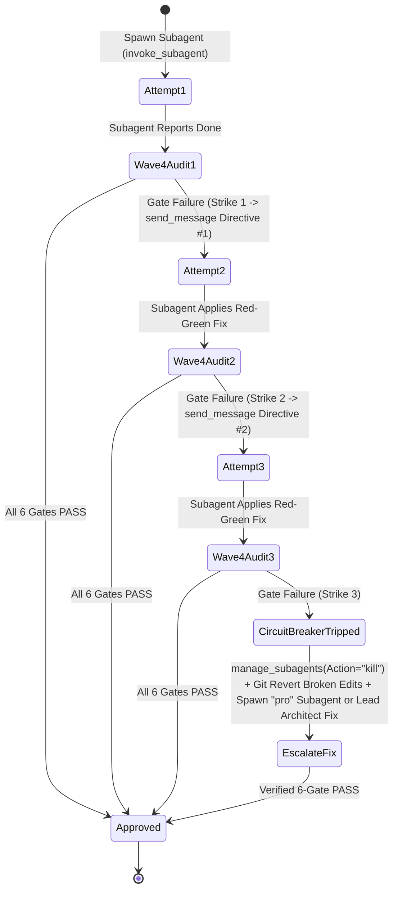
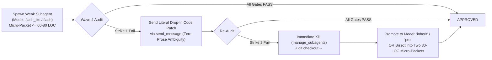

# Subagent Swarm & Dynamic Workflow Orchestration Patterns for `jetski-cli`

> **Reference Purpose**: Exhaustive operational playbook for orchestrating high-velocity parallel subagent swarms in **Jetski CLI (`jetski-cli`)** using the five native multi-agent primitives (`define_subagent`, `invoke_subagent`, `send_message`, `manage_subagents`, and `run_workflow`) plus the `advanced` workflow library (`parallel`, `race`, `retry`, `fallback`, `best_of`, `verify`, `with_timeout`).

---

## 1. The 5 Native `jetski-cli` Multi-Agent Primitives

### 1.1 `define_subagent` — Dynamic Persona Registration vs. Static Custom Agents
`define_subagent` registers a specialized subagent persona for the duration of the active conversation. All defined subagents automatically receive read/search codebase tools and `send_message` to report back to the Lead Orchestrator.

| Parameter | Type | Required | Operational Behavior |
| :--- | :--- | :---: | :--- |
| `Name` | `string` | Yes | Unique identifier passed as `TypeName` to `invoke_subagent` (e.g., `"recon-ast"`, `"wp-worker"`, `"appsec-auditor"`). |
| `Description` | `string` | Yes | Concise operational charter explaining when and why to invoke this persona. |
| `SystemPrompt` | `string` | Yes | Immutable behavioral rules, output schemas, anti-slop guardrails, and mandatory `send_message` reporting contract. |
| `EnableWriteTools` | `boolean` | No | Set `false` for read-only Reconnaissance (Wave 1) and Audit (Wave 4) subagents; set `true` for Wave 3/5 implementation workers. |
| `EnableSubagentTools` | `boolean` | No | Set `false` for leaf workers to prevent uncontrolled recursive subagent spawning; set `true` only for hierarchical sub-orchestrators. |
| `EnableMCPTools` | `boolean` | No | Set `true` when the subagent requires external MCP integrations (issue trackers, docs, cloud APIs). |

**Dynamic `define_subagent` vs. Static `.agents/agents/<name>.md` Custom Agents**:
- **Static Custom Agents** (`.agents/agents/*.md` or `agents/<name>/agent.json`): Discovered automatically at session startup across workspace and global directories. Best for standing personas shared across repositories.
- **Dynamic `define_subagent`**: Created on-the-fly by the Lead Orchestrator when a custom persona is not pre-installed or requires project-specific system prompt constraints (e.g., pinning a specific language toolchain or security policy).

---

### 1.2 `invoke_subagent` — Concurrent Multi-Call Spawning in a Single Turn
When the Lead Orchestrator emits multiple `invoke_subagent` calls in the **same response turn**, `jetski-cli` launches all subagents concurrently in the background.

| Parameter | Allowed Values | Orchestration Guidance |
| :--- | :--- | :--- |
| `TypeName` | `"self"`, `"research"`, `"image-generator"`, or any custom `Name` | Use `"research"` for fast read-only Wave 1 recon; use `"self"` or a custom `define_subagent` persona for Wave 3/4/5 tasks. |
| `Role` | 2–5 word title | Displayed on the subagent UI card (e.g., `"WP-1: JWT Token Service"`, `"Auditor 4C: AppSec STRIDE"`). Make each role distinct. |
| `Prompt` | Full Markdown string | Must be a **100% self-contained Zero-Inference Work Packet**. Subagents do not see the parent conversation history. |
| `Model` | `"inherit"` \| `"pro"` \| `"flash"` \| `"flash_lite"` | Defaults to `"inherit"`. Tier dynamically based on cognitive complexity (see Section 3). |
| `Workspace` | `"inherit"` \| `"share"` \| `"branch"` | Defaults to `"inherit"`. Select based on file-write disjointness and build isolation needs (see Section 3). |

> [!IMPORTANT]
> **Reactive Wakeup Protocol**: Never poll `manage_subagents` in a busy loop or run shell `sleep` commands after `invoke_subagent`. Simply end your turn by calling no more tools; `jetski-cli` automatically resumes your turn when subagents send completion messages or finish.

---

### 1.3 `send_message` — Contextual Iterative Reassignment
When a subagent's deliverable fails any gate in the Wave 4 Audit Council, **never spawn a brand-new subagent from scratch** if the existing worker's context is healthy. Calling `send_message` wakes the existing subagent with its full memory intact (files already read, mental model of the module, and prior compiler outputs):

```json
{
  "tool": "send_message",
  "args": {
    "Recipient": "9e22df20-2aa8-442d-9592-782726b4f9d0",
    "Message": "## SURGICAL CORRECTION DIRECTIVE (Attempt 2/3)\n1. Gate 5 [MAJOR] in `src/auth/token.ts:48`: Replace non-constant-time `===` signature check with `crypto.timingSafeEqual`.\n2. Gate 4 [RED] in `tests/corner_cases/token.corner.test.ts`: Add whitespace-only token test case (`\"   \"`).\n3. Re-run `npx vitest run tests/corner_cases/token.corner.test.ts` and reply via `send_message`."
  }
}
```

---

### 1.4 `manage_subagents` — Lifecycle Inspection & 3-Strike Circuit Breaker Termination
Use `manage_subagents` to inspect active subagent states (`Action="list"`) or terminate stalled/runaway subagents (`Action="kill"` or `"kill_all"`):
- `manage_subagents(Action="list")`: Returns each direct subagent's `conversationId` and live execution state.
- `manage_subagents(Action="kill", ConversationIds=["<id>"])`: Immediately terminates the target subagent and its descendants, cleaning up branched workspaces while preserving logs. Mandatory when enforcing the **3-Strike Circuit Breaker**.

---

### 1.5 `run_workflow` & The `advanced` Library — Programmable Python Orchestration
Use `run_workflow` when orchestration logic is best expressed as executable Python code: multi-stage pipelines, high fan-out over many modules/files, automated Worker $\leftrightarrow$ Auditor retry loops, or competitive execution patterns.

**Built-in `run_workflow` Primitives**:
- `phase(name: str)`: Groups subsequent logs and agent cards under a named UI stage.
- `log(*args)`: Emits structured progress output to the workflow result and UI.
- `agent(prompt=None, schema=None, role=None, type_name="self", workspace="inherit", model=None)`:
  - **Single-shot execution**: `result = await agent(prompt, schema=..., role="...")` runs one turn and returns the JSON-schema-validated output passed to `finish`.
  - **Multi-turn persistent agent**: `worker = agent(role="WP-1", workspace="inherit")` followed by `res1 = await worker(prompt1, schema)` and `res2 = await worker(prompt2, schema)` preserves conversation state across multiple turns until `del worker`.
- `parallel(items, fn)`: Runs `fn(item)` concurrently across all items and returns results in item order.
- `pipeline(items, fn)`: Runs `fn(item)` sequentially one item at a time.
- `call_tool(name, **args)`: Invokes allowed host tools (`read_file`, `write_file`, `edit_file`, `search_web`, `invoke_subagent`, `send_message`, `manage_task`) directly from Python.

**`advanced` Workflow Library (`from advanced import ...`)**:
- `parallel(items, fn, max_concurrency=4, return_exceptions=False)`: Concurrency-throttled fan-out with optional exception capture.
- `race(fns)`: Runs multiple zero-arg callables concurrently (`[lambda: agent(...), lambda: agent(...)]`), returns the first to succeed, and cancels the rest.
- `retry(fn, attempts=3)`: Automatically re-executes a transient or flaky agent/tool callable up to `attempts` times.
- `fallback(*fns)`: Tries callables in sequential order until one succeeds (e.g., fast `"flash"` agent first, falling back to `"pro"` on failure).
- `best_of(n, prompt, schema, judge_prompt)`: Spawns `n` candidate agents in parallel and invokes an impartial judge agent (shown candidates in randomized order) to select the highest-quality output.
- `verify(result, criteria)`: Passes a candidate output to an adversarial verifier agent that returns `{"pass": bool, "reasons": [...]}`.
- `with_timeout(awaitable, seconds)`: Cancels any `agent()`, `call_tool()`, or `parallel()` call that exceeds `seconds`.

---

## 2. Wave-by-Wave Parallelism & Speedup Patterns

### Pattern 1: Wave 1 Parallel 3-Way Recon Swarm (3 Subagents in 1 Turn)
Launch all 3 reconnaissance dimensions simultaneously in a single turn to compress repository discovery time by ~3x:

```json
[
  {
    "tool": "invoke_subagent",
    "args": {
      "TypeName": "research",
      "Role": "Recon 1A: Codebase & AST",
      "Model": "flash",
      "Workspace": "inherit",
      "Prompt": "Inspect repo structure, domain types, 3 code exemplars, pinned versions in package.json/pyproject.toml, and exact lint/typecheck/test commands. Send structured findings back via send_message."
    }
  },
  {
    "tool": "invoke_subagent",
    "args": {
      "TypeName": "research",
      "Role": "Recon 1B: 4-Pillar RTM & 10D Matrix",
      "Model": "inherit",
      "Workspace": "inherit",
      "Prompt": "Deconstruct requirements into REQ-001..N, build a >=90% 4-Pillar RTM (40% Happy, 30% Alt, 20% Error, 10% E2E), and generate a 10-Dimension Corner-Case Matrix (CC-001..K). Send via send_message."
    }
  },
  {
    "tool": "invoke_subagent",
    "args": {
      "TypeName": "research",
      "Role": "Recon 1C: AppSec STRIDE & Taint",
      "Model": "inherit",
      "Workspace": "inherit",
      "Prompt": "Map all trust boundaries, STRIDE threats, untrusted input Sources to dangerous Sinks, and BOLA/IDOR multi-tenant boundaries. Send via send_message."
    }
  }
]
```

---

### Pattern 2: Wave 3 Disjoint Feature + Test Fleet (`WP-1..WP-K` + `WP-Verify` + `WP-Corner`)
After freezing shared contracts in Wave 2, spawn all feature implementation subagents alongside the dedicated verification (`WP-Verify`) and adversarial corner-case (`WP-Corner`) test authors in **one single turn**:

```json
[
  {
    "tool": "invoke_subagent",
    "args": {
      "TypeName": "self",
      "Role": "WP-1: Ledger Transfer Service",
      "Model": "inherit",
      "Workspace": "inherit",
      "Prompt": "ALLOWED FILES ONLY: ['src/ledger/transfer.ts', 'tests/unit/transfer.unit.test.ts']. Implement executeTransfer() per Frozen Contract..."
    }
  },
  {
    "tool": "invoke_subagent",
    "args": {
      "TypeName": "self",
      "Role": "WP-2: Idempotency Store",
      "Model": "flash",
      "Workspace": "inherit",
      "Prompt": "ALLOWED FILES ONLY: ['src/ledger/idempotency.ts', 'tests/unit/idempotency.unit.test.ts']. Implement RedisIdempotencyStore per Frozen Contract..."
    }
  },
  {
    "tool": "invoke_subagent",
    "args": {
      "TypeName": "self",
      "Role": "WP-Verify: 4-Pillar RTM Suite",
      "Model": "flash",
      "Workspace": "inherit",
      "Prompt": "ALLOWED FILES ONLY: ['tests/verification/ledger.rtm.test.ts']. Implement all mapped TC-IDs across Pillar 1 (40%), Pillar 2 (30%), Pillar 3 (20%), Pillar 4 (10%) covering >=90% of REQ-IDs..."
    }
  },
  {
    "tool": "invoke_subagent",
    "args": {
      "TypeName": "self",
      "Role": "WP-Corner: 10D Adversarial Suite",
      "Model": "inherit",
      "Workspace": "inherit",
      "Prompt": "ALLOWED FILES ONLY: ['tests/corner_cases/ledger.corner.test.ts']. Implement adversarial tests across all 10 Corner-Case Dimensions (0/-0.0/MaxSafeInt, float drift, UTF-8/null bytes, TOCTOU double-spend, self-transfer, SQLi/prototype pollution)..."
    }
  }
]
```

---

### Pattern 3: Wave 4 Parallel 3-Auditor Council (6 Quality & Security Gates in 1 Turn)
Once Wave 3 workers report completion, spawn the 3 specialized Audit Subagents concurrently:
1. **`Auditor-Execution-RTM` (Gates 1, 3, 4)**: Runs `validate-packets`, `calc-coverage --threshold 90.0`, and `run-remediation --enforce-anti-cheat` (executing both functional and 10D corner-case test suites and auditing `git diff` on `tests/`).
2. **`Auditor-Staff-Code-Review` (Gates 2, 5)**: Runs `audit-diff` (zero `TODO`/`FIXME`/stubs/`any`/`@ts-ignore`), inspects AST/concurrency/resource lifecycles, and evaluates `eval-review-scorecard` (requiring $\ge 75.0/100$, `0 Blockers`, `0 Majors`) with drop-in replacement code for any defect.
3. **`Auditor-Principal-AppSec` (Gate 6)**: Runs `audit-security`, performs Source-to-Sink taint verification across OWASP Web/API/LLM Top 10, scores findings via `calc-cvss` (requiring `0 Critical/High` with $\text{CVSS} < 7.0$), and provides hardened fixes + regression tests.

---

### Pattern 4: Wave 5 Parallel Contextual Reassignment & 3-Strike Circuit Breaker
When Wave 4 surfaces defects across multiple Work Packets, dispatch parallel `send_message` calls to each responsible subagent simultaneously and enforce the **3-Strike Circuit Breaker**:



---

### Pattern 5: Advanced `run_workflow` Patterns (`best_of`, `race`, `verify`, Multi-Turn Loops)

```python
from advanced import best_of, parallel, race, retry, verify, with_timeout

# 1. Competitive Architecture / Cryptography Implementation via best_of()
phase("Wave 3A: High-Assurance Crypto Module via best_of(3)")
crypto_spec = "Implement AES-256-GCM envelope encryption in src/crypto/envelope.py with strict nonce uniqueness and constant-time tag verification. Return full file content."
best_crypto_code = await best_of(
    3,
    prompt=crypto_spec,
    schema={"type": "string"},
    judge_prompt="Pick the implementation with strongest cryptographic safety, zero nonce reuse risk, strict typing, and complete error handling.",
)
await call_tool("write_file", Path="C:/workspace/src/crypto/envelope.py", Content=best_crypto_code, Overwrite=True)

# 2. Fast Competitive Spike via race() with Timeout Protection
phase("Wave 3B: Fast Root-Cause Diagnosis via race()")
diagnosis = await with_timeout(
    race([
        lambda: agent("Diagnose deadlock in src/pool.py by analyzing lock acquisition order.", schema={"type": "string"}, model="inherit"),
        lambda: agent("Diagnose deadlock in src/pool.py by tracing async await cancellation paths.", schema={"type": "string"}, model="pro"),
    ]),
    seconds=180,
)
log("Winning diagnosis:", diagnosis)

# 3. Adversarial Gate Verification via verify()
phase("Wave 4: Adversarial Gate Verification")
gate_check = await verify(
    best_crypto_code,
    criteria="Must use 96-bit CSPRNG nonce via os.urandom(12), reject empty AAD or key != 32 bytes, and contain zero TODO/pass placeholders.",
)
if not gate_check["pass"]:
    raise RuntimeError(f"Adversarial verification failed: {gate_check['reasons']}")
```

---

## 3. Model Tiering & Workspace Selection Decision Matrices

### 3.1 Model Selection Matrix (`Model` Parameter)

| Model Tier | Relative Speed / Cost | Cognitive Strength | Mandatory Use Cases in `jetski-orchestrator` |
| :--- | :--- | :--- | :--- |
| **`"flash_lite"`** | Fastest / Lowest Cost | High-speed literal execution, simple pattern matching | • Boilerplate DTOs, constant tables, simple config files.<br>• High-fan-out file discovery or simple regex/AST inventory tasks. |
| **`"flash"`** | Very Fast / Low Cost | Strong structured synthesis, fast code & test authoring | • **Wave 1A** Codebase & AST Reconnaissance.<br>• **Wave 3** Standard CRUD/adapter Work Packets and **WP-Verify** 4-Pillar RTM test suite generation. |
| **`"inherit"`** | Balanced Default | Full baseline reasoning & multi-constraint adherence | • **Wave 1B & 1C** RTM/10D Corner-Case planning & STRIDE threat modeling.<br>• **Wave 3** Core business logic Work Packets and **WP-Corner** 10D adversarial test suites.<br>• **Wave 4A** Execution, RTM & Anti-Cheat Auditor. |
| **`"pro"`** | Deepest Reasoning | Staff/Principal-grade causal analysis & security auditing | • Complex concurrency/lock-free algorithms, distributed consensus, and cryptographic modules.<br>• **Wave 4B** Staff Code Reviewer & **Wave 4C** Principal AppSec Reviewer.<br>• **Wave 5** Strike-3 Circuit Breaker escalation recovery. |

### 3.2 Workspace Isolation Selection Matrix (`Workspace` Parameter)

| Workspace Mode | Filesystem & Git Behavior | Disk / Merge Overhead | When to Select in `jetski-orchestrator` |
| :--- | :--- | :--- | :--- |
| **`"inherit"`** *(Default)* | Shares the parent's active working directory directly. | **Zero** disk or merge overhead; edits appear immediately. | **Primary choice for Wave 1, Wave 3, Wave 4, and Wave 5** whenever parallel Work Packets satisfy strict file disjointness ($\text{Files}(WP_i) \cap \text{Files}(WP_j) = \emptyset$). |
| **`"share"`** | Creates an isolated working tree sharing the underlying repository object store (similar to `git worktree` / `hg share`). | **Low** disk overhead; isolated build/test caches. | Use when parallel workers run whole-project compilation, lockfile-mutating commands, or test runners that collide on local `.cache` / `SQLite` / port resources. |
| **`"branch"`** | Clones a completely isolated branched workspace from the parent. | **High** isolation; requires explicit diff extraction or merge. | Use when running competitive implementations (`race` or `best_of` editing the same files) or speculative refactoring with overlapping write sets. |

---

## 4. Adaptive Resilience Patterns for Weak / Lower-Tier Subagents

When utilizing fast/lightweight subagent tiers (`"flash_lite"`, `"flash"`) or operating with lower-capacity literal models, standard multi-turn debugging loops can degrade into remediation thrashing (fixing Bug A breaks Feature B, followed by random syntax guesses). Use these three adaptive resilience patterns to guarantee high velocity and zero quality regression:

### 4.1 Fast Model Promotion Ladder (Strike 1 Literal Patch $\rightarrow$ Strike 2 Kill & Promote / Bisect)
While full-reasoning subagents (`"inherit"`, `"pro"`) get up to 3 strikes in the circuit breaker, **do not waste 3 attempts arguing with a confused weak subagent**:



- **Why Strike-2 Promotion Wins**: Once a small-capacity subagent pollutes its context window with failed compiler stack traces and broken edits, its probability of self-recovery drops precipitously on Turn 3. Killing on Strike 2, reverting dirty edits, and promoting to `"inherit"` or `"pro"` (or splitting the task in half) saves both wall-clock time and tokens.

---

### 4.2 The `fallback(weak_worker, strong_worker)` Auto-Escalation Pattern
In `run_workflow`, wrap work packet execution in `fallback(...)` from the `advanced` library so cheap/fast subagents handle everything they can, while automatic verification failures seamlessly trigger a high-reasoning `"inherit"` or `"pro"` subagent without manual intervention:

```python
from advanced import fallback, parallel, verify

async def run_tier_attempt(wp: dict, model_tier: str):
    log(f"[{wp['id']}] Attempting with model={model_tier}")
    code = await agent(
        wp["spec"],
        schema={"type": "string"},
        role=f"{wp['id']} ({model_tier})",
        model=model_tier,
        workspace="inherit",
    )
    # Deterministic + Adversarial Gate Check before accepting output
    check = await verify(
        code,
        criteria=f"Must implement 100% of {wp['id']} spec, contain zero TODO/pass/any/hardcoded test literals, and satisfy all boundary guards.",
    )
    if not check["pass"]:
        raise RuntimeError(f"Model {model_tier} failed verification: {check['reasons']}")
    await call_tool("write_file", Path=wp["target_path"], Content=code, Overwrite=True)
    return {"id": wp["id"], "winning_model": model_tier}

async def execute_with_auto_promotion(wp: dict):
    # Try fast 'flash' model first; automatically escalate to 'pro' if verification raises
    return await fallback(
        lambda: run_tier_attempt(wp, "flash"),
        lambda: run_tier_attempt(wp, "pro"),
    )

phase("Wave 3: Tiered Auto-Escalating Swarm")
results = await parallel(work_packets, execute_with_auto_promotion, max_concurrency=4)
```

---

### 4.3 The `best_of(n=3)` Redundant Micro-Swarm Pattern
When a module involves subtle edge cases (e.g., interval merging, pagination cursor math, retry backoff calculation) and you want to use fast subagents without risking a single model's blind spot, spawn `n=3` redundant candidates in parallel and let a strong judge agent pick the cleanest, spec-compliant implementation:

```python
from advanced import best_of

phase("Wave 3: Redundant 3x Candidate Synthesis + Judge Selection")
winning_patch = await best_of(
    3,
    prompt=wp_cursor_pagination_spec,
    schema={"type": "string"},
    judge_prompt="""Evaluate all 3 candidate implementations against these strict rules:
1. Reject any candidate with TODO, pass, type suppression, or hardcoded test input literals.
2. Verify off-by-one boundary accuracy on empty [], 1-item [x], and exact page_size multiples.
3. Select the candidate with the cleanest linear guard clauses and 100% frozen contract compliance.""",
)
await call_tool("write_file", Path="C:/workspace/src/pagination/cursor.ts", Content=winning_patch, Overwrite=True)
```
