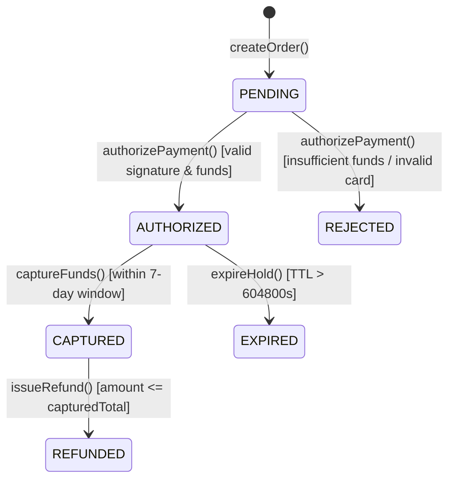

# Zero-Inference Planning & Ground-Truth Reconnaissance Playbook

> **Reference Purpose**: Authoritative reference manual fusing all core doctrines of `research-planner` into `jetski-orchestrator`. Defines how the Lead Orchestrator eliminates subagent hallucinations, architectural drift, and placeholder slop through 360° Requirements Deconstruction, Ground-Truth AST Reconnaissance, Pre-Spawn Contract Freezing, and Spoon-Fed Disjoint Work Packets.

---

## 1. The Zero-Inference Mandate & "Smart Architect, Literal Worker" Principle

Subagents spawned via `invoke_subagent` or `run_workflow` start with a **blank conversation window**, zero institutional memory of earlier user turns, and—when running on fast tiers (`"flash"` or `"flash_lite"`)—narrower causal reasoning depth.

When a subagent encounters an underspecified instruction such as *"Add token validation and handle errors appropriately"*, it does not pause to ask clarifying questions—**it guesses**. Guessing produces four systemic failures:
1. **API Hallucination**: Invents library functions or signatures from outdated training corpora.
2. **Contract Clash**: Invents DTO field names, error classes, or return shapes that fail to integrate with sibling subagents running in parallel.
3. **Silent Error Swallowing**: Wraps failing logic in `try { ... } catch (e) {}` or `except Exception: pass` to make tests appear green.
4. **Placeholder Slop**: Emits `// TODO: implement edge cases`, `pass`, or hardcoded mock returns when algorithmic complexity rises.

> [!IMPORTANT]
> **The Zero-Inference Invariant**: *Never ask a worker subagent to "design", "decide", "figure out", or "handle appropriately".* The Lead Orchestrator acts as the **Senior Staff Architect** who front-loads 100% of cognitive and architectural labor during Waves 1 and 2. Worker subagents act as **strict code-assembly technicians** executing a deterministic blueprint where any two independent subagents following the same Work Packet produce functionally identical code.

---

## 2. Phase 1: 360° Requirements Deconstruction

Before reading or writing code, deconstruct the user's objective across five mandatory dimensions (executed in parallel by **Subagent 1B** during Wave 1):

1. **Atomic Functional Requirements (`REQ-ID`s)**:
   - Assign an immutable identifier (`REQ-001`, `REQ-002`, ...) to every discrete functional behavior, state transformation, calculation, and side effect.
   - Specify exact input schemas, validation rules, output shapes, and persistence guarantees.
2. **Negative Requirements (The "Must NOTs")**:
   - Explicitly list forbidden behaviors, security boundaries, and backward-compatibility invariants (e.g., *"MUST NOT break legacy v1 webhook payload consumers"*, *"MUST NOT log plaintext bearer tokens"*).
3. **Implicit Contracts (Unspoken Engineering Rules)**:
   - Resolve every implicit contract up front:
     - **Nullability & Empty States**: Behavior on `null`, `undefined`, `""`, `[]`, `{}`.
     - **Pagination & Bounds**: Default `limit` (e.g., `20`), maximum `limit` (e.g., `100`), sort order stability, cursor vs. offset semantics.
     - **Timeouts & Retries**: Exact timeout thresholds in milliseconds, exponential backoff jitter parameters, and circuit-breaker thresholds.
     - **Idempotency & Concurrency**: How duplicate requests (`Idempotency-Key`), concurrent balance mutations, or out-of-order events are serialized.
     - **Character Encodings & Timezones**: UTF-8 NFC normalization, UTC ISO-8601 timestamps, integer cents vs. `Decimal` currency representation.
4. **Environmental & Platform Constraints**:
   - Pin runtime versions (Node.js, Python, Go, Rust), OS path conventions (Windows `\` vs. POSIX `/`), shell environment (`pwsh` vs. `bash`), and sandbox restrictions (no external network access during unit tests).
5. **Up-Front Ambiguity Resolution**:
   - Surface every underspecified assumption during Wave 1/Wave 2 and either resolve it via codebase ground truth or ask the user via `ask_question` before spawning Wave 3 workers.

---

## 3. Phase 2: Ground-Truth Codebase Reconnaissance Protocol

Speculation about existing code is strictly forbidden. **Subagent 1A (`Recon-Codebase-AST`)** executes a 5-step ground-truth investigation:

1. **AST & Type Topology Mapping**:
   - Locate all existing domain models, interfaces, database entities, abstract base classes, and dependency injection containers that the new feature will import or extend.
   - Record exact file paths, line numbers, and exported symbol names.
2. **Harvesting 2–3 Canonical Code Exemplars**:
   - Extract verbatim 15–30 line snippets from 2–3 well-written files in the repository that demonstrate:
     - Module import ordering and path alias conventions (`@/lib/...` vs. relative `../`).
     - Error handling and custom exception hierarchy patterns.
     - Structured logging and telemetry conventions.
     - Unit test fixture setup and assertion style.
3. **Pinning Dependency Versions from Manifests**:
   - Read `package.json`, `pyproject.toml`, `requirements.txt`, `go.mod`, or `Cargo.toml`.
   - Record exact major/minor versions of critical libraries (e.g., `zod@3.22`, `pydantic@2.6`, `jose@5.2`, `sqlalchemy@2.0`) so workers never emit deprecated v1 syntax or un-installed packages.
4. **Tooling & Deterministic Command Discovery**:
   - Verify the exact, working CLI commands for:
     - **Linter**: e.g., `npx eslint src/`, `ruff check .`, `golangci-lint run`
     - **Typechecker**: e.g., `npx tsc --noEmit`, `mypy --strict src/`
     - **Targeted Test Runner**: e.g., `npx vitest run <file>`, `pytest <file> -k "<test_name>"`, `go test -v ./pkg/... -run <TestName>`
5. **Identifying Architectural Traps & Fragile Zones**:
   - Flag circular import hazards, global mutable singletons, ORM lazy-loading traps, and shared configuration files that require special isolation.

---

## 4. Phase 3: Contract Freezing & Pre-Spawn Interface Creation

Parallel subagents cannot negotiate interfaces with each other mid-flight. The Lead Orchestrator **must freeze and materialize all shared contracts in Wave 2 before spawning Wave 3**:

### 4.1 Freezing DTOs, Schemas, and Function Prototypes
Write out 100% of shared TypeScript interfaces, Python dataclasses/Pydantic models, Go structs, or database schemas verbatim. Every parameter name, type, optionality modifier, and return type must be locked.

### 4.2 Algorithmic State Machines
For multi-step lifecycles, define explicit state transitions using Mermaid state diagrams and transition tables so workers never invent ad-hoc status flags:



### 4.3 Exhaustive Error Taxonomy Matrix
Every failure condition must map to a deterministic error contract:

| Failure Condition | Error Class / Code | HTTP Status | Exact Message Template | Retriable? |
| :--- | :--- | :---: | :--- | :---: |
| Empty or missing bearer token | `AuthTokenMissingError` (`AUTH_001`) | `401` | `"Authentication token is required"` | No |
| Expired JWT (`exp < now`) | `AuthTokenExpiredError` (`AUTH_002`) | `401` | `"Authentication token has expired"` | No |
| Tenant ID mismatch on resource | `TenantIsolationError` (`AUTH_003`) | `403` | `"Access denied for cross-tenant resource"` | No |
| Upstream Redis lock timeout | `LockAcquisitionTimeoutError` (`SYS_001`) | `503` | `"Resource lock timed out after 3000ms"` | Yes |

### 4.4 Pre-Spawn Shared File Creation & The Barrel/Router Pattern
- **Pre-Create Shared Types**: The Lead Orchestrator writes shared contract files (`src/types/contracts.ts`, `src/errors/taxonomy.ts`) directly in Wave 2. Wave 3 workers receive **read-only** access to those files.
- **Deferred Barrel/Router Wiring**: Never allow two parallel Wave 3 workers to append exports to the same `src/index.ts` or register routes in the same `src/router.ts`. Each worker creates its own self-contained module file; the Lead Orchestrator wires `index.ts` / `router.ts` during **Wave 6 (Holistic Integration)**.

```typescript
// Exemplar: Pre-Created Wave 2 Frozen Contract (src/types/payment.contracts.ts)
// Written by Lead Orchestrator BEFORE spawning Wave 3 workers.
export type PaymentState = 'PENDING' | 'AUTHORIZED' | 'CAPTURED' | 'REJECTED' | 'EXPIRED' | 'REFUNDED';

export interface AuthorizePaymentInput {
  readonly orderId: string;
  readonly tenantId: string;
  readonly amountMinorUnits: number; // Strictly positive integer cents (> 0)
  readonly currency: 'USD' | 'EUR' | 'GBP';
  readonly idempotencyKey: string;
}

export interface AuthorizePaymentResult {
  readonly transactionId: string;
  readonly state: PaymentState;
  readonly authorizedAtIso: string;
}

export interface IPaymentGateway {
  authorize(input: AuthorizePaymentInput): Promise<AuthorizePaymentResult>;
}
```

---

## 5. Phase 4: Spoon-Fed Task Decomposition & Disjoint File Ownership

### 5.1 Atomic Sizing & Mathematical Disjointness Heuristics
- **Single Responsibility**: One logical component per Work Packet.
- **File Blast Radius**: Maximum **1–2 files created or modified** per Work Packet.
- **Code Volume Cap**: Maximum **100–150 lines of production code** per Work Packet.
- **Zero In-Flight Cross-Task Dependencies**: Wave 3 parallel packets must depend *only* on Wave 2 pre-created contracts, never on un-written output from another concurrent Wave 3 packet.
- **Strict File Disjointness Invariant**: Across all concurrent Work Packets $WP_1, \dots, WP_K$ sharing an `"inherit"` workspace:
  $$\text{WriteFiles}(WP_i) \cap \text{WriteFiles}(WP_j) = \emptyset \quad \forall i \neq j$$

| Work Packet ID | Assigned Persona / Model | Allowed Write Files (`WriteFiles`) | Read-Only Dependencies (`ReadFiles`) | Wave 6 Deferred Wiring Target |
| :--- | :--- | :--- | :--- | :--- |
| **`WP-1`** | `self` (`"inherit"`) | `src/payment/authorizer.ts`<br>`tests/unit/authorizer.test.ts` | `src/types/payment.contracts.ts`<br>`src/errors/taxonomy.ts` | `src/payment/index.ts` |
| **`WP-2`** | `self` (`"flash"`) | `src/payment/idempotency-store.ts`<br>`tests/unit/idempotency-store.test.ts` | `src/types/payment.contracts.ts`<br>`src/errors/taxonomy.ts` | `src/payment/index.ts` |
| **`WP-Verify`** | `self` (`"flash"`) | `tests/verification/payment.rtm.test.ts` | `src/types/payment.contracts.ts` | `package.json` test script |
| **`WP-Corner`** | `self` (`"inherit"`) | `tests/corner_cases/payment.corner.test.ts` | `src/types/payment.contracts.ts` | `package.json` test script |

### 5.2 Surgical Insertion Anchor Exemplar (For Modifying Existing Files)
When a Work Packet must edit an existing file, always provide exact line numbers plus 3 lines of before/after context so the subagent never loses spatial orientation:

```markdown
#### Target File: `src/services/quota-manager.ts` (Lines 42–50)
Replace the existing `checkQuota` guard block:
<<< BEFORE CONTEXT (Lines 42-45) >>>
export async function enforceTenantQuota(tenantId: string, requestedUnits: number): Promise<void> {
  if (!tenantId) {
    throw new ValidationError('TENANT_ID_REQUIRED');
  }
<<< INSERT IMMEDIATELY AFTER LINE 45 >>>
  if (!Number.isSafeInteger(requestedUnits) || requestedUnits <= 0) {
    throw new ValidationError('INVALID_QUOTA_UNITS');
  }
<<< AFTER CONTEXT (Lines 46-50) >>>
  const currentUsage = await quotaRepo.getUsage(tenantId);
  if (currentUsage + requestedUnits > MAX_TENANT_QUOTA) {
```

### 5.2 Forbidden Vague Language Matrix (Enforced by `validate-spec`)

| Forbidden Vague Phrase (REJECTED) | Required Zero-Inference Replacement (MANDATORY) |
| :--- | :--- |
| *"Handle errors appropriately / gracefully"* | *"Catch `JoseError`, log at `WARN` with `{ requestId }`, and throw `new AuthTokenInvalidError('AUTH_004')`."* |
| *"Validate the input fields as needed"* | *"Validate `email` against RFC 5322 regex, trim whitespace, and reject strings $> 254$ chars with HTTP 400."* |
| *"Use a reasonable timeout / cache TTL"* | *"Set `timeoutMs: 3000` and Redis TTL `EX 86400` (24 hours)."* |
| *"Add unit tests for edge cases, etc."* | *"Implement 4 test functions testing `0`, `-1`, `Number.MAX_SAFE_INTEGER`, and `NaN` inputs."* |
| *"Update related files if necessary"* | *"Modify ONLY `src/services/quota.ts` (lines 40–85). Touching any other file is a Gate 1 violation."* |

### 5.3 The 6-Point Zero-Inference Readiness Gate Checklist
Before dispatching any Work Packet to a subagent, verify all 6 criteria pass:
- [ ] **1. Explicit File Whitelist**: Are `ALLOWED_FILES` and `READ_ONLY_FILES` listed with exact paths, and all other files explicitly forbidden?
- [ ] **2. Surgical Line Anchors**: For existing files, are exact line numbers and 3–5 surrounding context lines provided?
- [ ] **3. Linear Procedural Recipe**: Is every branch, loop, and edge case spelled out in numbered step-by-step instructions?
- [ ] **4. Pinned Verbatim Imports & Signatures**: Are all import statements and type definitions provided verbatim from Wave 1/2 recon?
- [ ] **5. Explicit Anti-Slop Ban**: Does the packet ban `TODO`, `FIXME`, `pass`, `any`, `@ts-ignore`, `# type: ignore`, and empty `catch` blocks?
- [ ] **6. Deterministic Verification Command**: Is there an exact, copy-pasteable shell command that exits `0` only when the unit works?

---

## 6. Low-Tier & Subagent Hazard Immunization Matrix

| # | Subagent / Low-Tier Model Hazard | Typical Symptom in Unchecked Swarms | Lead Orchestrator's Immunization Tactic |
| :-: | :--- | :--- | :--- |
| **1** | **Architectural Drift** | Worker invents new helper folders, renames contract fields, or duplicates utilities. | Pre-create shared contract files in Wave 2; lock exact file paths and exported symbol signatures in the packet. |
| **2** | **API & Version Hallucination** | Worker imports non-existent methods or mixes v1/v2 library syntax. | Inspect `package.json` / `pyproject.toml` in Wave 1A and provide verbatim copy-paste import blocks in every packet. |
| **3** | **Placeholder Slop & Stubbing** | Emits `// TODO: implement`, `pass`, `unimplemented!()`, or hardcoded dummy return values. | Keep functions $\le 30$ LOC; provide complete algorithmic pseudo-code; run `jetski_orchestrator.py audit-diff` in Gate 2. |
| **4** | **Context Collapse & File Truncation** | Editing a 600-line file causes the worker to drop existing methods or exports. | Provide exact line-range anchors for `edit_file`; split large modules into smaller cohesive files. |
| **5** | **Scope Creep & Collateral Edits** | Worker reformats unrelated files or edits shared barrel/config files concurrently. | Enforce the Disjoint File Ownership Matrix and audit `git status --porcelain` in Gate 1 (`validate-packets`). |
| **6** | **Type Suppression Bypass** | Uses `as any`, `@ts-ignore`, or `# type: ignore` to silence compiler errors. | Pre-define all complex generics in Wave 2; ban suppression directives in Gate 2; run `tsc --noEmit` / `mypy --strict`. |
| **7** | **Silent Exception Swallowing** | Wraps failing logic in `try { ... } catch {}` returning `null` or `false`. | Provide the Exhaustive Error Taxonomy Matrix specifying the exact exception class to instantiate and throw on each branch. |
| **8** | **Off-by-One & Boundary Blindness** | Handles nominal inputs but crashes on `0`, `""`, `[]`, `null`, or Unicode astral emojis. | Embed the 10-Dimension Corner-Case checklist directly in the packet and pair with an independent `WP-Corner` subagent. |
| **9** | **Self-Defeating / Mocked-Out Tests** | Worker mocks the function under test or asserts `expect(res).toBeDefined()`. | Separate feature implementation (`WP-1..K`) from verification/corner-case test synthesis (`WP-Verify` & `WP-Corner`), and enforce Mutation Sanity Checks. |
| **10** | **Infinite Compiler Error Spiral** | Worker makes random syntax edits when a build fails, compounding errors. | Cap reassignment at 3 attempts via the **3-Strike Circuit Breaker**; escalate on Strike 3 to `"pro"` or Lead Orchestrator. |

---

## 7. The 7 Structural Defenses Against Lower-Tier / "Dumb" Subagents

When delegating to lower-tier, small-parameter, or literal subagents (`"flash_lite"`, `"flash"`, or high-fan-out worker swarms), cognitive overload, attention decay ("lost in the middle"), API hallucination, and lazy shortcut-taking increase sharply. Enforce these **7 Structural Defenses** to make failure mechanically impossible:

### 7.1 Skeleton-First "Fill-in-the-Blank" Pre-Scaffolding
Weak subagents frequently corrupt imports, misspell exported function signatures, or break module structure when creating files from scratch.
- **Tactic**: During Wave 2, the Lead Orchestrator pre-creates the target source file skeleton containing 100% of imports, frozen type annotations, class/function signatures, and explicit fill-in-the-blank anchor markers:
  ```python
  # === [ANCHOR: IMPLEMENT calculate_prorated_invoice START] ===
  raise NotImplementedError("Subagent must implement lines between START and END anchors")
  # === [ANCHOR: IMPLEMENT calculate_prorated_invoice END] ===
  ```
- **Enforcement**: Validate with `jetski_orchestrator.py validate-spec --strict-literal` and lock test harnesses via `jetski_orchestrator.py lock-tests`. The worker subagent only replaces the `<= 50–80 LOC` block inside the anchors.

### 7.2 Zero-Navigation Context Inlining
Never expect a weak subagent to search the codebase, resolve transitive imports, or infer project conventions by reading other files.
- **Tactic**: Inline **100% of required context directly inside the Work Packet prompt**:
  1. Verbatim copy-pasteable import block.
  2. Verbatim definitions of all consumed DTOs, interfaces, and custom error classes.
  3. A 15–30 line canonical code exemplar copied from the repository demonstrating the exact logging, error-handling, and coding style required.

### 7.3 Concrete `Input -> Output` Truth Tables (Few-Shot I/O Examples)
Lower-tier models struggle to translate abstract prose specifications into boolean branching logic, often inverting `<` vs. `<=` or misordering guard clauses.
- **Tactic**: Replace abstract prose rules with explicit **Input $\rightarrow$ Expected Return / Exception Truth Tables** containing 4–6 concrete literal input vectors:

| # | Concrete Input Vector (`args`) | Condition Triggered | Exact Expected Return Value or Raised Exception |
| :-: | :--- | :--- | :--- |
| `1` | `amount=0, currency="USD"` | Zero boundary guard | Raises `ValidationError(code="ERR_ZERO_AMOUNT")` |
| `2` | `amount=-50, currency="USD"` | Negative boundary guard | Raises `ValidationError(code="ERR_NEGATIVE_AMOUNT")` |
| `3` | `amount=1050, currency="JPY"` | Unsupported currency | Raises `ValidationError(code="ERR_CURRENCY_UNSUPPORTED")` |
| `4` | `amount=1050, currency="USD"` | Nominal happy path | Returns `Receipt(net_cents=1020, fee_cents=30, status="SETTLED")` |

### 7.4 Sandwich Prompt Architecture (Top / Bottom Attention Framing)
Transformer attention heads exhibit a U-shaped retrieval curve: instructions at the very beginning and very end of a prompt receive maximum attention weight, while constraints buried in the middle decay ("Lost in the Middle").
- **Tactic**: Structure every Work Packet as a **3-Layer Attention Sandwich**:
  - **Top Bread (First 15 Lines)**: Mission statement, strict `ALLOWED_WRITE_FILES` lock, and exact target anchor range.
  - **Middle Filling**: Inlined types, Input $\rightarrow$ Output Truth Table, linear step-by-step recipe, and 15–30 line code exemplar.
  - **Bottom Bread (Last 15 Lines)**: Repeat the **5 Non-Negotiable Hard Rules** (Zero out-of-scope file edits, Zero `TODO`/stubs, Zero test modifications, Zero `any`/`@ts-ignore`, Exact verification command) + the mandatory `send_message` reporting instruction.

### 7.5 Micro-Packet Sizing Cap for Weak Models
When routing tasks to `"flash_lite"`, `"flash"`, or lower-capacity subagents, shrink packet granularity below the standard 150 LOC ceiling:
- **Maximum 1 file modified** per Work Packet.
- **Maximum 60–80 lines of code** written or changed per Work Packet.
- **Maximum 1–2 functions/methods** implemented per Work Packet.
- **Cyclomatic Complexity Cap**: Flatten nested conditionals into linear guard clauses (`if (...) throw/return;`).

### 7.6 Pre-Written & Checksum-Locked Test Harness (`lock-tests`)
Never allow a weak model to write both the production implementation and its own verification test in the same packet—it will inevitably write tautological tests or weaken assertions when its code fails.
- **Tactic**: Pre-author the test suite (or have `WP-Verify` / `WP-Corner` author it in a separate packet) and lock its SHA-256 checksum and assertion count using `jetski_orchestrator.py lock-tests --manifest .test-locks.json` before the implementation worker runs.

### 7.7 Literal Drop-In Replacement Remediation & Fast Promotion
When a lower-tier subagent fails an audit gate, abstract feedback like *"Fix the race condition in `acquire()`"* causes random thrashing.
- **Tactic**: On **Strike 1**, send the exact literal replacement code block with `file:line` context via `send_message`. If the weak subagent fails again on **Strike 2**, immediately terminate it (`manage_subagents(Action="kill")`) and either **promote** the packet to `"inherit"` / `"pro"` or **bisect** the packet into two 30-LOC micro-packets.
