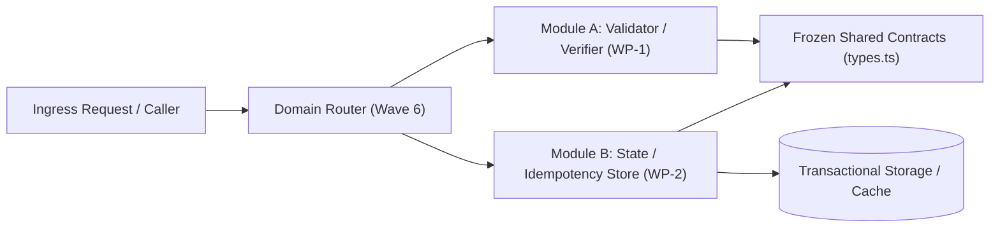
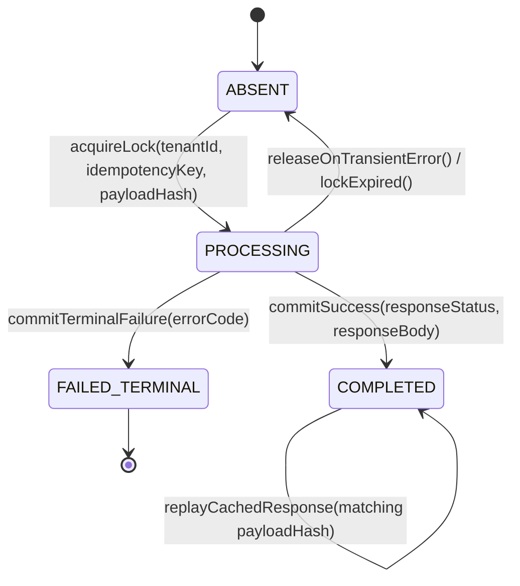
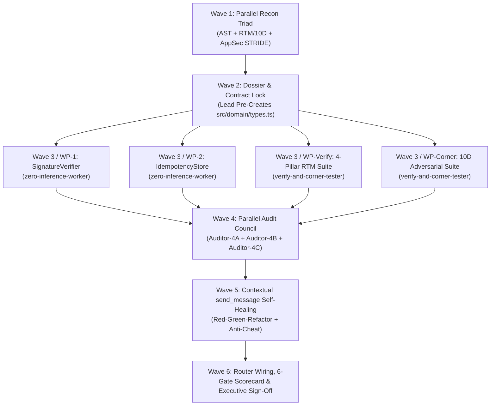

# Master Orchestration Dossier: <Project / Feature Name>

> **Lead Orchestrator**: `jetski-cli` Principal Orchestration Engine  
> **Dossier Status**: `DRAFT` | `RECON_COMPLETE` | `CONTRACTS_FROZEN` | `VERIFIED_READY`  
> **Target Branch**: `<branch-name>`  
> **Timestamp**: `<YYYY-MM-DDTHH:MM:SSZ>`  

---

## Section 1: Executive Objective & 360° Requirements Breakdown

### 1.1 Executive Objective
<Concise 2-3 sentence statement of the engineering objective, business invariant, and architectural target.>

### 1.2 Functional Requirements (`REQ-ID`s)
| Requirement ID | Category | Priority | Functional Specification |
| :--- | :--- | :---: | :--- |
| `REQ-001` | Core Domain | P0 | <Exact functional requirement statement with measurable criteria> |
| `REQ-002` | Persistence / State | P0 | <Exact state transition, idempotency, or storage requirement> |
| `REQ-003` | API / Transport | P0 | <Exact request/response schema, headers, and status code contract> |
| `REQ-004` | Observability / Audit | P1 | <Structured telemetry, audit trail, and deterministic error reporting> |

### 1.3 Negative "Must NOT" Requirements (Invariants & Explicit Non-Goals)
- **`NEG-001` (Cross-Tenant Isolation)**: The system MUST NOT return, mutate, or leak records across tenant boundaries under any query permutation.
- **`NEG-002` (Secret & PII Exposure)**: The system MUST NOT log raw cryptographic keys, HMAC secrets, bearer tokens, or unmasked PII in error messages or telemetry sinks.
- **`NEG-003` (Blocking I/O & Unbounded Memory)**: The system MUST NOT execute unbounded collection scans or synchronous blocking calls on the event loop.
- **`NEG-004` (Scope Boundary)**: <Explicit non-goal out of scope for this orchestration cycle>.

### 1.4 Implicit Engineering Contracts
- **Idempotency & Retry Safety**: All state-mutating operations must be safe under network retries using deterministic idempotency keys.
- **Backward Compatibility**: Public wire formats and existing database columns remain non-breaking.
- **Deterministic Time & Randomness**: Time-sensitive logic accepts an injected clock/timestamp provider for deterministic testing.

### 1.5 Ground-Truth Recon Summary
- **Language & Runtime**: `<e.g., TypeScript 5.4 / Node.js 20 LTS | Python 3.12 | Go 1.22>`
- **Framework & ORM**: `<e.g., Fastify 4.x + Prisma | FastAPI + SQLAlchemy 2.0>`
- **Existing Naming & Error Conventions**: `<Observed error base class, logger utility, and module export style>`
- **Pinned Third-Party Dependencies**: `<Exact packages and versions verified in lockfile>`

### 1.6 Deterministic Build, Lint, Typecheck & Test Commands
```pwsh
# Typecheck Command
<exact-typecheck-command, e.g., pnpm run typecheck>

# Lint Command
<exact-lint-command, e.g., pnpm run lint>

# Unit & Integration Test Command
<exact-test-command, e.g., pnpm test -- --run>
```

---

## Section 2: Architecture & File Manifest

### 2.1 Module Directory Map
```text
<project-root>/
├── src/
│   ├── <domain>/
│   │   ├── types.ts                # [FROZEN CONTRACT - Pre-Created by Lead Orchestrator in Wave 2]
│   │   ├── <module-a>.ts           # [WP-1 Exclusive Write Target]
│   │   ├── <module-b>.ts           # [WP-2 Exclusive Write Target]
│   │   └── index.ts                # [Wave 6 Lead Orchestrator Integration Target]
└── tests/
    ├── acceptance/
    │   └── <domain>.rtm.test.ts    # [WP-Verify Exclusive Write Target]
    └── adversarial/
        └── <domain>.corner.test.ts # [WP-Corner Exclusive Write Target]
```

### 2.2 Component & Data-Flow Architecture Diagram


### 2.3 Shared Contract Files Pre-Created by Lead Orchestrator
| File Path | Purpose | Mutability Lock |
| :--- | :--- | :---: |
| `<src/domain/types.ts>` | Frozen interfaces, DTOs, error classes, and constants shared across all Work Packets | **LOCKED BEFORE WAVE 3** (Read-Only for all workers) |

---

## Section 3: Frozen Data Contracts, Interfaces & Algorithmic State Machine

### 3.1 Exact Interfaces & DTO Definitions
```typescript
// Frozen Contract: <src/domain/types.ts>
// Zero ambiguous fields. All types, nullabilities, and readonly modifiers explicitly pinned.

export type ExecutionStatus = "PENDING" | "PROCESSING" | "COMPLETED" | "FAILED_TERMINAL";

export interface DomainRequestPayload {
  readonly tenantId: string;
  readonly idempotencyKey: string;
  readonly timestampMs: number;
  readonly payloadHash: string;
  readonly rawBody: string;
}

export interface DomainExecutionRecord {
  readonly tenantId: string;
  readonly idempotencyKey: string;
  readonly status: ExecutionStatus;
  readonly payloadHash: string;
  readonly responseStatus: number | null;
  readonly responseBody: string | null;
  readonly expiresAtMs: number;
}

export interface DomainServiceContract {
  execute(request: DomainRequestPayload): Promise<DomainExecutionRecord>;
}
```

### 3.2 Algorithmic State Machine (`stateDiagram-v2`)


### 3.3 Exhaustive Error & Edge Case Matrix
| Error Code | HTTP Status | Exception Class | Trigger Condition | Deterministic Message Contract |
| :--- | :---: | :--- | :--- | :--- |
| `ERR_INVALID_SIGNATURE` | `401` | `SignatureVerificationError` | Missing header, malformed hex, or HMAC mismatch | `"Cryptographic signature verification failed."` |
| `ERR_STALE_TIMESTAMP` | `401` | `ReplayWindowExpiredError` | `abs(nowMs - timestampMs) > toleranceWindowMs` | `"Request timestamp outside replay tolerance window."` |
| `ERR_IDEMPOTENCY_CONFLICT` | `409` | `IdempotencyConflictError` | Same `(tenantId, idempotencyKey)` re-sent with different `payloadHash` | `"Idempotency key already bound to a different payload."` |
| `ERR_CONCURRENT_IN_FLIGHT` | `409` | `ConcurrentExecutionError` | Record is currently in `PROCESSING` state with active lock | `"Request with this idempotency key is currently in flight."` |
| `ERR_STORAGE_UNAVAILABLE` | `503` | `StorageUnavailableError` | Backing store timeout or connection drop | `"State store unavailable; fail-closed policy enforced."` |

---

## Section 4: Verification & Test Plan — Bidirectional RTM ($\ge 90\%$ 4-Pillar Coverage)

> **Target Coverage Mandate**: $\ge 90.0\%$ of all Acceptance Criteria mapped and verified across the 4 Weighted Verification Pillars:
> - **Pillar 1: Golden Happy Paths (`Happy 40%`)**
> - **Pillar 2: Alternate Valid Branches (`Alternate 30%`)**
> - **Pillar 3: Standard Error & Rejection Flows (`Error 20%`)**
> - **Pillar 4: End-to-End Lifecycle & Integration Flows (`E2E 10%`)**

| `REQ-ID` | `AC-ID` & Acceptance Criteria (`Given-When-Then`) | Verification Pillar | `TC-ID` & Automated Test Function | Status |
| :--- | :--- | :---: | :--- | :---: |
| `REQ-001` | **`AC-001`**: **Given** a valid tenant secret and fresh timestamp, **When** `verifySignature` is called, **Then** it returns `true` in constant time. | `Happy 40%` | `TC-001`: `test_verify_signature_valid_payload` | `<MAPPED>` |
| `REQ-002` | **`AC-002`**: **Given** a first-time `(tenantId, idempotencyKey)`, **When** `processRequest` executes, **Then** it transitions `ABSENT -> PROCESSING -> COMPLETED` and stores the response. | `Happy 40%` | `TC-002`: `test_first_time_request_commits_completed` | `<MAPPED>` |
| `REQ-002` | **`AC-003`**: **Given** a `COMPLETED` record with matching `payloadHash`, **When** a duplicate request arrives, **Then** it returns the cached response without re-invoking the downstream handler. | `Alternate 30%` | `TC-003`: `test_duplicate_request_replays_cached_response` | `<MAPPED>` |
| `REQ-002` | **`AC-004`**: **Given** an expired record (`nowMs >= expiresAtMs`), **When** a new request arrives with the same key, **Then** it purges the expired entry and processes as a fresh request. | `Alternate 30%` | `TC-004`: `test_expired_idempotency_record_reprocessed` | `<MAPPED>` |
| `REQ-001` | **`AC-005`**: **Given** a tampered body or wrong tenant secret, **When** `verifySignature` is called, **Then** it throws `SignatureVerificationError` (`HTTP 401`). | `Error 20%` | `TC-005`: `test_tampered_payload_throws_401` | `<MAPPED>` |
| `REQ-002` | **`AC-006`**: **Given** an existing key with a mutated `payloadHash`, **When** `processRequest` is invoked, **Then** it throws `IdempotencyConflictError` (`HTTP 409`). | `Error 20%` | `TC-006`: `test_mutated_payload_same_key_throws_409` | `<MAPPED>` |
| `REQ-003` | **`AC-007`**: **Given** the full ingress pipeline, **When** a signed multi-tenant webhook is posted, replayed, and audited, **Then** the end-to-end HTTP lifecycle returns `200 OK` with idempotent headers. | `E2E 10%` | `TC-007`: `test_e2e_webhook_ingress_and_idempotent_replay` | `<MAPPED>` |

---

## Section 5: Adversarial 10-Dimension Corner-Case Matrix

| Dimension | Case ID | Trigger Vector / Adversarial Input | Expected System Invariant | Automated Test Function |
| :--- | :---: | :--- | :--- | :--- |
| **DIM-1: Numeric & Boundary** | `CC-001` | `timestampMs = 0`, `-1`, `NaN`, `Number.MAX_SAFE_INTEGER`, or `-Infinity` | Reject immediately with `ReplayWindowExpiredError` (`401`); zero arithmetic overflow | `test_dim1_numeric_timestamp_extremes` |
| **DIM-2: String & Encoding** | `CC-002` | Signature or tenant ID containing null bytes `\x00`, non-hex UTF-8 astral symbols, or odd-length hex | Reject cleanly without throwing unhandled `RangeError` in buffer decoding | `test_dim2_string_null_bytes_and_odd_hex` |
| **DIM-3: Collection & Capacity** | `CC-003` | Batch payload or header map exceeding maximum allowed keys (`> 10,000` entries) | Enforce deterministic size cap before parsing; reject with `413 Payload Too Large` | `test_dim3_collection_capacity_bounds` |
| **DIM-4: Nullability & Schema** | `CC-004` | `rawBody = ""`, `null`, `undefined`, or missing required `tenantId` / `idempotencyKey` fields | Reject at boundary validation with structured `400 Bad Request` | `test_dim4_null_undefined_empty_inputs` |
| **DIM-5: Concurrency & Race** | `CC-005` | 20 parallel fibers arriving at the exact same millisecond with identical `(tenantId, idempotencyKey)` | Atomic compare-and-set ensures exactly 1 execution and 19 `409` or cached responses; zero double-execution | `test_dim5_parallel_race_atomic_cas` |
| **DIM-6: State Inversion** | `CC-006` | Calling `commitSuccess` on a record already in `FAILED_TERMINAL` or `ABSENT` state | Reject illegal state transition with `IllegalStateTransitionError` | `test_dim6_illegal_state_transition_rejected` |
| **DIM-7: Resource & I/O Faults** | `CC-007` | Downstream handler throws midway or storage adapter times out during lock acquisition | Release transient lock cleanly (`PROCESSING -> ABSENT`) so future retries succeed; fail closed on storage outage | `test_dim7_handler_failure_releases_lock` |
| **DIM-8: Time & Clock Skew** | `CC-008` | Future-dated timestamp within tolerance (`+299s`) vs outside tolerance (`+301s`) across leap/epoch boundary | Accept within exact window `<= 300_000ms`; reject at `300_001ms` | `test_dim8_clock_skew_boundary_precision` |
| **DIM-9: Cross-Tenant Isolation** | `CC-009` | Tenant B replays an `idempotencyKey` already committed by Tenant A | Composite key `(tenantId, idempotencyKey)` isolates namespaces; Tenant B executes independently without reading Tenant A data | `test_dim9_cross_tenant_key_isolation` |
| **DIM-10: Injection & Crypto** | `CC-010` | Timing side-channel attack on HMAC comparison or SQL/NoSQL meta-characters in `idempotencyKey` | Enforce `crypto.timingSafeEqual` with equal-length buffers and parameterized key binding | `test_dim10_timing_safe_hmac_and_injection` |

---

## Section 6: AppSec STRIDE Threat Model & Source-to-Sink Taint Matrix

### 6.1 STRIDE Threat Model
| STRIDE Category | Threat Vector | Target Component | Mandatory Mitigation Control | Verification Test |
| :--- | :--- | :--- | :--- | :--- |
| **S — Spoofing** | Forged webhook ingress without valid tenant HMAC secret | `SignatureVerifier` (`WP-1`) | Per-tenant HMAC-SHA256 verification over `<timestamp>.<rawBody>` using `timingSafeEqual` | `test_tampered_payload_throws_401` |
| **T — Tampering** | Replaying an existing `idempotencyKey` with a modified payment amount | `IdempotencyStore` (`WP-2`) | SHA-256 `payloadHash` comparison; throw `IdempotencyConflictError` (`409`) on mismatch | `test_mutated_payload_same_key_throws_409` |
| **R — Repudiation** | Disputed state mutation without verifiable audit correlation | `DomainRouter` (`Wave 6`) | Structured audit log recording `tenantId`, `idempotencyKey`, `payloadHash`, and decision outcome | `test_e2e_webhook_ingress_and_idempotent_replay` |
| **I — Information Disclosure** | Timing side-channel via `===` string comparison or cross-tenant cache collision | `SignatureVerifier` / `IdempotencyStore` | Constant-time buffer comparison + strict `(tenantId, idempotencyKey)` composite partitioning | `test_dim9_cross_tenant_key_isolation` |
| **D — Denial of Service** | Replay flood or oversized body exhausting memory / lock table | Ingress / `SignatureVerifier` | Payload byte-length cap + replay timestamp window check before expensive storage lookups | `test_dim3_collection_capacity_bounds` |
| **E — Elevation of Privilege** | Tenant ID injection via body override instead of authenticated route context | `DomainRouter` (`Wave 6`) | Bind `tenantId` exclusively from verified credential context, never from unverified JSON body | `test_dim10_timing_safe_hmac_and_injection` |

### 6.2 Source-to-Sink Taint Matrix
| Untrusted Source | Tainted Symbol | Sanitizer / Validator Function | Target Sink | Security Invariant |
| :--- | :--- | :--- | :--- | :--- |
| HTTP Header `x-signature-hmac` | `rawSignatureHeader` | `validateHexFormat()` + `timingSafeEqual()` | Crypto HMAC Verifier | Buffer lengths checked prior to `timingSafeEqual`; non-hex rejected |
| HTTP Header `x-idempotency-key` | `idempotencyKey` | `validateIdempotencyKeyRegex(/^[a-zA-Z0-9_-]{8,128}$/)` | State Store Key Lookup | Parameterized lookup prefixed by `tenantId`; zero raw string interpolation |
| HTTP Raw Request Body | `rawBody` | Byte-length limit + HMAC verification before `JSON.parse` | Domain Handler & SHA-256 Digest | Never parsed or executed before cryptographic authenticity is proven |

---

## Section 7: Parallel Execution DAG & Disjoint File Ownership Matrix

### 7.1 Wave Execution DAG


### 7.2 Disjoint File Ownership Matrix (Zero Write Overlap)
| Work Packet ID | Assigned Subagent Role | Model Tier | Workspace Mode | Exclusive Allowed Write Files (Disjoint Lock) | Read-Only Reference Files |
| :--- | :--- | :---: | :---: | :--- | :--- |
| **`WP-1`** | `zero-inference-worker` | `inherit` | `inherit` | `<src/domain/signature-verifier.ts>`<br>`<tests/unit/signature-verifier.test.ts>` | `<src/domain/types.ts>` |
| **`WP-2`** | `zero-inference-worker` | `inherit` | `inherit` | `<src/domain/idempotency-store.ts>`<br>`<tests/unit/idempotency-store.test.ts>` | `<src/domain/types.ts>` |
| **`WP-Verify`** | `verify-and-corner-tester` | `inherit` | `inherit` | `<tests/acceptance/domain.rtm.test.ts>` | `<src/domain/types.ts>`<br>`<src/domain/signature-verifier.ts>`<br>`<src/domain/idempotency-store.ts>` |
| **`WP-Corner`** | `verify-and-corner-tester` | `inherit` | `inherit` | `<tests/adversarial/domain.corner.test.ts>` | `<src/domain/types.ts>`<br>`<src/domain/signature-verifier.ts>`<br>`<src/domain/idempotency-store.ts>` |
| **`Wave-6-Lead`** | Lead Orchestrator | `inherit` | `inherit` | `<src/domain/index.ts>`<br>`<docs/executive-signoff-report.md>` | All project files |
