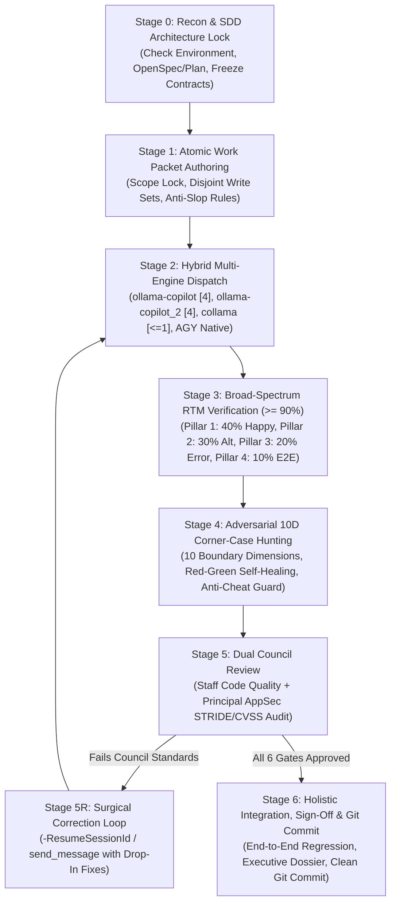

# Magic Orchestrator: The Omni-Disciplinary Master Orchestration System

> **Version**: `2.0.0-perfect`  
> **Engine Compatibility**: Antigravity CLI (`agy`), Antigravity IDE, GitHub Copilot CLI (`collama`, `ollama-copilot`, `ollama-copilot_2`), Python 3.8+, PowerShell Core (pwsh 7+)  
> **Core Architecture**: Spec-Driven Architecture Lock + Hybrid Multi-Engine Parallel Dispatch + 6-Gate Audit Council + Autonomous Red-Green Self-Healing + Mandatory VCS  

---

## Executive Overview

The **Magic Orchestrator** is an enterprise-grade, zero-leakage multi-agent orchestration framework designed to eliminate the compounding failure modes of autonomous AI software development.

### The Problem It Solves
When autonomous AI models are asked to execute complex engineering tasks in isolation:
1. **Context Blindness & Hallucination**: Small and mid-tier models guess architectural conventions, create conflicting data schemas, and hallucinate APIs.
2. **Boundary Pollution**: Uncoordinated parallel subagents overwrite shared files, break imports, and stomp on Git commits.
3. **The Happy-Path Trap**: Agents declare victory after testing only nominal cases, leaving edge cases, standard errors, and alternate branches unhandled.
4. **Silent Failure & Vulnerability Injection**: Slop shortcuts (`// TODO: implement later`, `# pass`, swallowed exceptions, mocked returns) and OWASP vulnerabilities (BOLA, SSRF, prompt injection) slip into production code.
5. **Human Debugging Burden**: When subagents fail, developers are forced to manually diagnose and repair bugs.

### The Solution: Magic Orchestrator
The Magic Orchestrator unites all 6 core software engineering disciplines into a cohesive, self-healing pipeline:

```
┌────────────────────────────────────────────────────────────────────────────────────────┐
│                                   MAGIC ORCHESTRATOR                                   │
├──────────────────────────┬─────────────────────────────┬───────────────────────────────┤
│ 1. RESEARCH & ARCH       │ 2. HYBRID FLEET ROUTING     │ 3. BROAD-SPECTRUM VERIFY      │
│ • Zero-Inference Spec    │ • collama (<=1 Concurrency) │ • Bidirectional RTM           │
│ • Contract Freezing      │ • ollama-copilot (Default 4)│ • 90%+ 4-Pillar Coverage      │
│ • Atomic Work Packets    │ • ollama-copilot_2 (4)      │ • Golden / Alt / Error / E2E  │
│ • SDD / OpenSpec         │ • AGY Subagents (Pro/Flash) │ • Schema & Contract Locks     │
├──────────────────────────┼─────────────────────────────┼───────────────────────────────┤
│ 4. CORNER-CASE HEALING   │ 5. DUAL COUNCIL REVIEW      │ 6. AUTHORITATIVE SIGN-OFF     │
│ • 10 Boundary Dimensions │ • Staff Code Quality Review │ • Holistic Integration        │
│ • Red-Green-Refactor     │ • Principal AppSec (STRIDE) │ • Executive Sign-Off Dossier  │
│ • Anti-Cheat Audit       │ • OWASP (Web/API/LLM)       │ • Mandatory Git Commit        │
│ • Zero Regressions       │ • Drop-In Hardened Fixes    │ • tasks.md Completion Check   │
└──────────────────────────┴─────────────────────────────┴───────────────────────────────┘
```

---

## Skill Fusion Matrix: How Child Skills Are Harmonized

| Skill Unified | Core Superpower Injected into Magic-Orchestrator | Operational Stage |
| :--- | :--- | :--- |
| **`research-planner`** | Zero-Inference Mandate, Ground-Truth Reconnaissance, Spoon-Fed Micro-Packets, Interface Freezing | **Stage 0 & Stage 1** |
| **`parallel-subagent-orchestrator`** | Strict Responsibility Scope Locks, Disjoint Write Paths, 4-Gate Audit Protocol, Reassignment Loop | **Stage 1, 2 & 5** |
| **`copilot-subagent-orchestrator`** | Multi-Engine Fleet Routing, `collama` TPM/RPM clamp ($\le 1$), `ollama-copilot` / `ollama-copilot_2` parallel subagents, auto-failover, `-ResumeSessionId` | **Stage 0 & Stage 2** |
| **`verify-tester`** | Bidirectional Requirements Traceability Matrix (RTM), 90%+ Scenario Coverage Mandate, Four Coverage Pillars | **Stage 3** |
| **`corner-case-tester`** | 10 Corner-Case Dimensions, Adversarial Test-First Imperative, Automated Red-Green-Refactor Healing Loop, Anti-Cheat Invariants | **Stage 4** |
| **`code-reviewer`** | Staff-level Code Review, 6 Immutable Doctrines, Zero Nitpick Domination, Drop-In Replacement Solutions, Concurrency & Scalability Safety | **Stage 5** |
| **`security-reviewer`** | Offensive AppSec Engineering, STRIDE Threat Modeling, Taint Tracking (Source $\rightarrow$ Sink), OWASP Top 10 (Web, API, LLM), CVSS v3.1/v4.0 Scoring | **Stage 5** |

---

## The 7-Stage Orchestration Lifecycle



---

## Directory & File Structure

```
magic-orchestrator/
├── SKILL.md                                 # Authoritative Antigravity skill specification
├── README.md                                # Architectural overview & operational guide
├── references/
│   ├── orchestration-lifecycle.md          # Deep dive into the 7-stage master lifecycle
│   ├── hybrid-engine-routing.md             # Engine rules: collama, ollama-copilot, AGY subagents
│   ├── multi-disciplinary-audit-council.md  # 6-Gate audit scoring rubric & criteria
│   └── self-healing-and-circuit-breakers.md # Red-Green-Refactor loop & anti-cheat invariants
├── templates/
│   ├── master-orchestration-dossier.md      # Blueprint combining Proposal, Spec, RTM, 10D Matrix
│   ├── atomic-work-packet.md               # Zero-inference task packet with responsibility boundaries
│   ├── council-audit-scorecard.md           # 6-Gate unified scoring matrix
│   ├── executive-signoff-dossier.md         # Final executive summary & verification metrics
│   └── correction-directive.md             # Surgical correction message for subagents / resume sessions
├── scripts/
│   ├── magic_orchestrator.ps1              # Windows PowerShell master orchestrator CLI
│   ├── magic_orchestrator.py               # Cross-platform Python master orchestrator CLI
│   ├── remediation_runner.py               # Autonomous Red-Green self-healing test controller
│   └── orchestrate_workflow.py             # Antigravity run_workflow integration script
└── examples/
    └── full-lifecycle-example.md            # Complete real-world walkthrough from prompt to git commit
```

---

## Quick Start Guide

### 1. Environment & Engine Health Probe
Verify your environment, installed SDD tools, Git status, and Copilot CLI engines:
```powershell
pwsh .agents/skills/magic-orchestrator/scripts/magic_orchestrator.ps1 -CheckEnvironment
```
Or via Python:
```bash
python .agents/skills/magic-orchestrator/scripts/magic_orchestrator.py check-env
```

### 2. Validate Work Packets & Boundary Isolation
Ensure work packets have mutually exclusive write paths and zero anti-slop violations:
```powershell
pwsh .agents/skills/magic-orchestrator/scripts/magic_orchestrator.ps1 -ValidatePackets -PacketDir ./packets
```

### 3. Calculate Broad-Spectrum Requirements Coverage ($\ge 90\%$)
Audit your Requirements Traceability Matrix (RTM) against the 90% threshold:
```powershell
pwsh .agents/skills/magic-orchestrator/scripts/magic_orchestrator.ps1 -CalcCoverage -RtmFile ./docs/rtm.md -Threshold 90.0
```

### 4. Execute Automated Security & Code Quality Scan
Scan diffs or files for OWASP threats, dangerous sinks, hardcoded secrets, and suppression directives:
```powershell
pwsh .agents/skills/magic-orchestrator/scripts/magic_orchestrator.ps1 -AuditSecurity -DiffFile ./pr.diff
pwsh .agents/skills/magic-orchestrator/scripts/magic_orchestrator.ps1 -AuditDiff -DiffFile ./pr.diff
```

### 5. Run the Autonomous Self-Healing Remediation Loop
Execute test suites, detect failing corner cases, and guide iterative healing under anti-cheat checks:
```powershell
pwsh .agents/skills/magic-orchestrator/scripts/magic_orchestrator.ps1 -RunRemediation `
  -TestCommand "npm test" -SourceDir "./src" -MaxIterations 5
```

### 6. Synthesize the 6-Gate Council Scorecard
Compile findings across all 6 gates into a unified Council Audit Scorecard:
```powershell
pwsh .agents/skills/magic-orchestrator/scripts/magic_orchestrator.ps1 -GenerateScorecard -OutScorecard ./council-scorecard.md
```

---

## The 6-Gate Council Audit Rubric

| Gate | Focus | Threshold | Tool |
| :---: | :--- | :--- | :--- |
| **Gate 1** | **Scope & Blast Radius** | $100\%$ Disjoint write paths; zero out-of-scope file modifications | `magic_orchestrator.py validate-packets` |
| **Gate 2** | **Spec & Anti-Slop** | Zero `TODO`, `FIXME`, placeholder stubs, or `@ts-ignore` / `any` | `magic_orchestrator.py audit-diff` |
| **Gate 3** | **Functional RTM** | $\ge 90.0\%$ scenario coverage across the Four Functional Pillars | `magic_orchestrator.py calc-coverage` |
| **Gate 4** | **10D Corner Cases** | $100\%$ corner cases passing; zero anti-cheat test tampering | `remediation_runner.py` |
| **Gate 5** | **Staff Code Quality** | Zero blockers or major bugs; concurrency & memory safe | `magic_orchestrator.py audit-diff` |
| **Gate 6** | **AppSec & CVSS** | Zero Critical/High vulnerabilities; STRIDE threat model satisfied | `magic_orchestrator.py audit-security` |

---

## Contributing & Extensibility
All scripts and templates within `magic-orchestrator` are designed for frictionless extension:
- Custom security rules can be added directly to `magic_orchestrator.py`.
- Custom corner-case dimensions can be registered in `references/self-healing-and-circuit-breakers.md`.
- New execution engines can be registered in `references/hybrid-engine-routing.md`.
