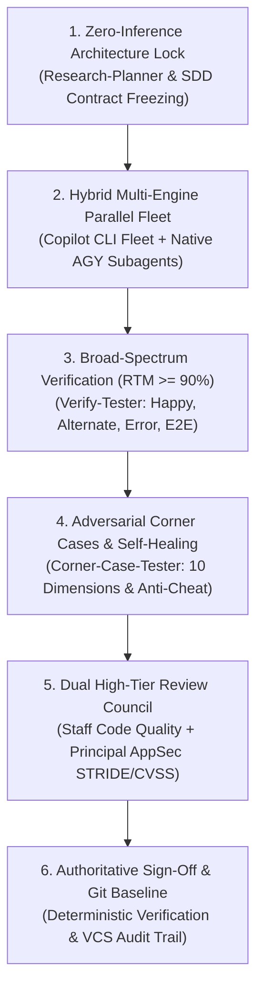
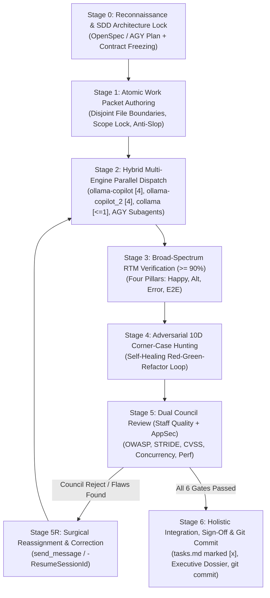

# Magic Orchestrator: The Omni-Disciplinary Master Orchestration System

> **Status**: Production Grade (`v2.0.0-perfect`)  
> **Target Runtime**: Antigravity CLI (`agy`) & Antigravity IDE  
> **Model Recommendation**: Active Top-Tier Model (Gemini 3.8 / Argon Pro tier) as Lead Architect & Audit Council Director  

The **Magic Orchestrator** is an end-to-end, zero-leakage orchestration system that fuses the highest disciplines of software engineering into a unified, self-healing pipeline. It eliminates the fatal flaws of modern autonomous AI coding: architectural guesswork, premature coding, boundary pollution, swallowed errors, security vulnerabilities, untested alternate branches, and broken regressions.

---

## The 6 Immutable Pillars of Magic Orchestration



1. **Zero-Inference Architecture Lock (Front-Loaded Intelligence)**:
   Never allow an executor model to "figure out", "design", or "handle appropriately". All data contracts, schemas, interfaces, error taxonomies, and file paths are frozen before any implementation starts.
2. **Strict Responsibility Boundary & Disjoint Write Paths**:
   Subagents operate on strictly partitioned, non-overlapping file sets. Shared contracts are pre-created by the Lead Architect. Cross-contamination and merge conflicts are mathematically prohibited.
3. **Intelligent Hybrid Multi-Engine Routing**:
   Dynamically dispatches work across local and cloud engines:
   - **`collama`**: Strictly clamped to concurrency **$\le 1$** (TPM/RPM protection).
   - **`ollama-copilot`**: Default **4** parallel subagents (unrestricted).
   - **`ollama-copilot_2`**: Default **4** parallel subagents (second copilot instance).
   - **AGY Native Subagents**: `invoke_subagent` with `pro`, `flash`, `flash_lite`, or `inherit` models, with workspace isolation (`inherit`, `branch`, `share`).
4. **Broad-Spectrum Functional Verification ($\ge 90\%$ RTM)**:
   Every feature must provide a bidirectional Requirements Traceability Matrix across the **Four Functional Pillars**:
   - $40\%$ Golden Happy Paths
   - $30\%$ Alternate Branches & Optional Parameters
   - $20\%$ Standard Error Flows & Validations
   - $10\%$ End-to-End Workflow Integrations
5. **Adversarial Corner-Case Discovery & Automated Red-Green Self-Healing**:
   Systematically interrogates code across **10 Corner-Case Dimensions** (Numeric, Strings, Collections, Nulls, Race Hazards, State Inversions, Resource Limits, Network Skew, Business Invariants, Injections). Fixes defects autonomously in a disciplined **Test-First (Red $\rightarrow$ Green)** loop under strict **Anti-Cheat Invariants**.
6. **Dual Council Review & Mandatory Version Control**:
   Every deliverable is scrutinized by two independent analytical bodies:
   - **Staff Code Reviewer**: Correctness, concurrency, scalability, memory safety, zero nitpicks, and drop-in replacements.
   - **Principal AppSec Reviewer**: Threat modeling (STRIDE), taint tracking (Source $\rightarrow$ Sanitizer $\rightarrow$ Sink), OWASP Top 10 (Web, API, LLM), and objective CVSS v3.1/v4.0 scoring.
   - All specifications, plans, and changes are committed to Git with structured changelogs.

---

## The 7-Stage Master Lifecycle



---

### Stage 0: Ground-Truth Reconnaissance & Spec-Driven Architecture Lock

The Lead Architect (using AGY's smartest Gemini model) establishes full ground-truth context before writing any code:

1. **Environment & Engine Probe**:
   Run the environment probe to detect installed tools, Copilot engines, and Git status:
   ```powershell
   pwsh .agents/skills/magic-orchestrator/scripts/magic_orchestrator.ps1 -CheckEnvironment
   ```
2. **Codebase AST & Type Topology**:
   - Inspect existing interfaces, abstract classes, domain models, and dependencies.
   - Discover canonical patterns and active build/lint/test commands.
3. **Spec-Driven Development (SDD) Hierarchy**:
   - **Priority 1 — OpenSpec / SDD CLI (`openspec` / `specify`)**:
     Initialize change: `openspec new change <feature-name>` and create:
     - `proposal.md`: Problem statement, scope, non-goals, and blast radius.
     - `specs/<domain>/spec.md`: Behavioral invariants and `Given-When-Then` acceptance criteria.
     - `design.md`: Architecture topology, frozen contracts, and interface prototypes.
     - `tasks.md`: Sequenced checklist ready for dispatch.
   - **Priority 2 — Master Orchestration Dossier**:
     If OpenSpec is not installed, author a unified master document using [templates/master-orchestration-dossier.md](./templates/master-orchestration-dossier.md).
4. **Contract Freezing**:
   Write out 100% of data types, API schemas, and prototypes. No executor may change contracts without lead approval.

---

### Stage 1: Zero-Assumption Atomic Work Packet Authoring

Decompose the master architecture into atomic, single-responsibility **Work Packets** using [templates/atomic-work-packet.md](./templates/atomic-work-packet.md):

1. **Packet Sizing Rules**:
   - **Max 1–2 files touched** per packet.
   - **Max 100–150 lines of code change** per packet.
   - 100% self-contained: includes all types, imports, function signatures, and step-by-step logic.
2. **Strict Responsibility Boundary (Scope Lock)**:
   - `Allowed to Create/Modify`: Exact absolute paths the worker is permitted to write.
   - `Read-Only Reference Files`: Paths and line numbers to follow as canonical exemplars.
   - `Strictly Forbidden`: Modules, configs, or contracts outside the packet's boundary.
3. **Anti-Slop Directives**:
   - Explicitly forbid `TODO`, `FIXME`, placeholder stubs (`pass`, `unimplemented!()`), mocked returns in production code, empty catch blocks, and linter suppressions (`any`, `@ts-ignore`).
4. **Verification Command Specification**:
   - Exact CLI command to execute with expected exit code and output pattern.
5. **Boundary Disjointness Verification**:
   Verify that all work packets have mutually exclusive write sets:
   ```powershell
   pwsh .agents/skills/magic-orchestrator/scripts/magic_orchestrator.ps1 -ValidatePackets -PacketDir ./packets
   ```

---

### Stage 2: Hybrid Multi-Engine Parallel Dispatch

The Lead Architect selects the optimal execution engine for each work packet based on workload characteristics:

| Engine | Concurrency | Best Suited For | Auto-Failover Rule |
| :--- | :--- | :--- | :--- |
| **`collama`** | **Strict $\le 1$** | High-focus algorithms, sensitive core modules, rate-limit sensitive runs | Clamp to 1; batch serially if multiple tasks assigned |
| **`ollama-copilot`** | **Default 4** | Standard parallel modules, independent services, test generation | Dispatches up to 4 parallel workers simultaneously |
| **`ollama-copilot_2`** | **Default 4** | Secondary parallel worker fleet, large fan-out batches | Dispatches up to 4 parallel workers simultaneously |
| **AGY Native (`invoke_subagent`)** | **Dynamic** | Architectural spikes, deep research (`Model: "pro"`), quick tasks (`Model: "flash"`) | Run concurrently; isolate workspaces via `branch` or `share` |

#### Dispatching Workflow:
```powershell
# Dispatch Fleet A to ollama-copilot (4 workers)
pwsh .agents/skills/magic-orchestrator/scripts/magic_orchestrator.ps1 -DispatchCopilot `
  -Engine ollama-copilot -MaxSubagents 4 -SpecContextPath "./openspec/changes/feature-x" `
  -Tasks "Task 1.1: Core Auth Validator", "Task 1.2: Token Parser", "Task 1.3: Session Store", "Task 1.4: Cookie Signer"

# Dispatch Fleet B to ollama-copilot_2 (4 workers)
pwsh .agents/skills/magic-orchestrator/scripts/magic_orchestrator.ps1 -DispatchCopilot `
  -Engine ollama-copilot_2 -MaxSubagents 4 -SpecContextPath "./openspec/changes/feature-x" `
  -Tasks "Task 2.1: User Repo", "Task 2.2: Profile Service", "Task 2.3: Password Hasher", "Task 2.4: Email Verifier"

# Dispatch Focused Sensitive Task to collama (Max 1 worker)
pwsh .agents/skills/magic-orchestrator/scripts/magic_orchestrator.ps1 -DispatchCopilot `
  -Engine collama -MaxSubagents 1 -SpecContextPath "./openspec/changes/feature-x" `
  -Tasks "Task 3.1: Cryptographic Constant-Time Key Exchange"
```

For native Antigravity subagents:
```python
# Concurrently spawn in the same turn
invoke_subagent(TypeName="self", Role="WP-1: Token Manager", Prompt=packet_1_content, Model="inherit")
invoke_subagent(TypeName="self", Role="WP-2: Session Service", Prompt=packet_2_content, Model="inherit")
```

---

### Stage 3: Broad-Spectrum Verification & Bidirectional RTM Audit ($\ge 90\%$)

Once subagents report completion, enforce the **Broad-Spectrum Verification Protocol**:

1. **Bidirectional Requirements Traceability Matrix (RTM)**:
   Verify that every functional requirement (`REQ-ID`) and acceptance criterion (`AC-ID`) maps directly to automated tests across the **Four Pillars**:
   - **Golden Happy Paths ($40\%$)**: Standard inputs, primary user flows, successful mutations, HTTP 200/201.
   - **Alternate Valid Branches ($30\%$)**: Optional parameters, pagination, filtering, user tier variations.
   - **Standard Error Flows ($20\%$)**: Validation rejections, 400 Bad Request, 401/403 Auth, 404 Not Found, 409 Conflict.
   - **End-to-End Workflow Integrations ($10\%$)**: Multi-step lifecycle, state persistence across transactions.
2. **Execute Scenario Coverage Audit**:
   ```powershell
   pwsh .agents/skills/magic-orchestrator/scripts/magic_orchestrator.ps1 -CalcCoverage `
     -RtmFile ./docs/rtm.md -Threshold 90.0
   ```
   If coverage is $< 90\%$, execution halts and missing scenarios must be synthesized before proceeding.

---

### Stage 4: Adversarial Corner-Case Hunting & Automated Self-Healing

Apply the **10-Dimension Corner-Case Matrix** to challenge implementation robustness:

1. **The 10 Corner-Case Dimensions**:
   - `DIM-1: Numeric Boundaries`: Zero, $-1$, `MaxInt`, floating-point imprecision (`0.1 + 0.2 != 0.3`), division by zero.
   - `DIM-2: String & Encodings`: Empty string `""`, whitespace, null bytes `\0`, multi-byte UTF-8, astral emojis, RTL.
   - `DIM-3: Collections`: Empty collections, 1-item collections, duplicate entries, $10^5$ items, deeply nested objects.
   - `DIM-4: Nullability & Types`: `null`, `undefined`, missing keys, unexpected type coercions (`"123" + 1`).
   - `DIM-5: Concurrency & Races`: TOCTOU, simultaneous double-clicks, thread interleavings, unawaited promises.
   - `DIM-6: State Inversions`: Methods called out of order (calling `process()` before `init()`), re-entrancy, repeated cancellations.
   - `DIM-7: Resource Limits`: Memory pressure, connection pool exhaustion, file descriptor leaks, backpressure failures.
   - `DIM-8: Distributed Failures`: Network timeouts, DNS failure, 502/504 errors, clock skew, leap seconds.
   - `DIM-9: Business Invariants`: Self-transfers, negative balances, 100%+ discounts, conflicting permission flags.
   - `DIM-10: Injections & Path Hazards`: Path traversal (`../../`), SQL/NoSQL injections, prototype pollution, ReDoS.
2. **Automated Red-Green-Refactor Healing Loop**:
   Run the remediation runner to iteratively discover and fix corner-case failures:
   ```powershell
   pwsh .agents/skills/magic-orchestrator/scripts/magic_orchestrator.ps1 -RunRemediation `
     -TestCommand "npm test -- tests/corner_cases" -SourceDir "./src" -MaxIterations 5
   ```
3. **Anti-Cheat Invariant Enforcement**:
   The runner automatically audits `git diff` on test files. Any attempt to pass tests by deleting assertions, modifying fixtures, poisoning mocks, or returning hardcoded test values immediately fails the build.

---

### Stage 5: Dual Council Review (Staff Quality + Offensive AppSec)

All deliverables must receive unanimous approval from the **Dual Council**:

#### 1. Staff Code Quality Council
- **Hygiene & Pre-Flight**: Run diff analyzer to detect debug statements (`console.log`, `print`), leftover secrets, and suppression tags (`@ts-ignore`, `noqa`).
- **Architectural Integrity**: Domain boundary separation, coupling, backwards compatibility, database migration safety.
- **Correctness & Concurrency**: Atomic state mutations, deadlocks, race conditions, event loop unblocking.
- **Performance & Scalability**: $O(N^2)$ algorithm elimination, N+1 query prevention, memory leak prevention.
- **Rule of Constructive Review**: Zero nitpicks dominating; every finding must include a verified drop-in replacement.

#### 2. Principal AppSec Offensive Review Council
- **Threat Modeling (STRIDE)**: Spoofing, Tampering, Repudiation, Information Disclosure, Denial of Service, Elevation of Privilege.
- **Automated Security Scanner**:
  ```powershell
  pwsh .agents/skills/magic-orchestrator/scripts/magic_orchestrator.ps1 -AuditSecurity -DiffFile ./pr.diff
  ```
- **Taint Analysis**: Follow untrusted inputs from Sources (HTTP parameters, headers, cookies, webhooks, LLM outputs) to Sinks (SQL queries, system shells, file system, deserializers).
- **OWASP Top 10 Coverage**:
  - Web & API: BOLA/IDOR, Mass Assignment, SSRF, SQLi/Command Injection, CORS misconfiguration.
  - LLM/AI: Direct/Indirect Prompt Injection, Unsafe Output Handling, Excessive Agency.
- **CVSS v3.1/v4.0 Scoring & Exploit PoC**: Every finding must contain an exact CVSS vector and reproducible exploit PoC.

#### 3. Council Audit Scorecard Synthesis:
Generate the unified Council Audit Scorecard across all 6 gates:
```powershell
pwsh .agents/skills/magic-orchestrator/scripts/magic_orchestrator.ps1 -GenerateScorecard `
  -OutScorecard ./council-audit-scorecard.md
```

#### 4. The Correction Loop & Circuit Breaker:
- If **any** gate fails:
  - If using Copilot CLI engines: Resume the session with `-ResumeSessionId "<uuid>"` and pass `-CorrectionFeedback "<surgical directive>"`.
  - If using AGY subagents: Send a surgical correction message via `send_message(Recipient=<id>, Message=<directive>)` using [templates/correction-directive.md](./templates/correction-directive.md).
- **Circuit Breaker Rule**:
  - Maximum **3** correction rounds per subagent or task packet.
  - If a task fails 3 consecutive rounds, kill the subagent (`manage_subagents(Action="kill")`), escalate to the Lead Architect (`pro` tier), and apply direct surgical fixes with documented rationale.

---

### Stage 6: Holistic Integration, Executive Sign-Off & Mandatory Git Commit

1. **Cross-Module Wiring & Smoke Test**:
   - Verify that all disjoint modules integrate cleanly (exports, imports, schema migrations, routing).
   - Execute the complete end-to-end regression suite.
2. **Executive Sign-Off Dossier**:
   - Author the final deliverable using [templates/executive-signoff-dossier.md](./templates/executive-signoff-dossier.md).
   - Mark all checklist items complete in `tasks.md` (`- [x]`).
3. **Mandatory Version Control Policy**:
   - All specs (`openspec/` or master dossier), test plans, RTMs, audit scorecards, and code changes **MUST** be committed to Git.
   - Run clean git commit:
     ```powershell
     git add .
     git commit -m "feat(<scope>): <objective> [Verified by Magic Orchestrator: RTM >= 90%, 10D Corner-Cases Clean, AppSec Approved]"
     ```

---

## The 6-Gate Audit Council Rubric

| Gate | Focus Area | Mandatory Passing Standard | Tool / Script |
| :--- | :--- | :--- | :--- |
| **Gate 1** | **Scope & Blast Radius** | Zero modified files outside allowed set; zero configuration pollution | `magic_orchestrator.ps1 -ValidatePackets` |
| **Gate 2** | **Spec & Anti-Slop** | 100% of interfaces implemented; zero `TODO`, `FIXME`, stubs, or `any` | `magic_orchestrator.ps1 -AuditDiff` |
| **Gate 3** | **Functional RTM** | $\ge 90\%$ scenario coverage across 4 Pillars (Happy, Alt, Error, E2E) | `magic_orchestrator.ps1 -CalcCoverage` |
| **Gate 4** | **Adversarial Corner Cases** | 100% passing across 10 boundary dimensions; zero test tampering | `magic_orchestrator.ps1 -RunRemediation` |
| **Gate 5** | **Staff Code Quality** | Zero blockers or major defects; safe concurrency; no resource leaks | `magic_orchestrator.ps1 -AuditDiff` |
| **Gate 6** | **AppSec & CVSS** | Zero P0/P1/Critical/High vulnerabilities; STRIDE & OWASP clean | `magic_orchestrator.ps1 -AuditSecurity` |

---

## Command Reference Summary

```powershell
# 1. Check full environment, SDD tools, Git, and Copilot engines
pwsh .agents/skills/magic-orchestrator/scripts/magic_orchestrator.ps1 -CheckEnvironment

# 2. Validate work packet boundaries and anti-slop rules
pwsh .agents/skills/magic-orchestrator/scripts/magic_orchestrator.ps1 -ValidatePackets -PacketDir ./packets

# 3. Calculate RTM scenario coverage against 90% threshold
pwsh .agents/skills/magic-orchestrator/scripts/magic_orchestrator.ps1 -CalcCoverage -RtmFile ./rtm.md -Threshold 90.0

# 4. Run automated security scanner on git diff
pwsh .agents/skills/magic-orchestrator/scripts/magic_orchestrator.ps1 -AuditSecurity -DiffFile ./pr.diff

# 5. Run Red-Green-Refactor self-healing remediation loop
pwsh .agents/skills/magic-orchestrator/scripts/magic_orchestrator.ps1 -RunRemediation -TestCommand "npm test" -SourceDir "./src"

# 6. Generate unified Council Audit Scorecard
pwsh .agents/skills/magic-orchestrator/scripts/magic_orchestrator.ps1 -GenerateScorecard -OutScorecard ./scorecard.md
```

Cross-platform Python execution:
```bash
python .agents/skills/magic-orchestrator/scripts/magic_orchestrator.py --help
python .agents/skills/magic-orchestrator/scripts/magic_orchestrator.py check-env
python .agents/skills/magic-orchestrator/scripts/magic_orchestrator.py audit-diff --diff pr.diff
python .agents/skills/magic-orchestrator/scripts/magic_orchestrator.py calc-coverage --rtm-file rtm.md --threshold 90.0
python .agents/skills/magic-orchestrator/scripts/magic_orchestrator.py generate-scorecard --out scorecard.md
```

---

## Detailed References & Templates

- **Architecture & Lifecycle**: [references/orchestration-lifecycle.md](./references/orchestration-lifecycle.md)
- **Hybrid Engine Routing**: [references/hybrid-engine-routing.md](./references/hybrid-engine-routing.md)
- **Multi-Disciplinary Council Rubric**: [references/multi-disciplinary-audit-council.md](./references/multi-disciplinary-audit-council.md)
- **Self-Healing & Circuit Breakers**: [references/self-healing-and-circuit-breakers.md](./references/self-healing-and-circuit-breakers.md)
- **Master Orchestration Dossier**: [templates/master-orchestration-dossier.md](./templates/master-orchestration-dossier.md)
- **Atomic Work Packet Template**: [templates/atomic-work-packet.md](./templates/atomic-work-packet.md)
- **Council Audit Scorecard Template**: [templates/council-audit-scorecard.md](./templates/council-audit-scorecard.md)
- **Executive Sign-Off Dossier**: [templates/executive-signoff-dossier.md](./templates/executive-signoff-dossier.md)
- **Correction Directive Template**: [templates/correction-directive.md](./templates/correction-directive.md)
- **End-to-End Walkthrough Example**: [examples/full-lifecycle-example.md](./examples/full-lifecycle-example.md)
