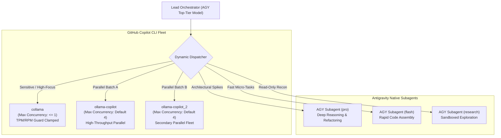

# Hybrid Multi-Engine Fleet Routing Reference Manual

This document defines the routing doctrine, concurrency caps, rate-limit safeguards, and failover mechanics for the **Magic Orchestrator**.

---

## 1. Multi-Engine Architecture Overview

The Magic Orchestrator manages a heterogeneous execution fleet composed of local Copilot CLI wrappers and cloud-based Antigravity subagents:



---

## 2. Engine Concurrency & Routing Specifications

| Engine Name | Concurrency Limit | Routing Heuristic | Rate-Limit Profile | Workspace Isolation |
| :--- | :---: | :--- | :--- | :--- |
| **`collama`** | **Strict $\le 1$** | Sensitive core algorithms, cryptographic modules, state transitions | Strict TPM/RPM protection. Never execute $> 1$ concurrent process. Batch tasks serially. | Local repository / Working directory |
| **`ollama-copilot`** | **Default 4** | Standard independent features, repositories, unit test suites | High throughput, unrestricted concurrency ceiling | Local repository / Working directory |
| **`ollama-copilot_2`** | **Default 4** | Secondary parallel fleet, fan-out subtasks, load balancing | High throughput, identical to `ollama-copilot` | Local repository / Working directory |
| **`agy-pro`** | **Dynamic** | Complex refactoring, self-healing escalation, security audits | Pro tier model, deep analytical reasoning | `inherit` / `branch` / `share` |
| **`agy-flash`** | **Dynamic** | Straightforward atomic packets, boilerplate, DTOs | Fast execution, lightweight parameter footprint | `inherit` / `branch` |
| **`agy-research`** | **Dynamic** | Read-only codebase survey, documentation search | Read-only sandbox, zero file mutation | Read-only |

---

## 3. The `collama` Rate-Limit Invariant

### Why `collama` is Clamped to $\le 1$
When using `collama` with specific LLM backend endpoints (such as Ollama or Cloud API proxies), exceeding a concurrency of 1 frequently triggers:
- HTTP 429 Too Many Requests (Rate limit exceeded)
- Tokens-Per-Minute (TPM) quota starvation
- Requests-Per-Minute (RPM) throttling
- Context window corruption due to interleaved streaming responses

### Mandatory Operational Rule:
The orchestrator's scripts (`magic_orchestrator.ps1` and `magic_orchestrator.py`) strictly enforce:
```powershell
if ($Engine -eq "collama" -and $MaxSubagents -gt 1) {
    Write-Warning "[SAFETY CLAMP] collama concurrency forced to 1 for TPM/RPM safety."
    $MaxSubagents = 1
}
```
If multiple tasks are assigned to `collama`, they **must be batched serially**: dispatch Task 1, wait for completion, then dispatch Task 2.

---

## 4. Multi-Dispatch Strategies

### Strategy A: Tri-Engine Balanced Multi-Dispatch
For large features with 8–10 independent tasks:
1. **Batch A (Tasks 1–4)** $\rightarrow$ Dispatched to `ollama-copilot` (`-MaxSubagents 4`).
2. **Batch B (Tasks 5–8)** $\rightarrow$ Dispatched to `ollama-copilot_2` (`-MaxSubagents 4`).
3. **Task C (Task 9, Critical Security/Auth)** $\rightarrow$ Dispatched to `collama` (`-MaxSubagents 1`).

All three engines run simultaneously, completing up to 9 subtasks in parallel without rate-limit collisions.

### Strategy B: Dynamic Auto-Failover
When `-Engine auto` is specified:
1. The orchestrator probes the health of all configured endpoints.
2. If `ollama-copilot` is unresponsive or returns an endpoint error, the task automatically fails over to `ollama-copilot_2`.
3. If both Copilot CLI instances are offline, the orchestrator falls back to native Antigravity subagents (`invoke_subagent`).

---

## 5. Spec-Driven Context Injection (`-SpecContextPath`)

Worker subagents start with an empty conversation context. To prevent drift, the orchestrator injects authoritative requirements into every worker invocation via `-SpecContextPath`:

```powershell
pwsh .agents/skills/magic-orchestrator/scripts/magic_orchestrator.ps1 -DispatchCopilot `
  -Engine ollama-copilot `
  -SpecContextPath "./openspec/changes/feature-auth" `
  -Tasks "Task 1.1", "Task 1.2"
```

The orchestrator automatically reads and prepends:
1. `proposal.md` (Scope, goals, non-goals)
2. `specs/**/*.md` (Exact behavioral invariants and acceptance criteria)
3. `design.md` (Architecture topology, interfaces, frozen contracts)
4. `tasks.md` (Sequencing and completion definitions)

---

## 6. Session Resumption for Guided Correction

When the Council Audit detects flaws in a Copilot CLI worker's output:
1. Extract the session UUID from the worker's execution logs (`--resume=<session-uuid>`).
2. Re-invoke the orchestrator with `-ResumeSessionId` and `-CorrectionFeedback`:
   ```powershell
   pwsh .agents/skills/magic-orchestrator/scripts/magic_orchestrator.ps1 -DispatchCopilot `
     -Engine ollama-copilot `
     -ResumeSessionId "b18b0f2a-7f28-4e39-9d5a-17c385ad09d4" `
     -SpecContextPath "./openspec/changes/feature-auth" `
     -CorrectionFeedback "AUDIT FAILED: Task 1.2 omitted input validation on null tokens. Re-read spec.md and fix."
   ```
This preserves the subagent's working memory while delivering surgical correction directives.
