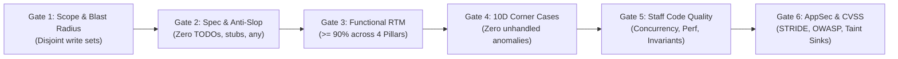

# Multi-Disciplinary Audit Council Reference Manual

The **Audit Council** is the authoritative quality governance body within the Magic Orchestrator. No feature, refactoring, or patch may be merged or marked complete without unanimous passing grades across all six audit gates.

---

## 1. The 6-Gate Audit Architecture



---

## 2. Gate 1: Scope & Blast Radius Audit

### Objective
Guarantee that subagents respected their isolated working boundaries and did not pollute foreign files, build configs, or shared dependencies.

### Verification Checklist
- [ ] Check `git status` or file modification timestamps against the work packet's `Allowed to Create/Modify` list.
- [ ] Verify that **zero** files outside the permitted list were modified, touched, or deleted.
- [ ] Confirm no accidental reversion or modification of another subagent's files.
- [ ] Confirm no unauthorized modifications to build tools, package manifests (`package.json`, `pom.xml`), or environment files (`.env`).

### Blocker Conditions
- Any edit to a file outside the work packet boundary $\rightarrow$ **INSTANT REJECT**. Rollback out-of-scope files immediately.

---

## 3. Gate 2: Spec Compliance & Anti-Slop Audit

### Objective
Verify that 100% of specified interfaces, data contracts, and error taxonomies are implemented without placeholders or shortcuts.

### Anti-Slop Invariants
The codebase is scanned for forbidden shortcuts:
- `// TODO: implement later`, `/* FIXME */`, `HACK`, `XXX`
- Placeholder functions: `pass` (Python), `unimplemented!()` (Rust), empty function bodies.
- Swallowed exceptions: `catch (e) {}`, `except Exception: pass`.
- Hardcoded mocks in production code: `if (env === 'production') return mockData;`.
- Type safety bypasses: `any` (TypeScript), `@ts-ignore`, `@ts-nocheck`, `# type: ignore`, `# noqa`.

### Blocker Conditions
- Presence of any forbidden anti-slop token in production paths $\rightarrow$ **INSTANT REJECT**.

---

## 4. Gate 3: Broad-Spectrum Functional Verification (RTM $\ge 90\%$)

### Objective
Verify that operational requirements are comprehensively validated across the **Four Functional Pillars**:

```
                              FOUR FUNCTIONAL COVERAGE PILLARS
                ┌──────────────────────────────┬──────────────────────────────┐
                │                              │                              │
         [Pillar 1: 40%]                [Pillar 2: 30%]                [Pillar 3: 20%]
         GOLDEN HAPPY PATHS             ALTERNATE BRANCHES             STANDARD ERROR FLOWS
         • Nominal success flows        • Optional parameters omitted  • Missing required fields (400)
         • Valid business payloads      • Pagination navigation        • Unauthorized access (401/403)
         • Database mutations verified  • User tier variations         • Resource not found (404)
         • HTTP 200/201 responses       • Filtering & sorting          • Conflict handling (409)
                │                              │                              │
                └──────────────────────────────┼──────────────────────────────┘
                                               │
                                        [Pillar 4: 10%]
                                   END-TO-END WORKFLOW INTEGRATIONS
                                   • Multi-step lifecycle flows
                                   • Cross-service data passing
                                   • State persistence across transactions
```

### Mathematical Formula:
$$\text{Scenario Coverage Ratio} = \frac{\text{Mapped & Passing Automated Scenarios}}{\text{Total Documented Acceptance Criteria}} \times 100\% \ge 90.0\%$$

### Blocker Conditions
- Coverage ratio $< 90.0\%$ $\rightarrow$ **BLOCKS SIGN-OFF**. Missing scenarios must be generated.

---

## 5. Gate 4: Adversarial 10D Corner-Case Hunting

### Objective
Ensure system resilience against extreme, hostile, and unexpected boundary conditions.

### The 10 Boundary Dimensions:
1. **Numeric**: Zero, $-1$, MaxInt, floating point epsilon (`0.1 + 0.2`), division by zero.
2. **Strings**: Empty string `""`, whitespace, null bytes `\0`, UTF-8 astral emojis, RTL characters.
3. **Collections**: Empty collections `[]`, 1-item collections, duplicate keys, $10^5$ items, deep recursion.
4. **Nullability**: `null`, `undefined`, missing JSON fields, type coercion (`"123" + 1`).
5. **Concurrency**: TOCTOU races, double submits, asynchronous callback jitter, unawaited promises.
6. **State Traps**: Calling methods out of lifecycle order (e.g., `close()` before `open()`).
7. **Resource Limits**: Memory leaks, connection pool exhaustion, unclosed file descriptors.
8. **Network / Distributed**: Network timeouts, upstream 502/504 errors, clock skew.
9. **Business Invariants**: Negative balances, self-referential transfers, 100%+ discounts.
10. **Injections / Paths**: Path traversal sequences (`../../`), SQL/NoSQL injection tokens, ReDoS.

### Anti-Cheat Enforcement:
All tests are verified via git diff audit. Deleting assertions, weakening thresholds, or poisoning mocks results in immediate failure.

---

## 6. Gate 5: Staff Code Quality & Concurrency

### Objective
Elevate code review to principal staff-engineer standards, evaluating architectural integrity, maintainability, and concurrency safety.

### Core Review Pillars:
1. **Logic Invariants & Correctness**:
   - Loop termination, state machine transitions, clean resource release (`finally`, `defer`).
2. **Concurrency & Thread Safety**:
   - Time-of-check to time-of-use (TOCTOU) races.
   - Atomic database operations (`SELECT ... FOR UPDATE`, optimistic locking).
   - Non-blocking asynchronous flows (never block event loop with CPU-heavy tasks).
3. **Performance & Scalability**:
   - Elimination of $O(N^2)$ loops and N+1 database queries.
   - Bounded in-memory collections (LRU eviction, no unbounded growth).
4. **Constructive Review Policy**:
   - Zero nitpick domination (formatting is left to linters).
   - Every critique must include **drop-in replacement code**.

---

## 7. Gate 6: Principal AppSec & CVSS Threat Neutralization

### Objective
Adopt an adversarial offensive mindset to discover and eliminate vulnerabilities.

### AppSec Review Dimensions:
1. **STRIDE Threat Modeling**:
   - Spoofing, Tampering, Repudiation, Information Disclosure, Denial of Service, Elevation of Privilege.
2. **Source-to-Sink Taint Tracking**:
   - Trace untrusted inputs from HTTP params/headers/webhooks to database queries, shells, or HTML rendering.
3. **OWASP Top 10 Coverage**:
   - BOLA / IDOR (API1:2023): Ensure every lookup validates tenant/user ownership.
   - Mass Assignment (API3:2023): Disallow raw body updates to sensitive fields (`role`, `is_admin`).
   - SSRF (API7:2023): Block private IP ranges (RFC 1918) and cloud metadata (`169.254.169.254`).
   - LLM Top 10: Defend against direct/indirect prompt injections and unvalidated tool outputs.
4. **CVSS v3.1 / v4.0 Scoring**:
   - Any finding with CVSS $\ge 7.0$ (High / Critical) strictly blocks deployment.
   - Every vulnerability must include an exploit PoC and hardened remediation code.
