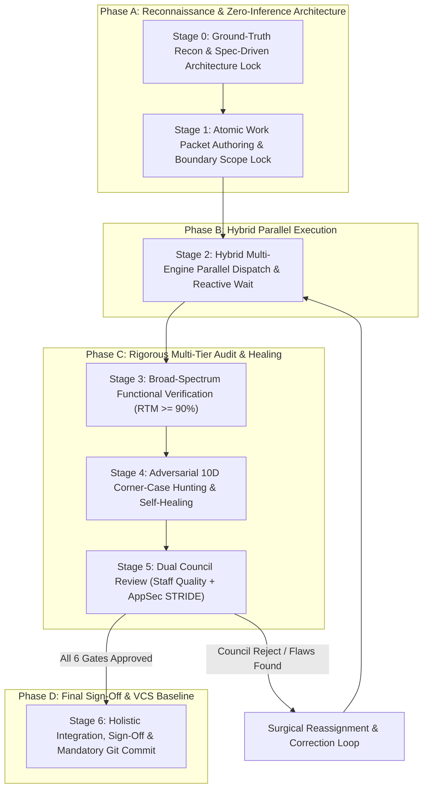

# The 7-Stage Magic Orchestration Lifecycle Reference Manual

This document provides the authoritative, stage-by-stage operational specification for the **Magic Orchestrator**. Every non-trivial engineering task handled by Antigravity under this skill must adhere to this lifecycle.

---

## High-Level Lifecycle Flow



---

## Stage 0: Ground-Truth Reconnaissance & Spec-Driven Architecture Lock

### Objectives
1. Eliminate speculation by extracting ground truth from the codebase.
2. Probe engine health and environment availability.
3. Lock architectural contracts, data types, and error taxonomies prior to coding.

### Step-by-Step Procedure
1. **Probe Environment**:
   Run the environment probe:
   ```powershell
   pwsh .agents/skills/magic-orchestrator/scripts/magic_orchestrator.ps1 -CheckEnvironment
   ```
   Inspect:
   - Git repository status (initialize if needed).
   - SDD tooling availability (`openspec`, `specify`).
   - Copilot CLI engines (`collama`, `ollama-copilot`, `ollama-copilot_2`).
   - Python / PowerShell runtime versions.

2. **Codebase AST & Type Topology**:
   - Locate existing core interfaces, DTOs, domain models, and utility modules.
   - Harvest 2–3 canonical code exemplars to establish conventions for naming, logging, and error handling.
   - Pinned dependencies: check `package.json`, `pyproject.toml`, `go.mod`, etc., for exact library versions.

3. **Spec-Driven Architecture Hierarchy**:
   - **OpenSpec Mode**: If `openspec` is present, create a change via `openspec new change <id>`. Author:
     - `proposal.md`: Problem statement, scope, non-goals, and blast radius.
     - `specs/<domain>/spec.md`: Behavioral invariants and `Given-When-Then` acceptance criteria.
     - `design.md`: Architecture topology, frozen contracts, and interface prototypes.
     - `tasks.md`: Sequenced checklist ready for dispatch.
   - **Native Master Dossier Mode**: If OpenSpec is absent, author a complete specification using `templates/master-orchestration-dossier.md`.

4. **Contract Freezing (The Zero-Inference Invariant)**:
   - Freeze all function signatures, parameters, return types, and schema definitions.
   - Define the exact error taxonomy: error classes, status codes, and error payloads.

---

## Stage 1: Atomic Work Packet Authoring & Boundary Scope Lock

### Objectives
1. Partition the architecture into independent, single-responsibility units.
2. Enforce strict responsibility boundaries to guarantee zero file overwrite conflicts.
3. Provide spoon-fed, zero-assumption prompts for worker subagents.

### Step-by-Step Procedure
1. **Work Packet Decomposition Rules**:
   - **Blast Radius**: Each packet is confined to **1–2 files**.
   - **Size Limit**: Maximum **100–150 lines of code change**.
   - **Self-Contained**: Must include all required imports, type signatures, and step-by-step logic.
   - **File Disjointness**: The set of files writable by Work Packet $i$ and Work Packet $j$ must have an empty intersection:
     $$\text{Files}(WP_i) \cap \text{Files}(WP_j) = \emptyset \quad \forall i \ne j$$

2. **Authoring the Work Packet**:
   Use `templates/atomic-work-packet.md`. Each packet must include:
   - **Scope Lock**: Absolute paths of permitted files, read-only references, and strictly forbidden paths.
   - **Exact Specification**: Complete prototypes and algorithmic state machines.
   - **Anti-Slop Directives**: Explicit prohibition of `TODO`, `FIXME`, stubs, swallowed errors, and type suppressions (`any`, `@ts-ignore`).
   - **Self-Verification Commands**: Exact shell commands to verify compilation, linting, and unit tests.

3. **Automated Boundary Verification**:
   Verify boundary disjointness before dispatch:
   ```powershell
   pwsh .agents/skills/magic-orchestrator/scripts/magic_orchestrator.ps1 -ValidatePackets -PacketDir ./packets
   ```

---

## Stage 2: Hybrid Multi-Engine Parallel Dispatch & Reactive Wait

### Objectives
1. Execute independent work packets concurrently across the optimal mix of engines.
2. Adhere to concurrency limits (especially `collama` $\le 1$).
3. Reactively wait for completion without busy-polling loops.

### Step-by-Step Procedure
1. **Engine Selection Matrix**:
   - **`collama`**: Strictly clamped to concurrency $\le 1$ to protect TPM/RPM rate limits. Best for sensitive cryptographic algorithms, core transaction logic, or rate-limited models.
   - **`ollama-copilot`**: Default 4 parallel subagents. High-throughput parallel execution for services, repositories, or test suites.
   - **`ollama-copilot_2`**: Default 4 parallel subagents. Secondary Copilot CLI fleet for high fan-out workloads.
   - **Antigravity Native Subagents (`invoke_subagent`)**: High-tier reasoning with `Model: "pro"`, fast execution with `Model: "flash"`, or workspace branching (`Workspace: "branch"`).

2. **Dispatching Tasks**:
   - Pass `-SpecContextPath` to inject authoritative requirements into Copilot CLI subagents.
   - Dispatch independent task groups in parallel in the same turn.

3. **Subagent Registry & Reactive Waiting**:
   - Maintain the active subagent registry:
     ```
     Subagent ID | Engine / Model | Work Packet | Permitted Files | Status
     ```
   - Do NOT poll in a loop. Sleep and wake reactively upon task completion notifications.

---

## Stage 3: Broad-Spectrum Functional Verification (RTM $\ge 90\%$)

### Objectives
1. Guarantee that at least $90\%$ of all functional requirements and acceptance criteria have corresponding automated tests.
2. Distribute test coverage across the **Four Functional Pillars**.

### Step-by-Step Procedure
1. **The Four Functional Pillars**:
   - **Pillar 1: Golden Happy Paths ($40\%$ Weight)**:
     - Standard valid inputs, primary user flows, successful mutations, HTTP 200/201.
   - **Pillar 2: Alternate Valid Branches ($30\%$ Weight)**:
     - Optional parameters omitted vs provided, pagination (first/middle/last/empty), sorting, user tiers.
   - **Pillar 3: Expected / Standard Error Flows ($20\%$ Weight)**:
     - Input validation errors (HTTP 400), authentication/authorization failures (HTTP 401/403), missing resources (HTTP 404), conflicts (HTTP 409).
   - **Pillar 4: End-to-End Workflow Integrations ($10\%$ Weight)**:
     - Multi-step customer journeys, cross-service data propagation, database persistence.

2. **Construct Bidirectional RTM**:
   - Forward trace: Every `REQ-ID` maps to at least one test case (`TC-ID`).
   - Backward trace: Every test case maps to a valid `REQ-ID`.

3. **Execute Coverage Audit**:
   ```powershell
   pwsh .agents/skills/magic-orchestrator/scripts/magic_orchestrator.ps1 -CalcCoverage `
     -RtmFile ./docs/rtm.md -Threshold 90.0
   ```
   If coverage $< 90\%$, identify uncovered requirements and generate missing tests.

---

## Stage 4: Adversarial 10D Corner-Case Hunting & Self-Healing

### Objectives
1. Expose latent bugs across 10 boundary dimensions before code reaches review.
2. Autonomously heal failing tests in a disciplined **Test-First (Red $\rightarrow$ Green)** loop.
3. Enforce **Anti-Cheat Invariants**.

### Step-by-Step Procedure
1. **The 10 Corner-Case Dimensions**:
   - `DIM-1`: Numeric Boundaries (Zero, $-1$, MaxInt, floating point epsilon, division by zero).
   - `DIM-2`: String & Encodings (Empty string `""`, whitespace, null bytes `\0`, UTF-8 astral emojis, RTL).
   - `DIM-3`: Collections (Empty collections, 1-item, duplicate entries, $10^5$ items, deeply nested objects).
   - `DIM-4`: Nullability & Types (`null`, `undefined`, missing keys, unexpected type coercions).
   - `DIM-5`: Concurrency & Races (TOCTOU, simultaneous double-clicks, thread interleavings, unawaited promises).
   - `DIM-6`: State Inversions (Methods called out of order, re-entrancy, repeated cancellations).
   - `DIM-7`: Resource Limits (Memory pressure, connection pool exhaustion, file descriptor leaks).
   - `DIM-8`: Distributed Failures (Network timeouts, DNS failure, 502/504 errors, clock skew).
   - `DIM-9`: Business Invariants (Self-transfers, negative balances, 100%+ discounts).
   - `DIM-10`: Injections & Path Hazards (Path traversal, SQL/NoSQL injections, prototype pollution, ReDoS).

2. **Test-First Imperative**:
   - Never modify production code to fix a bug without first authoring a failing automated test case.

3. **Autonomous Self-Healing Loop**:
   Run the remediation controller:
   ```powershell
   pwsh .agents/skills/magic-orchestrator/scripts/magic_orchestrator.ps1 -RunRemediation `
     -TestCommand "npm test" -SourceDir "./src" -MaxIterations 5
   ```

4. **Anti-Cheat Guard**:
   - The remediation controller inspects `git diff` on test files. If assertions are weakened, deleted, or mocked to bypass checks, the build fails immediately.

---

## Stage 5: Dual Council Review (Staff Quality + Offensive AppSec)

### Objectives
1. Provide comprehensive scrutiny across code craftsmanship and offensive application security.
2. Guarantee zero regressions, zero critical vulnerabilities, and zero unhandled race conditions.

### Step-by-Step Procedure
1. **Council Member 1: Staff Code Reviewer**:
   - Scrutinizes logic correctness, concurrency hazards, memory leaks, and performance bottlenecks.
   - Enforces **Zero Nitpick Domination**: formatting is left to linters; focus is strictly on architectural and logic safety.
   - Every critique must be accompanied by a **drop-in replacement code snippet**.

2. **Council Member 2: Principal AppSec Reviewer**:
   - Threat Modeling via **STRIDE** (Spoofing, Tampering, Repudiation, Information Disclosure, Denial of Service, Elevation of Privilege).
   - Source-to-Sink **Taint Tracking**: trace untrusted user inputs to dangerous execution sinks.
   - **OWASP Auditing**: Web/API Top 10 (BOLA, SSRF, Injection) and LLM Top 10 (Prompt Injection, Unsafe Output Handling).
   - Objective **CVSS v3.1/v4.0** scoring for any vulnerability.

3. **Synthesize Council Audit Scorecard**:
   Generate the unified scorecard using `templates/council-audit-scorecard.md`.

4. **Correction Feedback Loop & Circuit Breaker**:
   - If flaws are detected:
     - For Copilot CLI: Invoke `-ResumeSessionId "<uuid>"` with `-CorrectionFeedback`.
     - For AGY Subagents: Send surgical correction message via `send_message`.
   - **Circuit Breaker**: If a subagent fails after **3 iterations**, terminate the subagent, escalate to the Lead Architect (`pro` tier), and apply direct surgical fixes with documented rationale.

---

## Stage 6: Holistic Integration, Executive Sign-Off & Mandatory Git Commit

### Objectives
1. Wire all modules together and verify end-to-end functionality.
2. Produce executive and technical sign-off documentation.
3. Commit all code, specs, tests, and scorecards to Git version control.

### Step-by-Step Procedure
1. **Holistic Integration Verification**:
   - Verify that all disjoint modules connect seamlessly (imports, exports, dependency injection, database migrations).
   - Run the full project test suite and smoke tests.

2. **Executive Sign-Off Dossier**:
   - Author the final deliverable using `templates/executive-signoff-dossier.md`.
   - Verify all tasks in `tasks.md` are marked complete (`- [x]`).

3. **Mandatory Git Version Control**:
   - Stage all new and modified files (`git add .`).
   - Commit with a clear, conventional commit message:
     ```powershell
     git commit -m "feat(<scope>): <summary> [Magic-Orchestrator: 6-Gate Passed, RTM 92%, AppSec Clean]"
     ```
