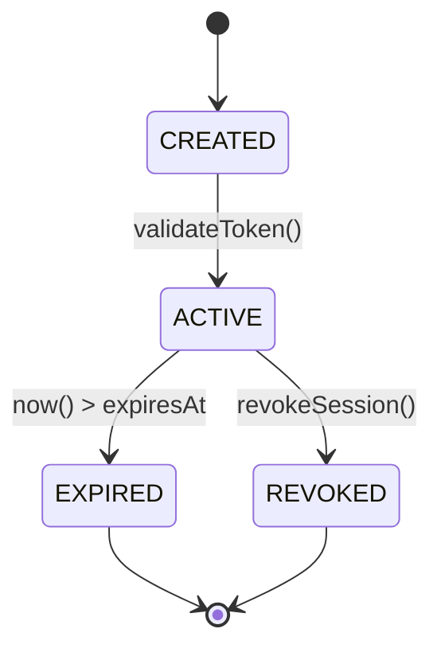
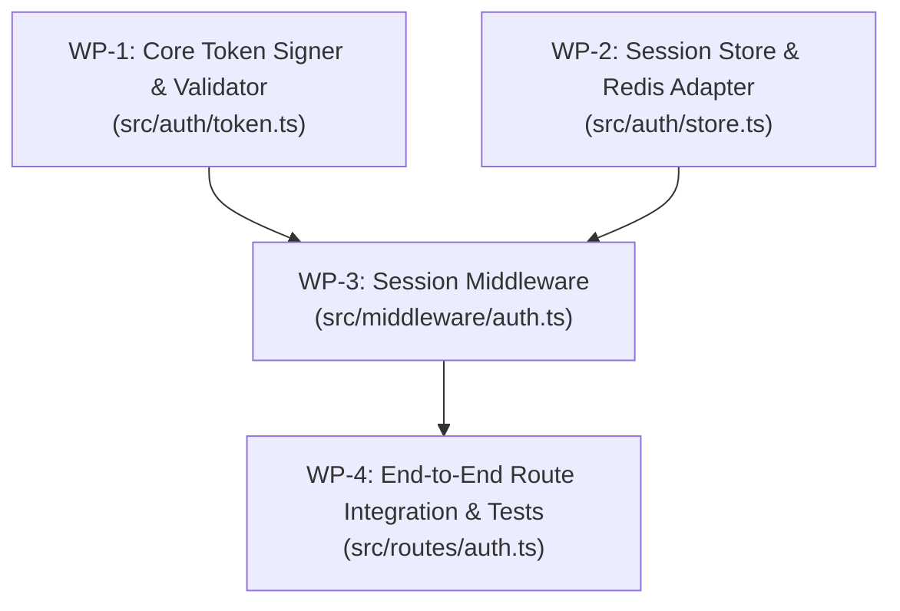

# Master Orchestration Dossier: [Project / Feature Name]

> **Lead Architect**: Antigravity (`agy`) Smartest Model  
> **Status**: DRAFT | IN_REVIEW | ARCHITECTURE_LOCKED | COMPLETED  
> **Target Branch**: `main`  
> **Date**: [YYYY-MM-DD]  

---

## 1. Proposal & Strategic Intent

### 1.1 Problem Statement
[Concise description of the user problem or technical objective being addressed.]

### 1.2 Proposed Architecture & Scope
[High-level overview of the proposed solution and architecture.]

### 1.3 In-Scope vs. Explicit Non-Goals
- **In-Scope**:
  - [Feature / Module 1]
  - [Feature / Module 2]
- **Strictly Out-of-Scope (Non-Goals)**:
  - [Non-Goal 1]
  - [Non-Goal 2]

### 1.4 Blast Radius & Dependency Impact
- **Touched Modules**: `src/auth/`, `src/services/`
- **Dependencies Introduced**: [e.g., `jose@^5.0.0`]
- **Database Migrations Required**: [Yes / No]

---

## 2. Zero-Inference Technical Specification

### 2.1 Domain Models & Frozen Data Contracts
```typescript
// Insert complete, production-ready TypeScript/Python/Go types.
// Zero ambiguous fields. All types, nullabilities, and defaults explicitly pinned.
export interface UserSession {
  readonly sessionId: string;
  readonly userId: string;
  readonly role: "user" | "admin" | "operator";
  readonly expiresAt: number; // Unix epoch milliseconds
  readonly ipAddress: string;
}
```

### 2.2 Prototypes & Method Signatures
```typescript
export interface SessionService {
  createSession(userId: string, role: string, ip: string): Promise<UserSession>;
  validateSession(sessionId: string): Promise<UserSession | null>;
  revokeSession(sessionId: string): Promise<boolean>;
}
```

### 2.3 Algorithmic State Transitions


### 2.4 Error Taxonomy & Status Codes
| Error Identifier | HTTP Status | Exception Class | Emitted Message / Code |
| :--- | :---: | :--- | :--- |
| `ERR_TOKEN_EXPIRED` | 401 | `AuthenticationException` | `"Session has expired. Re-authenticate."` |
| `ERR_INVALID_SIGNATURE` | 401 | `AuthenticationException` | `"Cryptographic signature verification failed."` |
| `ERR_FORBIDDEN_ROLE` | 403 | `AuthorizationException` | `"Insufficient role privileges for resource."` |

---

## 3. Bidirectional Requirements Traceability Matrix (RTM)

| Requirement ID | Acceptance Criteria (`Given-When-Then`) | Pillar | Target Test Identifier | Status |
| :--- | :--- | :---: | :--- | :---: |
| `REQ-AUTH-001` | Given valid credentials, when login is invoked, then issue valid JWT and return HTTP 200. | Happy (40%) | `test_login_success` | MAPPED |
| `REQ-AUTH-002` | Given optional `remember_me=true`, when login is invoked, then issue token with 30-day expiry. | Alt (30%) | `test_login_remember_me` | MAPPED |
| `REQ-AUTH-003` | Given missing password, when login is invoked, then return HTTP 400 Bad Request with field error. | Error (20%) | `test_login_missing_password` | MAPPED |
| `REQ-AUTH-004` | Given user registers, verifies email, and logs in, then profile state reflects active account. | E2E (10%) | `test_e2e_registration_flow` | MAPPED |

---

## 4. Adversarial 10-Dimension Corner-Case Matrix

| Dimension | Traps & Boundary Inputs | Expected System Behavior | Test Identifier |
| :--- | :--- | :--- | :--- |
| **DIM-1: Numeric** | Expiration timestamp = 0, `-1`, or `MaxInt64` | Reject with `ERR_INVALID_EXPIRY` | `test_expiry_numeric_bounds` |
| **DIM-2: Strings** | Token containing null byte `\0`, whitespace, or astral emojis | Reject cleanly without unhandled exception | `test_token_string_anomalies` |
| **DIM-3: Collections** | Scope array empty `[]` or containing 10,000 permissions | Clean validation rejection, bounded memory | `test_permissions_collection_bounds` |
| **DIM-4: Nullability** | Payload missing `userId` or payload is `null` | Return 400 Bad Request | `test_payload_nullability` |
| **DIM-5: Concurrency** | Double submit simultaneous session creation | Idempotent session deduplication | `test_concurrent_session_creation` |
| **DIM-6: State Inversion** | Calling `validateSession` after `revokeSession` | Return null / HTTP 401 | `test_validate_revoked_session` |
| **DIM-7: Resource Limits** | Redis session store connection timeout | Fail closed, return 503 Service Unavailable | `test_store_connection_timeout` |
| **DIM-8: Distributed** | Server clock skew of $\pm 60$ seconds | Allow configured leeway (e.g., 5s), then reject | `test_clock_skew_leeway` |
| **DIM-9: Invariants** | Revoking session with forged tenant ID | Return 404 / 403, isolate cross-tenant | `test_tenant_isolation_revocation` |
| **DIM-10: Injections** | Session ID containing path traversal `../../` or SQL tokens | Strict regex validation failure before query | `test_session_id_injection_protection` |

---

## 5. Execution DAG & Work Packet Partitioning



| Packet ID | Assigned Engine | Target Write Paths | Estimated LOC | Prerequisites |
| :--- | :--- | :--- | :---: | :--- |
| **`WP-1`** | `ollama-copilot` | `src/auth/token.ts`, `tests/auth/token.test.ts` | ~120 | None |
| **`WP-2`** | `ollama-copilot_2` | `src/auth/store.ts`, `tests/auth/store.test.ts` | ~130 | None |
| **`WP-3`** | `collama` | `src/middleware/auth.ts`, `tests/middleware/auth.test.ts` | ~110 | `WP-1`, `WP-2` |
| **`WP-4`** | `agy-pro` | `src/routes/auth.ts`, `tests/e2e/auth.test.ts` | ~140 | `WP-3` |
