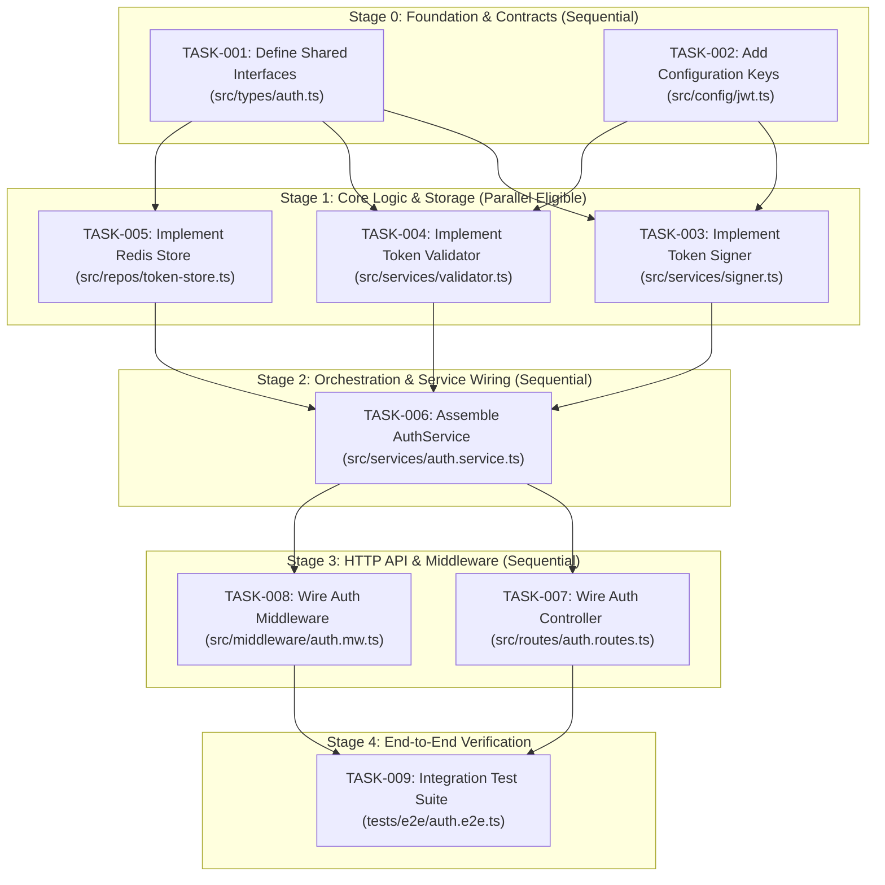

# Execution DAG & Dependency Plan

> **Artifact Purpose**: Topological execution roadmap mapping out task dependencies, concurrency stages, milestone checkpoints, and failure recovery procedures. Ensures that low-tier models or parallel subagents are dispatched only when all prerequisite interfaces are completely locked and verified.

---

## 1. Master Execution Flowchart (Mermaid DAG)

---

## 2. Stage Breakdown & Dispatch Registry

### Stage 0: Foundation & Interfaces (Must complete before any business logic)
| Task ID | Task Title | Permitted Write Files | Dependencies | Concurrency Mode | Verification Gate |
| :--- | :--- | :--- | :--- | :--- | :--- |
| `TASK-001` | Define Auth Interfaces | `src/types/auth.ts` | None | Sequential | `npx tsc --noEmit` |
| `TASK-002` | Add JWT Config Schema | `src/config/jwt.ts` | None | Sequential | `npx tsc --noEmit` |

### Stage 1: Isolated Units (Parallel execution safe)
| Task ID | Task Title | Permitted Write Files | Dependencies | Concurrency Mode | Verification Gate |
| :--- | :--- | :--- | :--- | :--- | :--- |
| `TASK-003` | Implement Token Signer | `src/services/signer.ts` | `TASK-001`, `TASK-002` | Parallel (Slot 1) | Unit tests pass |
| `TASK-004` | Implement Token Validator | `src/services/validator.ts` | `TASK-001`, `TASK-002` | Parallel (Slot 2) | Unit tests pass |
| `TASK-005` | Implement Redis Store | `src/repos/token-store.ts` | `TASK-001` | Parallel (Slot 3) | Unit tests pass |

### Stage 2: Service Composition
| Task ID | Task Title | Permitted Write Files | Dependencies | Concurrency Mode | Verification Gate |
| :--- | :--- | :--- | :--- | :--- | :--- |
| `TASK-006` | Assemble AuthService | `src/services/auth.service.ts` | `TASK-003`, `TASK-004`, `TASK-005` | Sequential | Unit tests pass |

### Stage 3: API & Route Wiring
| Task ID | Task Title | Permitted Write Files | Dependencies | Concurrency Mode | Verification Gate |
| :--- | :--- | :--- | :--- | :--- | :--- |
| `TASK-007` | Wire Auth Routes | `src/routes/auth.routes.ts` | `TASK-006` | Sequential | Route tests pass |
| `TASK-008` | Wire Auth Middleware | `src/middleware/auth.mw.ts` | `TASK-006` | Sequential | Middleware tests pass |

### Stage 4: Holistic Verification
| Task ID | Task Title | Permitted Write Files | Dependencies | Concurrency Mode | Verification Gate |
| :--- | :--- | :--- | :--- | :--- | :--- |
| `TASK-009` | Run Full E2E Suite | `tests/e2e/auth.e2e.ts` | `TASK-007`, `TASK-008` | Final Check | Full suite passes |

---

## 3. Disjoint Workspace & File Safety Rules

When dispatching tasks in parallel (e.g., Stage 1):
1. **Zero File Overlaps**: No two concurrent tasks may list the same file in their permitted write files.
2. **Read-Only Dependencies**: Files created in earlier stages become strictly read-only for subsequent parallel tasks.
3. **Workspace Isolation**: If running under Antigravity `invoke_subagent`, use `Workspace: "inherit"` only when file sets are 100% disjoint; otherwise use `Workspace: "branch"`.

---

## 4. Failure Recovery & Circuit Breakers

### Executor Failure Scenarios:
1. **Scenario A: Compilation or Test Failure**:
   - Do NOT advance the DAG.
   - Send the specific compiler/test error output back to the executor using the correction directive.
   - Max 2 correction attempts before terminating the executor.
2. **Scenario B: Out-of-Scope File Edits**:
   - Revert out-of-scope edits via `git checkout -- <unauthorized-file>`.
   - Re-instruct the model with strict file boundaries.
3. **Scenario C: Persistent Hallucination / Slop**:
   - Kill the subagent.
   - Split the task into two smaller micro-tasks or switch execution model to a higher-tier engine.
