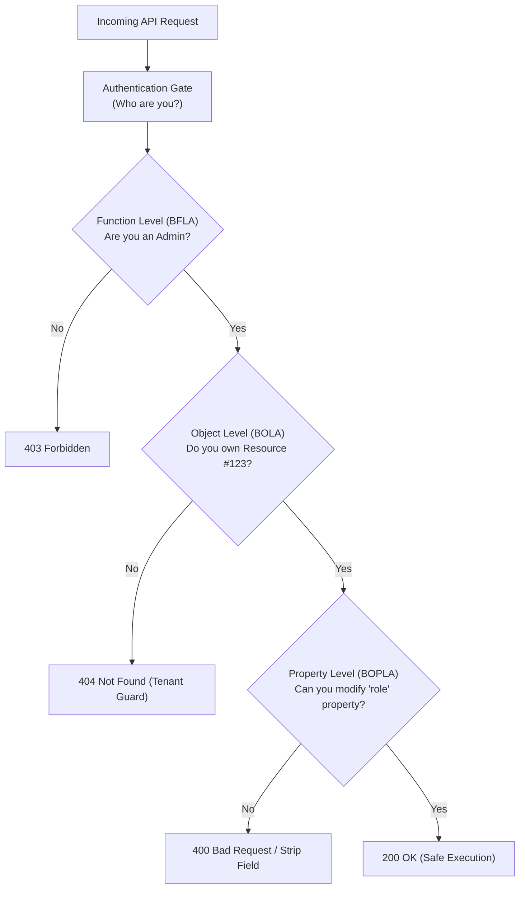
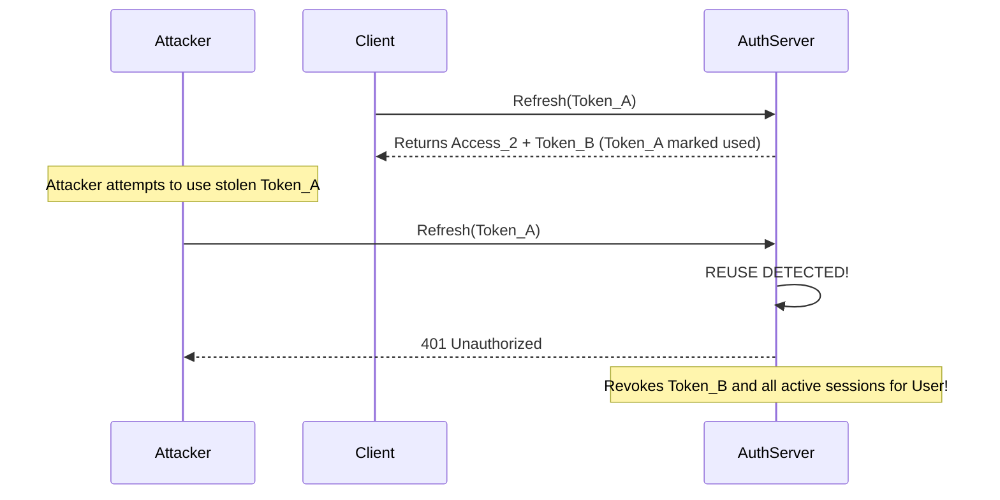

# Authentication & Access Control Security Playbook

This reference provides architectural blueprints, vulnerability patterns, and hardened implementation models for authentication, session handling, access control, and multi-tenant isolation.

---

## 1. Access Control Taxonomy: BOLA, BFLA & BOPLA



### 1.1 BOLA (Broken Object Level Authorization - API1:2023)
- **Failure Mode**: Verifying *who* the caller is, but failing to verify whether they have rights to the specific object ID they requested.
- **Root Cause**: Querying by ID alone without including tenant or user constraints.
- **Universal Fix**: Always append the caller's verified `tenant_id` or `user_id` to database queries.

### 1.2 BFLA (Broken Function Level Authorization - API5:2023)
- **Failure Mode**: Administrative endpoints or privileged HTTP methods (`DELETE`, `PATCH`, `PUT`) relying on frontend UI visibility hiding instead of backend enforcement.
- **Root Cause**: Missing middleware guards on router hierarchies.
- **Universal Fix**: Enforce RBAC/ABAC guards at the top-level route definition:
  ```typescript
  router.delete('/api/workspaces/:id',
    authenticateUser,
    requireRole(['ORGANIZATION_ADMIN']), // Explicit BFLA check
    requireWorkspaceOwnership           // Explicit BOLA check
  );
  ```

### 1.3 BOPLA (Broken Object Property Level Authorization - API3:2023)
- **Failure Mode**: Allowing callers to read or mutate sensitive fields they shouldn't access (e.g. `is_admin`, `verified`, `credit_balance`, `password_hash`).
- **Universal Fix**: Strict DTOs for inputs (Zod/Pydantic with `.strict()`) and view models for output serialization (never return the raw ORM entity).

---

## 2. Multi-Tenant Data Isolation Blueprints

In multi-tenant SaaS environments, cross-tenant data leaks represent catastrophic security failures.

### Strategy 1: PostgreSQL Row-Level Security (RLS)
The database engine automatically restricts all queries to the tenant set in the current database session:

```sql
-- Enable RLS on multi-tenant table
ALTER TABLE documents ENABLE ROW LEVEL SECURITY;

-- Create policy enforcing tenant separation
CREATE POLICY tenant_isolation_policy ON documents
  FOR ALL
  USING (tenant_id = current_setting('app.current_tenant_id', true)::uuid);
```

```python
# Application sets tenant context per transaction
async with db.transaction() as conn:
    await conn.execute("SET LOCAL app.current_tenant_id = $1", current_user.tenant_id)
    # Any query automatically filtered by tenant_id by PostgreSQL engine
    results = await conn.fetch("SELECT * FROM documents WHERE id = $1", doc_id)
```

### Strategy 2: Mandatory ORM Query Scoping
When RLS is not available, enforce tenant scoping at the ORM repository layer:

```typescript
// Repository pattern ensuring tenant_id cannot be omitted
export class TenantScopedRepository<T extends { tenantId: string }> {
  constructor(private model: any, private tenantId: string) {}

  async findById(id: string): Promise<T | null> {
    return await this.model.findOne({ _id: id, tenantId: this.tenantId });
  }

  async updateById(id: string, updateData: Partial<T>): Promise<T | null> {
    return await this.model.findOneAndUpdate(
      { _id: id, tenantId: this.tenantId },
      { $set: updateData },
      { new: true }
    );
  }
}
```

---

## 3. Session Management & Refresh Token Rotation (RTR)

### Token Hijacking Defense with RTR:
- Single-use Refresh Tokens: When a refresh token is used to issue a new Access Token, the refresh token is invalidated and a new one is returned.
- Reuse Detection: If an attacker attempts to use an already-revoked refresh token, invalidate the entire family of refresh tokens for that user session, forcing a re-login.



### Secure Cookie Configuration Flags:
Every authentication cookie stored in the browser must set:
```http
Set-Cookie: session_id=xyz123abc; Path=/; Secure; HttpOnly; SameSite=Strict; Max-Age=3600
```
- **`HttpOnly`**: Blocks JavaScript access (`document.cookie`), mitigating session theft via XSS.
- **`Secure`**: Ensures cookie is transmitted only over encrypted TLS (HTTPS) connections.
- **`SameSite=Strict`** (or `Lax`): Prevents browser from attaching the cookie on cross-site requests, neutralizing CSRF.
- **Prefix `__Host-`**: Ensures cookie can only be set from the host domain without subdomains, requiring `Secure` and `Path=/`.

---

## 4. OAuth2 & OpenID Connect (OIDC) Threat Checklist

Flaw | Threat | Required Defense
:--- | :--- | :---
**Missing State Param** | CSRF Login attack | Generate high-entropy state stored in session; verify on callback.
**Missing PKCE** | Authorization Code Interception | Require PKCE (`code_verifier` & `code_challenge`) for all clients.
**Wildcard Redirect URI** | Token/Code Theft via open redirect | Strict exact URI matching (`https://app.com/auth/callback`).
**Open ID Token Unverified** | Identity Spoofing | Validate JWT signature using IdP's JWKS endpoint, verify `aud` & `exp`.
