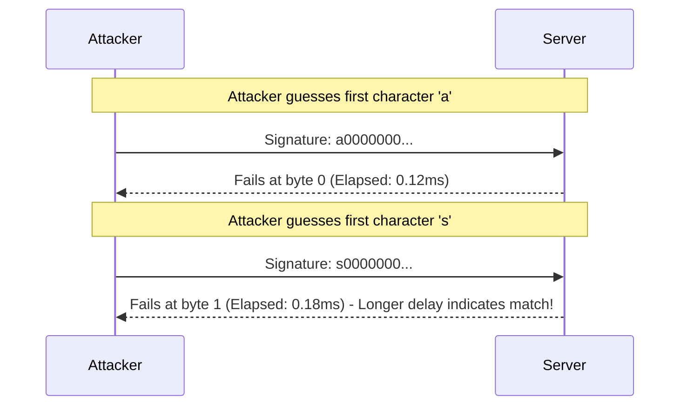

# Cryptographic Anti-Patterns & Hardening Guide

This reference provides guidance for auditing cryptographic implementations, identifying side-channel and algorithmic flaws, and replacing them with modern, battle-tested cryptographic primitives.

---

## 1. Predictable Pseudo-Random Number Generators (CWE-338)

- **Anti-Pattern**: Using standard pseudo-random number generators (`Math.random()`, `random.random()`, `rand()`) for security-sensitive tokens (password resets, session tokens, API keys, CSRF tokens, cryptographic nonces).
- **Vulnerability**: Standard PRNGs are deterministic algorithms (e.g. Mersenne Twister or xorshift128+) designed for statistical randomness and simulations, not cryptographic unpredictability. An attacker observing a few consecutive outputs can predict all future tokens.

### Comparison Table:

Language | Insecure (DO NOT USE for Secrets) | Cryptographically Secure (REQUIRED)
:--- | :--- | :---
**JavaScript / Node.js** | `Math.random()` | `crypto.randomBytes(32)` or `crypto.getRandomValues(new Uint8Array(32))`
**Python** | `random.random()`, `random.choice()` | `secrets.token_hex(32)`, `secrets.token_bytes(32)`
**Go** | `math/rand` | `crypto/rand` (`rand.Read(buf)`)
**Java** | `java.util.Random` | `java.security.SecureRandom`

### Hardened Examples:
```python
# GOOD: Python cryptographically secure token generation
import secrets

def generate_secure_token() -> str:
    # 256 bits of cryptographic entropy encoded as hex
    return secrets.token_urlsafe(32)
```

```typescript
// GOOD: Node.js cryptographically secure token generation
import crypto from 'crypto';

export function generateResetToken(): string {
  return crypto.randomBytes(32).toString('hex');
}
```

---

## 2. Timing Attacks on Secret Comparisons (CWE-208)

- **Anti-Pattern**: Using standard equality operators (`===`, `==`, `String.equals()`) to compare cryptographic signatures, HMAC digests, webhook signatures, or API keys.
- **Vulnerability**: Standard string comparisons return `false` as soon as the first non-matching byte is encountered (early exit). Attackers measuring response latency over thousands of requests can determine secret byte by byte.



### Hardened Drop-In Solutions:

```typescript
// GOOD: Node.js constant-time comparison
import crypto from 'crypto';

export function verifyWebhookSignature(payload: Buffer, secret: string, providedSigHex: string): boolean {
  const expectedSigHex = crypto.createHmac('sha256', secret).update(payload).digest('hex');

  const expectedBuffer = Buffer.from(expectedSigHex, 'hex');
  const providedBuffer = Buffer.from(providedSigHex, 'hex');

  if (expectedBuffer.length !== providedBuffer.length) {
    return false;
  }

  // Executes in constant time regardless of matching bytes
  return crypto.timingSafeEqual(expectedBuffer, providedBuffer);
}
```

```python
# GOOD: Python constant-time comparison
import hmac

def verify_api_token(expected_token: str, provided_token: str) -> bool:
    # hmac.compare_digest prevents timing leakage
    return hmac.compare_digest(expected_token.encode("utf-8"), provided_token.encode("utf-8"))
```

```go
// GOOD: Go constant-time comparison
import "crypto/subtle"

func VerifyToken(expected, provided []byte) bool {
    if subtle.ConstantTimeEq(int32(len(expected)), int32(len(provided))) != 1 {
        return false
    }
    return subtle.ConstantTimeCompare(expected, provided) == 1
}
```

---

## 3. Insecure Password Hashing & Key Derivation (CWE-328, CWE-916)

- **Anti-Pattern**: Hashing user passwords with fast general-purpose hash functions:
  - `MD5`, `SHA-1`, `SHA-256`, `SHA-512` (even with a salt).
- **Vulnerability**: Modern GPUs can compute billions of SHA-256 hashes per second. Attackers with leaked databases crack unsalted and salted SHA-256 passwords within minutes.
- **Requirement**: Use memory-hard and compute-hard Password-Based Key Derivation Functions (KDFs).

### Recommended Algorithms:
1. **Argon2id** (Primary Recommendation - Winner of Password Hashing Competition):
   - Memory-hard, resistant to GPU/ASIC cracking and side-channel cache attacks.
2. **bcrypt** (Secondary Recommendation):
   - Work factor minimum: 12 (14+ for high-security environments).
3. **PBKDF2-HMAC-SHA256**:
   - Minimum iterations: 600,000+ (per NIST SP 800-63B guidelines).

### Hardened Implementation (Node.js with Argon2):
```typescript
import argon2 from 'argon2';

export async function hashPassword(plainPassword: string): Promise<string> {
  return await argon2.hash(plainPassword, {
    type: argon2.argon2id,
    memoryCost: 65536, // 64 MB memory
    timeCost: 3,       // 3 iterations
    parallelism: 1
  });
}

export async function verifyPassword(hash: string, plainPassword: string): Promise<boolean> {
  return await argon2.verify(hash, plainPassword);
}
```

---

## 4. Insecure Symmetric Encryption Modes & IV Reuse (CWE-327, CWE-329)

### 4.1 AES-ECB Mode (Electronic Codebook)
- **Vulnerability**: ECB encrypts identical 16-byte plaintext blocks into identical ciphertext blocks. It leaks data patterns (e.g. repeated structures, images, formatted protocols) without providing true confidentiality.
- **Rule**: Never use `AES/ECB`. Always use Authenticated Encryption with Associated Data (AEAD) like **AES-256-GCM** or **ChaCha20-Poly1305**.

### 4.2 Nonce / IV Reuse in AES-GCM
- **Vulnerability**: Reusing the same 12-byte Nonce/IV with the same key in AES-GCM completely destroys the integrity guarantee and allows attackers to recover the authentication key and decrypt traffic.
- **Rule**: Every encryption operation must generate a cryptographically fresh, unique 12-byte nonce.

### Hardened Implementation (Python AES-256-GCM):
```python
import os
from cryptography.hazmat.primitives.ciphers.aead import AESGCM

class SecretCipher:
    def __init__(self, key_bytes: bytes):
        if len(key_bytes) != 32:
            raise ValueError("Key must be exactly 32 bytes (256 bits)")
        self.aesgcm = AESGCM(key_bytes)

    def encrypt(self, plaintext: bytes, associated_data: bytes = b"") -> bytes:
        # Generate fresh 12-byte (96-bit) nonce per encryption
        nonce = os.urandom(12)
        ciphertext = self.aesgcm.encrypt(nonce, plaintext, associated_data)
        # Prepend nonce to ciphertext for retrieval on decryption
        return nonce + ciphertext

    def decrypt(self, encrypted_payload: bytes, associated_data: bytes = b"") -> bytes:
        if len(encrypted_payload) < 28: # 12 bytes nonce + 16 bytes auth tag
            raise ValueError("Corrupt ciphertext payload")
        nonce = encrypted_payload[:12]
        ciphertext = encrypted_payload[12:]
        return self.aesgcm.decrypt(nonce, ciphertext, associated_data)
```

---

## 5. JWT Algorithm Confusion & Verification Bypass (CWE-347, CWE-287)

- **Vulnerability 1 (`alg: "none"`)**: Some libraries accept unverified tokens if the header specifies `{"alg": "none"}`.
- **Vulnerability 2 (Asymmetric to Symmetric Confusion)**: A system expecting an RSA-signed token (RS256) is tricked into validating with HMAC (HS256) using the server's public RSA key (which is publicly available) as the symmetric HMAC secret.

### Hardened Implementation:
```typescript
import jwt from 'jsonwebtoken';

const TRUSTED_PUBLIC_KEY = process.env.JWT_PUBLIC_KEY!;

export function verifyJwtToken(token: string): jwt.JwtPayload {
  // Explicitly restrict acceptable algorithms to avoid algorithm confusion
  return jwt.verify(token, TRUSTED_PUBLIC_KEY, {
    algorithms: ['RS256'], // Explicitly whitelist allowed algorithm
    issuer: 'https://auth.acme.com',
    audience: 'https://api.acme.com',
    clockTolerance: 5 // 5 seconds max clock skew
  }) as jwt.JwtPayload;
}
```
