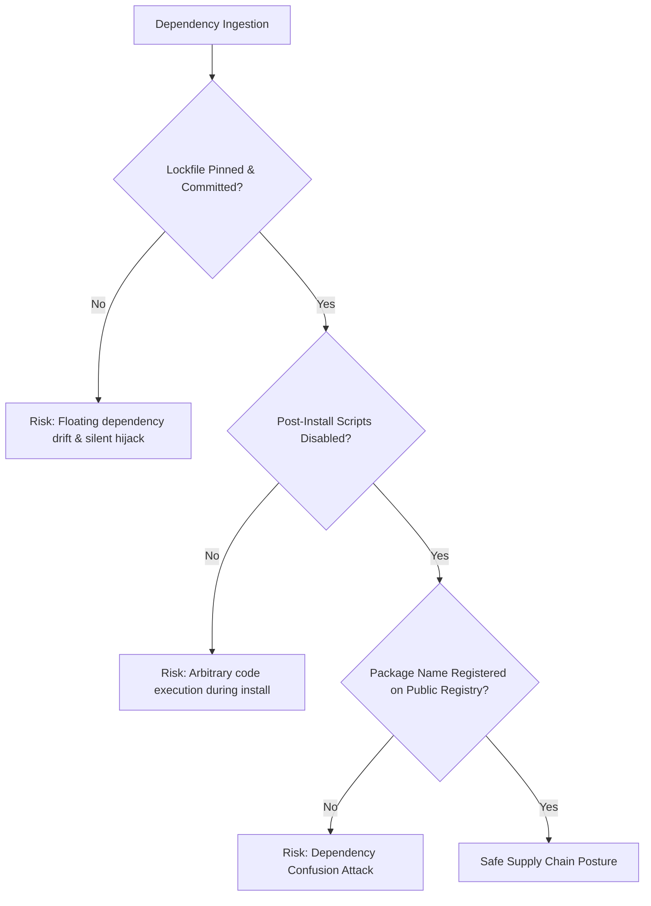
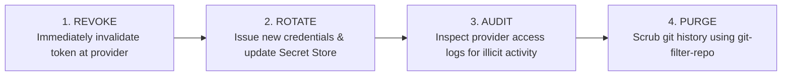

# Supply Chain Security & Secret Management Reference

This reference covers vulnerabilities, attack surfaces, and governance protocols surrounding third-party software dependencies, open-source supply chains, and secret lifecycle management.

---

## 1. Software Supply Chain Vulnerabilities



### 1.1 Dependency Confusion & Namespace Jacking
- **Mechanism**: An organization uses internal private packages (e.g. `@corp/auth-lib` or `corp-payments`). If the internal package name is not reserved on the public registry (npm, PyPI, RubyGems), an attacker registers the identical name on the public registry with a higher version number (e.g. `99.9.9`). Package managers default to fetching the higher version from the public registry, pulling attacker code into production builds.
- **Remediation**:
  1. Scope all internal packages under an organization namespace (e.g. `@myorg/package`).
  2. Configure scoped registries in `.npmrc` / `pip.conf`:
     ```ini
     @myorg:registry=https://npm.pkg.github.com
     always-auth=true
     ```
  3. Register placeholder packages on the public registry for all private package names.

### 1.2 Malicious Lifecycle Scripts
- **Mechanism**: Packages executing arbitrary shell scripts upon `npm install` via `preinstall`, `install`, or `postinstall` hooks.
- **Remediation**:
  - Run package installations with `--ignore-scripts` during CI builds:
    ```bash
    npm ci --ignore-scripts
    pnpm install --ignore-scripts
    ```
  - Explicitly audit necessary build scripts before allowlisting them.

### 1.3 Lockfile Tampering & Ingestion
- **Rule**: Lockfiles (`package-lock.json`, `pnpm-lock.yaml`, `poetry.lock`, `go.sum`, `Cargo.lock`) must **always** be committed to version control and verified in CI using frozen lockfile commands:
  - `npm ci` (never `npm install` in CI)
  - `pnpm install --frozen-lockfile`
  - `pip install --require-hashes -r requirements.txt`
  - `cargo build --locked`

---

## 2. Secret Lifecycle & Detection

### 2.1 Shannon Entropy & Secret Signatures
A secret generally exhibits high Shannon entropy ($H \ge 3.2$) or matches distinct cryptographic prefixes:

Service | Token Prefix / Signature | Typical Length
:--- | :--- | :---:
**AWS Access Key** | `AKIA[0-9A-Z]{16}` | 20 chars
**GitHub PAT** | `ghp_[0-9a-zA-Z]{36}` | 40 chars
**GitHub Fine-Grained** | `github_pat_[0-9a-zA-Z_]{82}` | 93 chars
**Stripe API Key** | `sk_live_[0-9a-zA-Z]{24}` | 32+ chars
**Slack Webhook** | `https://hooks.slack.com/services/T.../B.../...` | Variable
**Private Keys** | `-----BEGIN (RSA\|EC\|DSA\|OPENSSH\|PRIVATE) KEY-----` | Multiline

### 2.2 Client-Side Bundle Secret Leaks
- **Vulnerability**: In modern frontend frameworks (Next.js, Vite, Nuxt), environment variables prefixed with `NEXT_PUBLIC_` or `VITE_` are bundled directly into public JavaScript assets delivered to browsers.
- **Review Check**: Scrutinize all variables prefixed with `NEXT_PUBLIC_` or `VITE_`. If an API secret key, database URI, or master token is prefixed this way, it is publicly exposed to every website visitor.
- **Remediation**: Keep backend secrets restricted to server-side routes / server components without the public prefix.

---

## 3. Incident Response Protocol for Leaked Secrets

If a secret is discovered in a PR diff or git commit:



> [!CAUTION]
> Committing a follow-up commit that deletes the secret file does **NOT** secure the secret. The token remains readable in the Git commit history. The token must be **revoked immediately** at the provider, regardless of whether history is purged.
