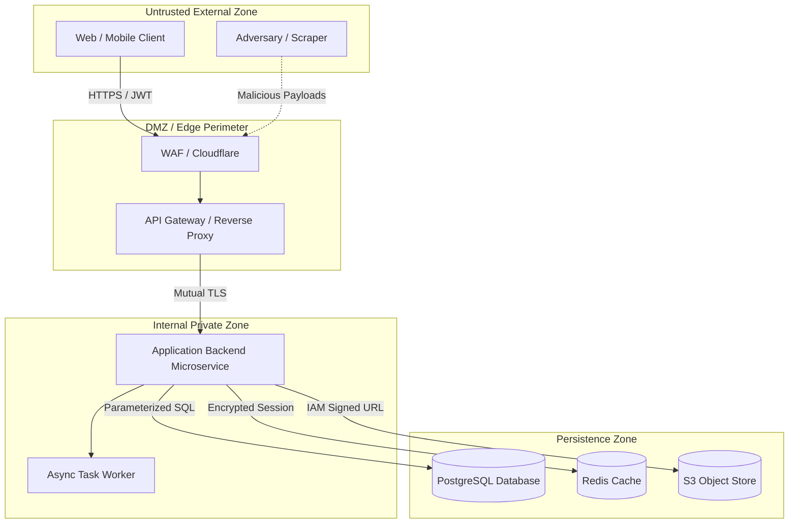

# STRIDE Threat Model Worksheet

**Feature / System**: `[FEATURE_NAME]`  
**Date**: `[YYYY-MM-DD]`  
**Architect / Reviewer**: `[NAME / AGENT]`  
**Target Release**: `[vX.Y.Z]`  

---

## 1. System Architecture & Trust Boundaries

### Trust Boundary Definitions:
1. **Boundary 1 (Client to Edge)**: Untrusted network $\rightarrow$ API Gateway (Authentication, Rate limiting, TLS termination).
2. **Boundary 2 (Service to Data Store)**: Application $\rightarrow$ Database/Redis (Least privilege database users, tenant RLS, network isolation).
3. **Boundary 3 (Third-Party Integrations)**: Webhook callers $\rightarrow$ Internal listeners (HMAC signature verification, replay protection).

---

## 2. STRIDE Threat Analysis Matrix

| Threat ID | STRIDE Category | Threat Description | Target Asset | Mitigating Control | Status |
| :--- | :--- | :--- | :--- | :--- | :--- |
| **T-01** | **Spoofing** | Attacker forges webhook signature or user session token. | Webhook Endpoint / API Gateway | Constant-time HMAC SHA-256 verification + timestamp replay check (<5m). | `[MITIGATED]` |
| **T-02** | **Tampering** | Attacker modifies request payload parameters (BOPLA/Mass Assignment). | User Profile & Roles | Strict Zod/Pydantic schemas with `.strict()` disallowing unknown fields. | `[MITIGATED]` |
| **T-03** | **Repudiation** | User executes money transfer then denies initiating action. | Financial Ledger | Append-only audit log signed with user session ID & client IP address. | `[MITIGATED]` |
| **T-04** | **Info Disclosure** | Stack traces or database errors leaked in API error response. | Internal Architecture & DB Schema | Global error middleware transforms all exceptions into opaque error codes. | `[MITIGATED]` |
| **T-05** | **Denial of Service** | Unbounded list query consumes database CPU & memory. | PostgreSQL Cluster | Enforce max page limit (e.g. `limit <= 100`) and index on sorted columns. | `[MITIGATED]` |
| **T-06** | **Elevation of Priv** | Regular user modifies ID to access administrative settings (BOLA/IDOR). | Admin Console / Other Tenant Data | Row-Level Security (RLS) + database-level tenant ID scoping. | `[MITIGATED]` |

---

## 3. Residual Risk Assessment

- **Accepted Risks**: `[Detail any known low-risk items accepted by engineering lead]`
- **Required Follow-Ups**: `[Detail follow-up tickets or upcoming infrastructure milestones]`
- **Sign-Off**: `[Security Engineering Lead Sign-off]`
